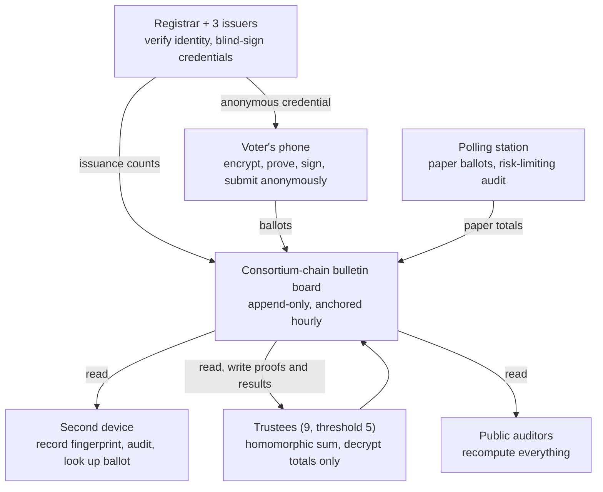

# e2e-verifiable-voting

**End-to-end verifiable voting system: a design proposal**

Full document: [English](docs/en.md) · [简体中文](docs/zh-CN.md) · [Français](docs/fr.md) · [Русский](docs/ru.md) · [Español](docs/es.md) · [العربية](docs/ar.md) · [日本語](docs/ja.md) · [한국어](docs/ko.md)

This repository contains a design proposal only. No implementation exists yet. Feedback through issues is welcome.

---

## English

A voting design aimed at preventing large-scale fraud: fabricated, deleted or altered ballots, tampered tallies, mass phone malware and organized vote buying. Voters bind a phone once and receive an anonymous credential valid for one election only, issued with blind signatures so it cannot be linked to their identity. Ballots are encrypted, posted to an append-only consortium-chain bulletin board, and tallied homomorphically, so anyone can recompute the result and each voter can confirm their ballot was recorded and counted without being able to prove how they voted. Random Benaloh audits catch phone malware, and polling stations keep paper ballots as a backstop. [Read more](docs/en.md)

## 简体中文

一套以防范大规模作弊为目标的投票设计，针对凭空造票、删票改票、篡改计票结果、批量感染手机和有组织买票。选民一次性绑定手机，每次选举领取只限当次有效的匿名凭证；凭证用盲签名发放，无法和身份对应。选票加密后写入只追加的联盟链公告板，用同态加密计票：任何人都能复算结果，选民能确认自己的票被记录并计入，却无法向别人证明投给了谁。随机抽查用来发现被恶意软件控制的手机，投票站保留纸质选票兜底。[阅读全文](docs/zh-CN.md)

## Français

Une conception de vote visant à empêcher la fraude à grande échelle : bulletins fabriqués, supprimés ou modifiés, dépouillement falsifié, logiciels malveillants sur des téléphones en masse et achat de votes organisé. L'électeur associe une fois son téléphone et reçoit une attestation anonyme valable pour un seul scrutin, délivrée par signature aveugle afin qu'elle ne puisse pas être reliée à son identité. Les bulletins sont chiffrés, publiés sur un tableau d'affichage en ajout seul (chaîne de consortium) et comptés de façon homomorphe : chacun peut recalculer le résultat et chaque électeur peut vérifier que son bulletin a été enregistré et compté, sans pouvoir prouver son choix. Des audits aléatoires de Benaloh détectent les téléphones compromis, et les bureaux de vote conservent le bulletin papier en dernier recours. [Lire la suite](docs/fr.md)

## Русский

Проект системы голосования, направленный против массовых фальсификаций: вбросов, удаления и подмены бюллетеней, подделки подсчёта, массового заражения телефонов и организованного подкупа. Избиратель один раз привязывает телефон и получает анонимное удостоверение, действующее только на одни выборы; оно выдаётся с помощью слепой подписи, поэтому его нельзя связать с личностью. Бюллетени шифруются, публикуются на доске объявлений в цепочке консорциума (только дополнение) и подсчитываются гомоморфно: любой может пересчитать результат, а каждый избиратель может убедиться, что его бюллетень записан и учтён, не имея возможности доказать свой выбор. Случайные проверки Бенало выявляют заражённые телефоны, а на участках сохраняются бумажные бюллетени как страховка. [Читать полностью](docs/ru.md)

## Español

Un diseño de votación orientado a impedir el fraude a gran escala: papeletas fabricadas, borradas o alteradas, escrutinios manipulados, malware masivo en teléfonos y compra organizada de votos. El votante vincula su teléfono una vez y recibe una credencial anónima válida solo para una elección, emitida con firma ciega para que no pueda vincularse con su identidad. Las papeletas se cifran, se publican en un tablón de solo añadir en una cadena de consorcio y se cuentan de forma homomórfica: cualquiera puede recalcular el resultado y cada votante puede confirmar que su papeleta se registró y se contó, sin poder demostrar a quién votó. Las auditorías aleatorias de Benaloh detectan teléfonos comprometidos y los colegios electorales conservan la papeleta de papel como respaldo. [Leer más](docs/es.md)

## العربية

تصميم للتصويت يهدف إلى منع التزوير واسع النطاق: اختلاق أوراق الاقتراع أو حذفها أو تعديلها، والتلاعب بالفرز، والبرمجيات الخبيثة على الهواتف بأعداد كبيرة، وشراء الأصوات المنظم. يربط الناخب هاتفه مرة واحدة ويحصل على وثيقة مجهولة صالحة لانتخابات واحدة فقط، تُصدر بالتوقيع الأعمى فلا يمكن ربطها بهويته. تُشفَّر الأوراق وتُنشر على لوحة إعلانات للإضافة فقط في سلسلة اتحاد، وتُفرز تماثليًا: يستطيع أي شخص إعادة حساب النتيجة، ويستطيع كل ناخب التأكد من تسجيل ورقته واحتسابها دون أن يتمكن من إثبات لمن صوّت. تكشف فحوص بينالوه العشوائية الهواتف المخترقة، وتحتفظ مراكز الاقتراع بالأوراق الورقية احتياطًا. [اقرأ المزيد](docs/ar.md)

## 日本語

大規模な不正の防止を目的とした投票システムの設計案。架空の票の作成、票の削除や改ざん、集計の改ざん、スマートフォンへの大規模なマルウェア感染、組織的な買票を対象とする。有権者はスマートフォンを一度だけ登録し、1回の選挙に限り有効な匿名の資格証明を受け取る。資格証明はブラインド署名で発行されるため、身元と結びつけられない。票は暗号化されて追記専用のコンソーシアムチェーン掲示板に掲載され、準同型暗号で集計される。誰でも結果を再計算でき、有権者は自分の票が記録・集計されたことを確認できるが、誰に投票したかを他人に証明することはできない。無作為な Benaloh 監査で乗っ取られたスマートフォンを見つけ、投票所では紙の投票を保険として残す。[全文を読む](docs/ja.md)

## 한국어

대규모 부정을 막는 것을 목표로 한 투표 시스템 설계안이다. 가짜 표 생성, 표 삭제·변조, 개표 조작, 스마트폰 대량 악성코드 감염, 조직적 매표를 대상으로 한다. 유권자는 스마트폰을 한 번만 등록하고, 선거 한 번에만 유효한 익명 자격 증명을 받는다. 자격 증명은 블라인드 서명으로 발급되므로 신원과 연결할 수 없다. 표는 암호화되어 추가만 가능한 컨소시엄 체인 게시판에 올라가고 동형 암호로 개표된다. 누구나 결과를 재계산할 수 있고, 유권자는 자기 표가 기록되고 개표에 포함되었음을 확인할 수 있지만 누구에게 투표했는지 남에게 증명할 수는 없다. 무작위 Benaloh 감사로 감염된 스마트폰을 잡아내고, 투표소에는 종이 투표를 안전장치로 남겨 둔다. [전문 읽기](docs/ko.md)

---

## Repository layout

| Path | Content |
| --- | --- |
| `docs/en.md` | English |
| `docs/zh-CN.md` | 简体中文（原文 / original） |
| `docs/fr.md` | Français |
| `docs/ru.md` | Русский |
| `docs/es.md` | Español |
| `docs/ar.md` | العربية |
| `docs/ja.md` | 日本語 |
| `docs/ko.md` | 한국어 |

The Chinese version is the original; the other versions are translations. If they differ, the Chinese version prevails.
