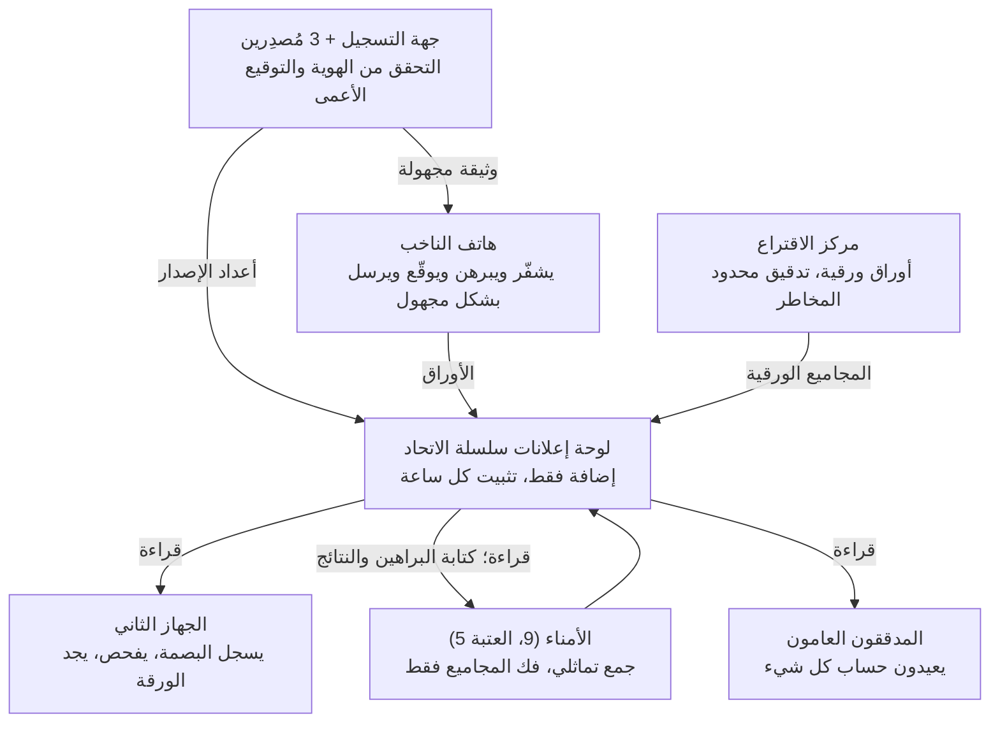

# نظام تصويت قابل للتحقق من طرف إلى طرف: مقترح تصميم

[English](en.md) · [简体中文](zh-CN.md) · [Français](fr.md) · [Русский](ru.md) · [Español](es.md) · **العربية** · [日本語](ja.md) · [한국어](ko.md)

آخر تحديث: 2026-11-08

## نظرة عامة

يستهدف هذا التصميم التزوير واسع النطاق: اختلاق أوراق اقتراع، وحذف الأوراق أو تعديلها، والتلاعب بالفرز، والبرمجيات الخبيثة على الهواتف بأعداد كبيرة، وشراء الأصوات المنظم. يربط الناخب هاتفه مرة واحدة، ويحصل قبل كل انتخابات على وثيقة أهلية صالحة لتلك الانتخابات فقط، ويصوّت من هاتفه في دقائق. لا تنشر السلسلة إلا نصوصًا مشفرة، ويستطيع أي شخص إعادة حساب النتيجة، ويستطيع كل ناخب التأكد من أن ورقته لم تُعدَّل ولم تُحذف وأنها احتُسبت. أما الحالات الفردية، كإكراه أحد أفراد الأسرة لناخب وجهًا لوجه، فلا يُصمَّم لها حل خاص، بل تُترك للقانون القائم مقابل عملية أبسط وأسرع.

**أهداف التصميم**

- **قابلية التحقق العام:** يستطيع أي شخص إعادة حساب النتيجة باستقلالية من بيانات السلسلة بأدوات مفتوحة المصدر.
- **قابلية التحقق الفردي:** يستطيع كل ناخب التأكد من تسجيل ورقته كما أدلى بها، دون تعديل أو حذف، ومن إدراجها في الفرز.
- **سرية الاقتراع:** يستحيل رياضيًا ربط الأوراق بالهويات، حتى لو كُسر التشفير مستقبلًا.
- **مقاومة التزوير واسع النطاق:** أي تزوير على نطاق واسع (اختلاق الأصوات أو حذفها أو تعديلها أو شراؤها) إما مستحيل وإما مكشوف حتمًا.
- **الكفاءة:** يُربط الهاتف مرة واحدة؛ وتُستلم وثيقة كل انتخابات تلقائيًا؛ ويستغرق التصويت دقائق؛ وتظهر نتائج قابلة للتحقق خلال ساعات من الإغلاق.

**المبادئ الأساسية**

- **الفصل بين السلطات:** تُوزَّع كل عملية حساسة على مؤسسات يراقب بعضها بعضًا. الإساءة تتطلب تواطؤًا، والتواطؤ يترك أثرًا.
- **براهين لا ثقة:** كل خطوة يرافقها برهان رياضي يستطيع أي شخص فحصه.
- **كشف التزوير الواسع إحصائيًا:** لا حاجة لأن يتحقق الجميع؛ فالفحوص العشوائية من نسبة صغيرة من الناخبين تجعل إخفاء التزوير الواسع مستحيلًا.
- **سلسلة الكتل مجرد لوحة إعلانات:** تضمن عدم تغيير البيانات بعد نشرها، ولا تتحمل مسؤولية الأمان قبل النشر.
- **الورق صمام أمان:** تحتفظ مراكز الاقتراع بالأوراق الورقية وبإمكانية التدقيق البشري.

## أساليب التزوير الشائعة واستجابة التصميم

يتبع الجدول التصنيفات المعتادة لقضايا التزوير الانتخابي في الولايات المتحدة. القناة الإلكترونية تقضي على التصويت المزدوج وحشو الصناديق والتلاعب بالفرز وإتلاف الأوراق؛ وينخفض انتحال الهوية وشراء الأصوات بشدة؛ أما جودة سجلات الناخبين والإكراه وجهًا لوجه فما زالت تحتاج إلى وسائل تقليدية.

| أسلوب التزوير | الممارسة المعتادة | استجابة التصميم | الأثر |
| --- | --- | --- | --- |
| التصويت المزدوج | التسجيل في عدة ولايات أو مقاطعات والتصويت في كل منها؛ أو التصويت إلكترونيًا ثم في مركز الاقتراع | وثيقة واحدة لكل شخص في كل انتخابات، مع تبادل الولايات بصمات هوية مُجزّأة لمن استلموا للكشف عن التكرار؛ تقبل السلسلة ورقة واحدة لكل وثيقة؛ حامل الوثيقة لا يصوّت في المركز إلا بورقة مؤقتة | مُنهى |
| انتحال الهوية | استخدام هوية مسجلين لا يصوّتون أو متوفين | التحقق من الوثائق عند ربط الهاتف؛ فحص حيوية الوجه عند كل إصدار؛ يمكن للناخب الاستعلام إن كان مسجلًا كمستلم | منخفض بشدة؛ ويكتشفه الضحية |
| التسجيل الوهمي، الناخبون الأشباح | تسجيل أسماء أو عناوين وهمية أو متوفين ثم التصويت عنهم | ربط السجل بسجلات الوفاة والانتقال والجنسية؛ الإصدار يتطلب وثيقة وفحص حيوية؛ نشر أعداد الوثائق الصادرة لكل دائرة فورًا ومقارنتها بالسكان ونسب المشاركة السابقة | الشذوذ قابل للكشف؛ وجودة السجل ما زالت تحتاج إلى إدارة |
| تصويت غير المؤهلين | تصويت غير المواطنين أو غير المقيمين أو المحرومين بموجب قانون الولاية | إعادة فحص الأهلية مقابل أحدث سجل عند كل إصدار | بقدر جودة السجل |
| تزوير الاقتراع البريدي والجمع غير القانوني | طلب أوراق الآخرين البريدية، وتزوير التواقيع، وجمع الأوراق ثم تعديلها أو إتلافها | لا وسيط في القناة الإلكترونية: الوثيقة مقفلة في هاتف الناخب نفسه وتتطلب فحص حيوية، ولا ورقة يمكن اعتراضها | مُنهى في القناة الإلكترونية |
| شراء الأصوات | الدفع للناخب للتصويت لمرشح معين مع طلب دليل | لا إيصالات؛ الوثيقة لا يمكن تصديرها من الهاتف؛ لا يُقبل إلا التطبيق الرسمي | يصعب توسيعه |
| "المساعدة" غير القانونية والإكراه وجهًا لوجه | ملء الأوراق عن كبار السن أو ذوي الإعاقة أو من لا يجيدون اللغة بحجة المساعدة | التصويت يتطلب فحص حيوية الناخب نفسه؛ المراقبة وجهًا لوجه لا تُمنع تحديدًا | مخفف جزئيًا |
| حشو الصناديق من قبل الموظفين | إضافة أوراق أو التصويت عن الغائبين | لا يملك الموظفون وثائق ولا يمكنهم اختلاق أوراق صالحة؛ لا يجوز أن تتجاوز الأوراق الإلكترونية الصالحة عدد الوثائق الصادرة، والمقارنة علنية | مُنهى في القناة الإلكترونية |
| إتلاف الأوراق أو إخفاؤها | رمي بعض الأوراق أو إخفاؤها قبل الفرز | بيانات السلسلة غير قابلة للحذف ومثبتة خارجيًا؛ يجد الناخب ورقته ببصمتها؛ إيصال موقّع يثبت الاستلام | يُكشف حتمًا |
| التلاعب بالفرز أو التجميع | تغيير أرقام مركز ما أو أثناء التجميع | الفرز جمع تماثلي علني لكل النصوص المشفرة يستطيع أي شخص إعادته؛ وفك التشفير مصحوب ببرهان صحة | مُنهى |
| اختراق أجهزة التصويت أو أنظمة الفرز | العبث بالبرمجيات لتغيير الأوراق أو النتائج | على الهاتف تكشفه الفحوص العشوائية؛ وعلى الخوادم يمكن إعادة حساب كل نتيجة من البيانات العامة دون الوثوق بأي خادم | التلاعب الواسع يُكشف حتمًا |
| منع الناخبين الشرعيين من التصويت | شطبهم من السجل أو رفض إصدار وثيقة لهم دون سبب | يستطيع الناخب الاستعلام عن حالة تسجيله وإصداره؛ الرفض مُسبَّب وقابل للطعن؛ أعداد المشطوبين لكل دائرة تُنشر | قابل للكشف |

خارج النطاق: تزوير التواقيع على عرائض الترشح، ومخالفات تمويل الحملات، والتضليل الإعلامي ونحوها مما لا يتصل بالتصويت والفرز. التصنيفات مستندة إلى [قاعدة بيانات مؤسسة هيريتج](https://electionfraud.heritage.org/categories) و[تحقيق News21](https://www.pewtrusts.org/en/research-and-analysis/articles/2012/08/30/election-fraud).

### المبادئ الخمسة وراء التصميم

1. **وثيقة أهلية مجهولة (التوقيع الأعمى): تمنع التصويت المزدوج دون كشف لمن صوّت.** تخيّل بطاقة مرقمة داخل مظروف مبطن بورق كربون، يختمه المُصدِر فينطبع الختم على البطاقة دون أن يرى الرقم. عند الإصدار تعرف جهة التسجيل أن "علياء استلمت"، فلا تحصل على ثانية؛ وعند التصويت لا يُعرض إلا البطاقة والختم، فلا يعرف أحد لمن تعود البطاقة.
2. **وثيقة واحدة لورقة واحدة كقاعدة على السلسلة: الأصوات المكررة تُرفض.** تُنشر كل ورقة مع المفتاح العام للوثيقة. إذا ظهر المفتاح نفسه مرة أخرى رفضته كل العُقد وفق القاعدة العلنية نفسها، ولا يحق لأي عقدة الاستثناء.
3. **الفرز التماثلي: المجموع دون فتح أي ورقة.** كل ورقة أشبه بصندوق مقفل له خاصية فريدة: إذا "كدّست" كل الصناديق نتج صندوق جديد يحوي المجموع بالضبط. يستطيع أي شخص إجراء التكديس، فيصبح الفرز قابلًا لإعادة الحساب علنًا؛ ولا يُفتح صندوق المجاميع الوحيد إلا بخمسة أمناء على الأقل معًا، مع برهان رياضي على نزاهة الفتح.
4. **الفحص العشوائي: الهاتف الغشاش لا مخبأ له.** يسلّم الهاتف أولًا الصندوق المقفل، فتسجل بصمته على جهاز ثانٍ، ثم تقرر إيداعه أو فتحه فورًا للفحص. لا يعرف الهاتف اختيارك مسبقًا، فالغش مقامرة؛ وكلما زاد عدد الأوراق المعدَّلة اقترب احتمال انكشافه من 100%.
5. **البيانات العامة والتثبيت الخارجي ومطابقة الأعداد: الحذف والأوراق الزائدة تترك أثرًا.** يستطيع أي شخص تنزيل البيانات؛ وتُنشر بصمتها كل ساعة على سلاسل عامة خارجية وفي الصحف، فلا تتطابق أي إعادة كتابة لاحقة للتاريخ؛ والفحوص العلنية مثل "الأوراق الإلكترونية لا تتجاوز الوثائق الصادرة" لا تترك مجالًا لأوراق مختلقة.

## نموذج التهديد وافتراضات الثقة

لكل أسلوب تزوير قادر على العمل بنطاق واسع استجابة: صحة النتيجة لا تعتمد على نزاهة أحد، وسرية الاقتراع تضمنها الرياضيات لا انضباط المؤسسات.

| التزوير الواسع | من قد يقوم به | الاستجابة |
| --- | --- | --- |
| اختلاق الأوراق وإصدار وثائق لأشخاص غير موجودين | أشخاص من الداخل | توقيع أعمى مشترك من 3 مُصدِرين؛ نشر أعداد الإصدار ومقارنتها بالوثائق المستخدمة على السلسلة؛ يمكن للناخب الاستعلام إن كان مسجلًا كمستلم |
| حذف الأوراق أو تعديلها أو التلاعب بالفرز | أشخاص من الداخل، مخترقون | بيانات علنية مثبتة خارجيًا؛ فرز تماثلي يعيده أي شخص؛ تحقق الناخب ببصمة الورقة |
| برمجيات خبيثة على الهواتف بأعداد كبيرة | مخترقون، جهات أجنبية | فحص عشوائي عند التصويت؛ تسجيل البصمة على جهاز ثانٍ أولًا |
| شراء الأصوات المنظم | جماعات سياسية، جماعات مصالح | لا إيصالات؛ الوثيقة مقفلة في الشريحة الآمنة؛ التطبيق الرسمي فقط |
| تعطيل النظام | مخترقون | عُقد متعددة الأطراف، تصويت لمدة 14 يومًا، مراكز الاقتراع كاحتياط |
| التلصص على النتائج أو تسريبها مبكرًا | أمناء متواطئون | عتبة 5 من 9؛ لا يُفك تشفير إلا المجاميع وبعد الإغلاق فقط |
| لا يُعالج تحديدًا: إكراه ناخبين أفراد وجهًا لوجه | — | القانون القائم؛ وعند الحاجة يُضاف قسم "الوحدة الاختيارية: مقاومة الإكراه" |

**افتراضات الثقة**

- **السرية:** يضمنها التوقيع الأعمى؛ لا يمكن رياضيًا ربط الوثائق بالهويات بصرف النظر عن نزاهة المؤسسات، ولا تغيّر الحواسيب الكمومية ذلك. يفترض أن المرحِّلات المجهولة لا تحتفظ بسجلات.
- **السلامة:** لا تعتمد على أحد. حتى لو تواطأت المؤسسات كلها، يكشف التحقق العام التلاعب.
- **الإصدار:** لن يتواطأ المُصدِرون الثلاثة وجهة التسجيل جميعًا؛ وإن فعلوا، تكشف مطابقة الأعداد الوثائق الزائدة.
- **توافر السلسلة:** ثلثا العُقد على الأقل نزيهة. وإن تجاوز الخبيث الثلث، فلا يستطيع إلا تعطيل الخدمة، لا تزوير الأوراق ولا إعادة كتابة التاريخ.
- **الهواتف:** لا يُضمن خلو كل هاتف، لكن التلاعب الواسع يُكشف حتمًا بالفحوص.

## الأدوار والفصل بين السلطات

الضرر الذي يمكن لكل دور إحداثه منفردًا محدود؛ والعمود الأخير هو اختبار الفصل بين السلطات.

| الدور | من يتولاه | المهام | أسوأ ما يمكنه فعله منفردًا |
| --- | --- | --- | --- |
| الناخب | مواطن مؤهل | التسجيل، التصويت، الفحص، التحقق | التأثير في صوته فقط |
| جهة التسجيل | مكاتب الانتخابات القائمة | التحقق من الهوية والأهلية؛ تسجيل من استلم وثيقة هذه الانتخابات | رفض الإصدار (قابل للاستعلام والطعن) |
| مُصدِرو الوثائق (3) | مكتب الانتخابات وجهة يعيّنها كل حزب رئيسي | التوقيع الأعمى على الوثائق المجهولة | لا يستطيع وحده إصدار وثيقة صالحة؛ ولا يرى محتواها |
| الأمناء (9، العتبة 5) | الأحزاب الرئيسية، هيئات انتخابية مستقلة، محاكم، جامعات | حفظ أجزاء مفتاح الانتخابات؛ فك تشفير المجاميع معًا بعد الإغلاق | لا شيء |
| عُقد الاتحاد (21 فأكثر) | هيئات الانتخابات في الولايات، الأحزاب، الجامعات، الإعلام، المراقبون | التحقق من الأوراق وتخزينها؛ التوقيع المشترك على الإيصالات | تعطيل الخدمة؛ لا يمكنها التزوير أو إعادة الكتابة |
| المرحِّلات المجهولة (عدة) | مشغلون مستقلون غير من سبق | تمرير الأوراق وإخفاء عنوان IP | لا يرى أي مرحِّل المسار كاملًا |
| مراكز الاقتراع | المراكز القائمة | التصويت الورقي، المساعدة | التأثير في خدمة المركز؛ والورق قابل للتدقيق |
| المدققون العامون | أي شخص | تنزيل البيانات وإعادة الحساب | لا صلاحية كتابة |
| مطورو البرمجيات | مجتمع المصادر المفتوحة وهيئات الاعتماد | التطوير، التدقيق، البناء القابل لإعادة الإنتاج | الشيفرة الخبيثة تكشفها الفحوص والمراجعة العامة |

## المكونات التشفيرية

كل المكونات ناضجة ومدروسة جيدًا ولها تطبيقات منشورة؛ لا يُخترع تشفير جديد. مقارنة بتصميم مقاوم للإكراه، حُذفت أثقل الأجزاء (شبكات الخلط وتصفية الوثائق المزيفة).

| المكوّن | الاستخدام | الغرض |
| --- | --- | --- |
| ElGamal الأسي (تماثلي) | الأوراق | تُجمع النصوص المشفرة مباشرة؛ لا يُفك إلا المجموع، ولا تُفك أي ورقة منفردة |
| توليد المفاتيح الموزع + فك التشفير بعتبة (5/9) | مفتاح الانتخابات | لا يملك أحد المفتاح الخاص كاملًا |
| التوقيع الأعمى (3 مُصدِرين) | الوثيقة المجهولة لهذه الانتخابات | يوقّع المُصدِرون دون رؤية الوثيقة؛ لا رابط رياضيًا بالهوية |
| الشريحة الآمنة في الهاتف + توثيق التطبيق | المفتاح الخاص للوثيقة | لا يمكن تصدير المفتاح؛ ولا يستخدمه إلا التطبيق الرسمي |
| توقيع شنور | كل ورقة | لا يصوّت إلا حامل الوثيقة؛ ومرة واحدة فقط |
| براهين المعرفة الصفرية | صحة الورقة وصحة فك التشفير | إثبات "العدد المسموح بالضبط من الاختيارات في كل منافسة" و"فك التشفير نزيه" دون كشف المحتوى |
| تحدي بينالوه | عند التصويت | لا يعرف الهاتف هل ستُودع الورقة أم تُفحص، فالغش يعرّضه للانكشاف |
| دوال التجزئة وأشجار ميركل | بصمات الأوراق، التثبيت الخارجي | بصمات للبيانات: تغيير بايت واحد يكسر التطابق |

## العملية كاملة

تمر الانتخابات بسبع خطوات: التحضير، وربط الهاتف (مرة واحدة)، ووثيقة الانتخابات، والتصويت والفحص، والتحقق، والفرز، والتدقيق العام. تُنشر مخرجات كل خطوة على السلسلة ليفحصها أي شخص.

تكتب جهة التسجيل وهواتف الناخبين ومراكز الاقتراع على السلسلة؛ والأجهزة الثانية والجمهور يقرأون فقط؛ والأمناء يقرأون ثم يكتبون براهين فك التشفير والنتائج.

### 1. التحضير (قبل التصويت بنحو 60 يومًا)

1. **مراسم المفاتيح:** يجري 9 أمناء توليد المفاتيح الموزع في بث علني. يُنشر المفتاح العام، ويحتفظ كل منهم بجزء من المفتاح الخاص في وحدة أمان عتادية.
2. **المعلمات على السلسلة:** المنافسات والمرشحون، وفترة التصويت، وقواعد التحقق، وبصمات كل إصدارات البرمجيات.
3. **نشر البرمجيات:** تطبيق التصويت وأدوات التحقق ومدقق الفرز كلها مفتوحة المصدر وقابلة لإعادة البناء، وتدققها عدة جهات مستقلة بتقارير علنية.
4. **اختبارات علنية:** انتخابات تجريبية كاملة وبرنامج مكافآت للثغرات.

### 2. ربط الهاتف (مرة واحدة، حتى 4 سنوات)

1. **التحقق من الهوية:** يقدّم الناخب وثيقته في أي مكتب انتخابات أو مكتب مرور أو بريد، ويطابقها الموظف مع التسجيل. أو عبر الإنترنت برمز تفعيل يُرسل بالبريد إلى العنوان المسجل مع رقم الوثيقة.
2. **ربط الهاتف:** ينشئ التطبيق مفتاح هوية طويل الأمد داخل الشريحة الآمنة، ولا يمكن تصدير المفتاح الخاص. تصدر جهة التسجيل شهادة هوية طويلة الأمد تثبت فقط أن "هذا الهاتف يعود لهذا الشخص"، ولا تمنح حق التصويت.
3. **الصلاحية:** حتى 4 سنوات أو حتى انتهاء الوثيقة، ثم يُعاد التحقق.
4. **الإلغاء التلقائي:** عند حذف الناخب من السجل (وفاة، انتقال من الولاية، فقدان الجنسية، حكم قضائي...) تُلغى الشهادة. السجل مرتبط بسجلات الوفاة والانتقال وتغيير الجنسية.
5. **هاتف جديد:** النقل في أي مكتب أو بتفويض من الهاتف القديم، وتُلغى الشهادة القديمة.

من لا يريد استخدام الهاتف لا يحتاج إلى التسجيل، ويصوّت ورقيًا في المركز كالمعتاد.

### 3. وثيقة الانتخابات (في كل انتخابات، صالحة لها فقط)

1. **مفتاح جديد:** قبل فتح التصويت ينشئ التطبيق في الشريحة زوج مفاتيح جديدًا لهذه الانتخابات.
2. **فحص الحيوية:** يستخدم التطبيق الكاميرا الأمامية لفحص الحيوية ومطابقة الوجه بصورة الوثيقة، للتأكد من أن الناخب نفسه يستخدمه ومنع غيره من استخدام هاتف متوفى أو غير مؤهل.
3. **إعادة فحص الأهلية:** يثبت التطبيق الهوية لجهة التسجيل بالشهادة، فتعيد الجهة فحص الأهلية مقابل أحدث سجل وتسجّل "صدرت الوثيقة". وثيقة واحدة لكل شخص في كل انتخابات؛ وتتبادل الولايات بصمات هوية مُجزّأة لمن استلموا، فمن سُجّل في عدة ولايات لا يحصل إلا على واحدة.
4. **التوقيع الأعمى:** يوقّع المُصدِرون الثلاثة على المفتاح العام الجديد توقيعًا أعمى دون رؤيته، فلا يستطيع أحد ربط الوثيقة بالهوية.
5. **الحصول على الوثيقة:** المفتاح العام مع التواقيع الثلاثة هو وثيقة الأهلية المجهولة لهذه الانتخابات فقط، وتنتهي بانتهائها. تستغرق العملية نحو دقيقة.
6. **أعداد علنية:** تُنشر أعداد الإصدار لكل دائرة فورًا. يستطيع الناخب الاستعلام متى شاء إن كان مسجلًا كمستلم؛ فإن ظهر ذلك دون طلبه، فقد انتحل أحد هويته.

### 4. التصويت والفحص (فترة تصويت 14 يومًا)

1. **الاختيار:** يختار الناخب المرشحين في كل منافسة.
2. **تسجيل البصمة:** يشفّر التطبيق الاختيار ويعرض رمز QR لبصمة الورقة. يمسحه الناخب بجهاز ثانٍ أو يدوّن أول 8 رموز منه. يجب إتمام ذلك قبل الخطوة التالية.
3. **الإيداع أو الفحص:**
    - **الفحص:** يكشف التطبيق العشوائية المستخدمة في التشفير؛ فيفتح الجهاز الثاني النص المشفر ويتأكد من تطابق المحتوى مع الاختيار، وتطابق البصمة مع المسجلة. تُلغى الورقة المفحوصة ويعود الناخب إلى الخطوة 1.
    - **الإيداع:** يرفق التطبيق برهان معرفة صفرية، ويوقّع بالوثيقة، ويرسل عبر المرحِّلات المجهولة، ثم يتلف العشوائية.
4. **على السلسلة:** تتحقق العُقد من التواقيع والبرهان وفترة التصويت ومن أن الوثيقة لم تصوّت. عندها فقط تُكتب الورقة في كتلة، ويُعاد إيصال موقّع بشكل مشترك من العُقد.
5. **وثيقة واحدة لورقة واحدة:** لا يمكن تغيير الورقة بعد إيداعها، فلا تستطيع البرمجيات الخبيثة التصويت مجددًا خفية.

### 5. تحقق الناخب

| متى | ما الذي يُتأكد منه | كيف |
| --- | --- | --- |
| أثناء التصويت | لم يعدّل الهاتف الورقة | الفحص مرة على الأقل قبل الإيداع؛ لا يعرف الهاتف مسبقًا إن كنت ستفحص |
| في أي وقت بعده | الورقة على السلسلة، لم تُحذف ولم تُستبدل | البحث بالبصمة المسجلة على جهاز ثانٍ أو أي موقع بحث عام |
| بعد الفرز | الورقة احتُسبت | بصمتك ضمن مدخلات الفرز، وكل براهين الفرز وفك التشفير صحيحة |
| عند النزاع | الأدلة | تقديم شكوى إلى لجنة النزاعات الانتخابية بالإيصال وبيانات السلسلة |

### 6. الفرز (خلال ساعات من الإغلاق)

1. **التجميد:** يُنشر ارتفاع الكتلة عند الموعد النهائي، ولا تُقبل بعده أوراق إلكترونية.
2. **فحص القواعد:** يُتحقق علنًا من أن لكل وثيقة ورقة واحدة بالضبط و3 تواقيع صالحة.
3. **الجمع التماثلي:** تُضرب كل الأوراق الصالحة لكل منافسة للحصول على المجاميع المشفرة. يستطيع أي شخص حسابها بنفسه.
4. **فك المجاميع:** يفك 5 أمناء على الأقل معًا مجموع كل منافسة مع براهين الصحة. لا تُفك أي ورقة منفردة أبدًا.
5. **مطابقة الأعداد:** لا يجوز أن تتجاوز الأوراق الإلكترونية الصالحة عدد الوثائق الصادرة؛ وتُقارن أعداد الإصدار لكل دائرة بأعداد المسجلين والمشاركة السابقة، ويُحقق في الشذوذ.
6. **النشر:** مجاميع كل منافسة وكل البراهين، مدمجة مع نتائج مراكز الاقتراع الورقية.

### 7. التدقيق العام

- **إعادة حساب مستقلة:** يستطيع أي شخص تنزيل البيانات بالمدقق المفتوح وإعادة فحص الوثائق والجمع والتحقق من فك التشفير.
- **تقارير متعددة الأطراف:** تنشر الأحزاب والإعلام والجامعات وغيرها من الجهات المستقلة تقاريرها خلال 24 ساعة من إعلان النتائج.
- **التدقيق الورقي:** تدقيق محدود المخاطر في قناة المراكز، بمقارنة عينة من الأوراق بالعد الإلكتروني.
- **رصد الشذوذ:** تُنشر بلاغات الفحص الفاشل وأعداد الإصدار لكل دائرة حسب المنطقة، ويؤدي تركّز الشذوذ إلى التحقيق.
- **القوة الإحصائية للفحص:** لا حاجة لأن يفحص الجميع. إذا فُحص 1% من الأوراق عشوائيًا، فإن احتمال تعديل 1000 ورقة دون أن يلاحظ أحد هو نحو 0.004%. يفترض ذلك أن الهاتف لا يستطيع توقع من سيفحص، ولذلك لا يسجّل التطبيق ولا يبلّغ إن كان الناخب قد فحص.

## القضايا الرئيسية والحلول

للتزوير الواسع خمسة مسارات رئيسية؛ وفيما يلي سبب فشل كل منها هنا. البنود الأخيرة مسائل تشغيلية.

### اختلاق الأوراق

- تتطلب الوثيقة تواقيع المُصدِرين الثلاثة؛ لا يستطيع أي منهم إصدارها وحده.
- حتى لو تواطأ المُصدِرون الثلاثة وجهة التسجيل لإصدار وثائق زائدة، فلا نتيجة إلا اثنتان: تتجاوز الوثائق المستخدمة على السلسلة عدد الإصدارات المسجلة، أو يُقال لناخبين حقيقيين "صدرت مسبقًا". وكلاهما ينكشف.
- أعداد الإصدار لكل دائرة علنية فورًا وتُقارن بأعداد المسجلين والمشاركة السابقة، ويُحقق في الدوائر الشاذة.
- **الناخبون الأشباح في السجل** (متوفون أو منتقلون ما زالوا مسجلين) يؤثرون أيضًا في الاقتراع البريدي الحالي، ولا تستطيع سلسلة الكتل حلهم. يربط هذا التصميم السجل بسجلات الوفاة والانتقال وتغيير الجنسية، ويعيد فحص أحدث سجل ويجري فحص الحيوية عند كل إصدار، ويستهدف بالتفتيش الدوائر ذات نسب الإصدار المرتفعة بشكل شاذ.

### حذف الأوراق أو تعديلها أو تعديل النتائج

- البيانات علنية وتُثبت خارجيًا كل ساعة؛ فأي تعديل لا يتطابق مع التثبيت.
- يجد الناخب ورقته بالبصمة المسجلة؛ وإن غابت، يثبت الإيصال أن النظام استلمها.
- الفرز جمع تماثلي علني يعيده أي شخص؛ والأمناء لا يفكون إلا المجاميع ببراهين.

### البرمجيات الخبيثة على الهواتف بأعداد كبيرة

- **الفحص:** عند التشفير لا يعرف الهاتف هل ستُودع الورقة أم تُفحص؛ فالغش يعرّضه للانكشاف، وكلما زاد الغش صار الانكشاف أكيدًا.
- **البصمة أولًا:** يجب تسجيل البصمة على جهاز ثانٍ قبل الاختيار بين الإيداع والفحص؛ وإلا أمكن للهاتف إيداع ورقة خفية وعرض أخرى للفحص.
- **وثيقة واحدة لورقة واحدة:** لا تغيير بعد الإيداع، فلا تصويت ثانٍ خفي.
- **الاستجابة:** عند تأكيد فحص فاشل يُعلن فورًا، ويُجمَّد إصدار التطبيق المعني، ويصوّت الناخبون المتأثرون في المراكز.

### شراء الأصوات المنظم

شراء الأصوات المنظم تزوير واسع النطاق، ولا يجوز تجاهله كما يُتجاهل الإكراه الفردي. ودون آليات ثقيلة يمكن جعله صعب التوسيع:

- **لا إيصالات:** لا يحصل الناخب على شيء يثبت لمن صوّت. الفحص لا يكشف إلا الأوراق الملغاة، وتُتلف عشوائية الورقة المودعة فورًا.
- **الوثيقة لا تُصدَّر:** المفتاح مقفل في الشريحة الآمنة، فبيع الصوت يعني تسليم الهاتف نفسه. وتشغيل آلاف الهواتف مركزيًا يصعب إخفاؤه.
- **التطبيق الرسمي فقط:** لا تعمل الوثيقة إلا في التطبيق الرسمي الموثّق، فلا يستطيع المشترون بناء تطبيق معدّل يصدر إيصالات.
- **الخطر المتبقي:** مراقبة المشتري للبائع وجهًا لوجه مكلفة وصعبة التوسيع، وتُترك للقانون القائم.

### حجب الخدمة

- مع 14 يومًا من التصويت، لا يحسم تعطل يوم واحد شيئًا.
- لا تُعالج إلا الأوراق ذات الوثيقة الصالحة؛ ويُرفض الحشو عند المدخل، والتحقق رخيص.
- العُقد موزعة على عدة مزودي سحابة ومراكز بيانات خاصة؛ وتُقدَّم بيانات القراءة من عدة مرايا.
- إذا تعطلت القناة الإلكترونية، فمراكز الاقتراع هي الاحتياط؛ وهجوم واسع قبل الموعد النهائي يؤدي إلى تمديد قانوني لفترة التصويت.

### تواطؤ الأمناء

- فك تشفير أي شيء يتطلب 5 من الأمناء التسعة.
- حتى لو فكّوا ورقة منفردة، فلن يعرفوا إلا كيف صوّتت وثيقة مجهولة، لا من صوّت.
- الخطر الرئيسي هو التلصص على نتائج مرحلية. لا يجري فك التشفير إلا بعد الإغلاق؛ وأجزاء المفتاح محفوظة في وحدات أمان عتادية، وكل استخدام يُسجَّل على السلسلة.

### الخصوصية طويلة الأمد

- استحالة ربط التوقيع الأعمى مطلقة رياضيًا. حتى لو كسر حاسوب كمومي التشفير يومًا، فلن يكشف إلا أصوات وثائق مجهولة، لا أصحابها.
- افتراض أساسي: المرحِّلات المجهولة لا تحتفظ بسجلات، ويديرها عدة مشغلين مستقلين لا يرى أي منهم المسار كاملًا.

### فقدان الهاتف والتصويت المزدوج

- فُقد قبل استلام وثيقة الانتخابات: يُعاد التسجيل ويُستلم كالمعتاد.
- فُقد بعده: الوثيقة تتطلب رمز الهاتف أو بصمته الحيوية، فلا يستطيع من يجده استخدامها. يمكن للناخب الإدلاء بورقة مؤقتة في المركز؛ وتُنشر أعداد هذه الأوراق لكل دائرة، ويُحقق في تركّزها.
- يسجّل السجل ما إذا كان كل شخص قد استلم وثيقة هذه الانتخابات. من استلم لا يصوّت في المركز إلا بورقة مؤقتة، ومن لم يستلم يصوّت ورقيًا كالمعتاد.

### النزاعات

- **ورقة مفقودة:** الإيصال موقّع بشكل مشترك من العُقد، فلا يستطيع النظام إنكاره.
- **الفحص يُظهر محتوى خاطئًا:** سجل الفحص على الجهاز الثاني يثبت علنًا ما شفّرته تلك الورقة فعلًا، لا ما اختاره الناخب حينها؛ ولذا يعتمد التحقيق على عدد البلاغات وتوزيعها.
- **الوضع القانوني:** يجب أن يحدد التشريع حجية بيانات السلسلة والإيصالات كأدلة.

### سهولة الاستخدام

- يُربط الهاتف مرة واحدة؛ واستلام وثيقة كل انتخابات يستغرق نحو دقيقة؛ والتصويت مع فحص واحد يستغرق دقائق.
- يدعم التطبيق قارئات الشاشة وعدة لغات والخط الكبير؛ ومن لا يملك جهازًا ثانيًا يمكنه استعارة هاتف أحد أفراد أسرته أو استخدام أجهزة الاستعلام العامة في المراكز.
- من لا يستطيع أو لا يريد استخدام الهاتف يستطيع دائمًا التصويت ورقيًا.

## سلسلة الاتحاد والبنية التحتية

تُستخدم سلسلة اتحاد متعددة الأطراف لا سلسلة عامة. وهي هنا مجرد لوحة إعلانات للإضافة فقط؛ وسجل إضافة فقط تنسخه عدة أطراف باستقلالية يمنح أمانًا يكاد يكون مماثلًا.

- **الإجماع:** تحمّل الأعطال البيزنطية (مثل HotStuff)، يحتمل أقل من ثلث العُقد الخبيثة، وكتلة كل ثانيتين تقريبًا.
- **العُقد:** 21 أو أكثر، تديرها هيئات الانتخابات في الولايات والأحزاب الرئيسية والجامعات والإعلام والمراقبون، دون أن تتجاوز أي فئة الثلث.
- **قواعد الكتابة:** لا تُقبل إلا الأوراق ذات الوثيقة الصالحة والتوقيع والبرهان الصالحين، ضمن فترة التصويت، ومن وثيقة لم تصوّت بعد؛ ويُرفض كل ما عداها. لا تملك العُقد قرار قبول ورقة صالحة أو رفضها.
- **القراءة العامة:** يستطيع أي شخص تنزيل البيانات كاملة، مع عدة مواقع مرآة.
- **التثبيت الخارجي:** كل ساعة يُكتب جذر ميركل لحالة السلسلة في عدة سلاسل عامة ويُنشر في إعلانات صحفية. حتى لو تواطأت كل العُقد لإعادة كتابة التاريخ، فلن يتطابق مع التثبيت.
- **تقدير السعة (تقريبي):** نحو 150 مليون ورقة بنحو 5 كيلوبايت لكل منها (مع البراهين) تساوي نحو 750 غيغابايت، يمكن تخزينها على خادم عادي. على مدى 14 يومًا يبلغ المتوسط نحو 124 ورقة في الثانية؛ والتصميم لذروات بعشرة أضعاف يعني نحو 1,200 ورقة في الثانية، والتحقق قابل للتوازي.
- **سرعة الفرز:** الجمع التماثلي ضرب دفعي بسيط، ولا يُفك إلا مجموع كل منافسة، فتتوافر النتائج خلال ساعات من الإغلاق.

**لماذا لا سلسلة عامة:**

- **الخصوصية:** معاملات السلاسل العامة تتطلب رسومًا وحسابات قد تكشف هوية الناخب.
- **التكلفة والازدحام:** الرسوم وأوقات التأكيد غير متوقعة في ذروة الانتخابات.
- **الحوكمة:** لا يجوز أن يقرر معدّنون أو مدققون مجهولون إن كانت بيانات الانتخابات تدخل السلسلة.

## خارطة الطريق

البدء بانتخابات صغيرة منخفضة المخاطر، والانتقال إلى المرحلة التالية فقط بعد اجتياز معيارها. القناة الإلكترونية تكمّل مراكز الاقتراع دائمًا ولا تحل محلها.

1. **النموذج الأولي والمراجعة العامة (نحو السنة الأولى)**
    - تنفيذ مفتوح المصدر، وورقة تصميم، ومكافآت للثغرات.
    - المعيار: اجتياز تدقيق تشفيري مستقل، ولا ثغرات خطيرة غير مصلحة.
2. **انتخابات تجريبية (نحو السنتين 1–2)**
    - انتخابات داخلية لاتحادات طلابية ومنظمات مجتمعية ونقابات وغيرها.
    - المعيار: نسبة الفحص ونسبة بلاغات الشذوذ ونتائج اختبارات سهولة الاستخدام ضمن الأهداف.
3. **تجارب رسمية صغيرة (نحو السنتين 2–3)**
    - الناخبون في الخارج والعسكريون وذوو الإعاقة، مكمّلًا للاقتراع البريدي القائم.
    - المعيار: لا فروق عددية غير مفسرة في التجارب.
4. **قناة مكملة في الانتخابات المحلية (نحو السنوات 3–5)**
    - انتخابات المقاطعات والمدن، إلى جانب القناة الورقية في المراكز.
5. **قرار التوسع**
    - يتحدد وفق بيانات التجارب والتشريع. ويتطلب قانونًا من الولاية واعتمادًا وفق المعايير الفدرالية لأنظمة التصويت.

## الوحدة الاختيارية: مقاومة الإكراه

معطلة افتراضيًا. إذا رُئي لاحقًا أن الإكراه الفردي يستحق المنع، يمكن إضافة الوحدات التالية، مقابل عملية أبطأ وأعقد بوضوح.

| الوحدة | ما تعالجه | الثمن |
| --- | --- | --- |
| استلام الوثيقة في مقصورة خاصة | لا يستطيع المُكرِه مراقبة الإصدار | الحضور شخصيًا في كل انتخابات |
| وثائق مزيفة | تحت الضغط تُسلَّم وثيقة مزيفة مطابقة في المظهر، وتُحذف أوراقها بصمت عند الفرز | يتحول الفرز إلى خلط وتصفية، أبطأ بكثير؛ ويصبح التصميم أعقد بكثير |
| إعادة التصويت، والعبرة بالأخير | بعد تصويت تحت الإكراه يستطيع الناخب تغييره | تستطيع البرمجيات الخبيثة أيضًا إعادة التصويت خفية، مما يتطلب جداول ورقية لرموز التأكيد ومراقبة مستمرة من جهاز ثانٍ |
| إلغاء التصويت الإلكتروني في المركز | يوم الانتخابات يُلغى الإلكتروني في المركز ويُصوَّت ورقيًا | يجب إخفاء سجلات الإلغاء وإلا رآها المُكرِه |

لا تعمل هذه الوحدات إلا مجتمعة؛ وإضافة واحدة منها وحدها محدودة الأثر.

## المخاطر المتبقية والأنظمة المرجعية

يضمن هذا التصميم كشف الاختلاق والحذف والتعديل الواسع، ويجعل شراء الأصوات المنظم صعب التوسيع، لكن بعض المخاطر لا يمكن إزالتها كليًا.

**المخاطر المتبقية**

- **الاعتماد على أن بعض الناخبين يفحصون فعلًا:** مع قلة الفحوص قد يمر تلاعب صغير؛ أما الواسع فيكاد يستحيل إخفاؤه.
- **جودة السجل:** لا تحل سلسلة الكتل مشكلة الناخبين الأشباح؛ ويعتمد ذلك على صيانة السجل ورصد الشذوذ العددي.
- **الاعتماد على المنصات:** الشرائح الآمنة وتوثيق التطبيقات تعتمد على منصات مثل Apple وGoogle، مما يتطلب بدائل وضوابط تنظيمية.
- **التعقيد ينقل الثقة:** لا يستطيع عامة الناس قراءة هذه البراهين، فيثقون في النهاية بالخبراء الذين فحصوها؛ لذا يجب أن يكون المدققون المستقلون متنوعين وعابرين للأحزاب.
- **لا سجل ورقيًا في القناة الإلكترونية:** لا إعادة عد يدوي تقليدية؛ ويُعتمد على البراهين التشفيرية.
- **رأي الخبراء:** مجتمع أمن الحاسوب حذر عمومًا من التصويت عبر الإنترنت، إذ يرى صعوبة ضمان أمان الأجهزة الطرفية بالتقنيات الحالية؛ وما زال كثير من الخبراء يفضّلون الأوراق المعلَّمة يدويًا.

**الأنظمة المرجعية**

- **Helios وBelenios:** أنظمة أكاديمية للتصويت عبر الإنترنت قابلة للتحقق من طرف إلى طرف؛ والفرز التماثلي والفحص هنا مماثلان لها.
- **ElectionGuard:** أدوات مفتوحة المصدر من Microsoft للتحقق من طرف إلى طرف، تُستخدم للفرز المشفر في مراكز الاقتراع.
- **JCJ / Civitas:** البحث الأصلي في مقاومة الإكراه بالوثائق المزيفة، ويقابل قسم "الوحدة الاختيارية: مقاومة الإكراه".
- **التصويت عبر الإنترنت في إستونيا:** إعادة التصويت، وأسبقية الورقة الورقية يوم الانتخابات على الإلكتروني، والتحقق بجهاز ثانٍ.
- **التصويت الإلكتروني في سويسرا:** جداول ورقية لرموز التأكيد ضد التلاعب في الجهاز.

