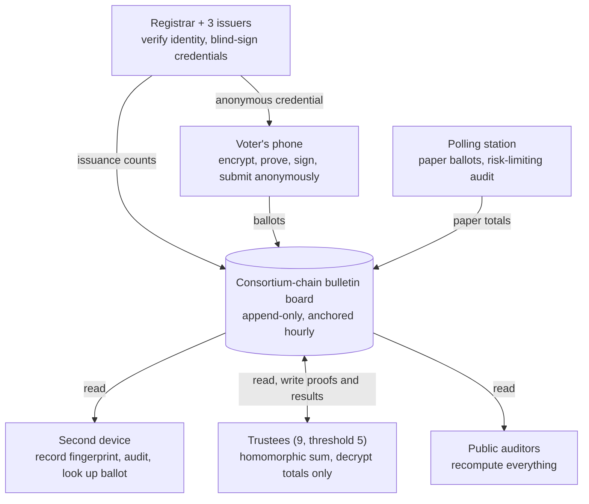

# End-to-End Verifiable Voting System: Design Proposal

**English** · [简体中文](zh-CN.md) · [Français](fr.md) · [Русский](ru.md) · [Español](es.md) · [العربية](ar.md) · [日本語](ja.md) · [한국어](ko.md)

Last updated: 2026-11-08

## Overview

This design targets large-scale fraud: fabricated ballots, deleted or altered ballots, tampered tallies, mass phone malware and organized vote buying. A voter binds a phone once, receives an eligibility credential valid for one election only before each election, and votes on the phone in a few minutes. The chain publishes only ciphertexts, anyone can recompute the result, and each voter can confirm that their ballot was not altered or deleted and was included in the tally. Isolated cases such as a voter being coerced in person by a family member are not specifically designed for; they are left to existing law in exchange for a simpler, faster process.

**Design goals**

- **Publicly verifiable:** anyone can independently recompute the result from on-chain data with open-source tools.
- **Individually verifiable:** each voter can confirm their ballot was recorded as cast, not altered, not deleted, and included in the tally.
- **Secret ballot:** ballots cannot be linked to identities mathematically, even if the encryption is broken in the future.
- **Resistant to large-scale fraud:** any fraud at scale (fabricating, deleting, altering or buying votes) is either impossible or certain to be detected.
- **Efficient:** bind the phone once; the per-election credential is obtained automatically; voting takes minutes; verifiable results within hours of the close.

**Core principles**

- **Separation of powers:** every sensitive operation is split among institutions that check each other. Abuse requires collusion, and collusion leaves traces.
- **Proofs, not trust:** every step carries a mathematical proof that anyone can check.
- **Catch large-scale fraud statistically:** not everyone needs to verify; random checks by a small fraction of voters make large-scale fraud impossible to hide.
- **The blockchain is only a bulletin board:** it guarantees data cannot be changed once posted; it is not responsible for security before posting.
- **Paper as a backstop:** polling stations keep paper ballots and human auditability.

## Common Fraud Methods and How This Design Responds

The table follows the usual categories of US election fraud cases. The online channel eliminates double voting, ballot stuffing, tally tampering and discarded ballots; impersonation and vote buying are greatly reduced; voter-roll quality and in-person coercion still need traditional measures.

| Fraud method | Typical practice | Response in this design | Effect |
| --- | --- | --- | --- |
| Double voting | Registering in several states or counties and voting in each; voting online and then again at a polling station | One credential per person per election, with states sharing hashed identities of issued voters to catch cross-state duplicates; the chain accepts one ballot per credential; credential holders can only cast provisional ballots at polling stations | Eliminated |
| Impersonation | Using the identity of registered non-voters or deceased people | ID verification when binding the phone; liveness face check every time a credential is issued; voters can check whether they are recorded as having received one | Greatly reduced; victims can detect it |
| False registration, phantom voters | Registering fake names, fake addresses or deceased people, then voting for them | Voter roll linked to death, move-out and citizenship records; credentials require ID plus liveness check; issuance counts per precinct published in real time and compared with population and past turnout | Anomalies detectable; roll quality still needs governance |
| Ineligible voting | Non-citizens, non-residents or people barred by state law voting | Eligibility rechecked against the latest roll every time a credential is issued | As good as the roll data |
| Mail-ballot fraud, illegal harvesting | Requesting others' mail ballots, forging signatures, collecting ballots and altering or discarding them | Online ballots pass through no intermediary: the credential is locked in the voter's own phone, needs a liveness check, and there is no paper ballot to intercept | Eliminated in the online channel |
| Vote buying | Paying voters to vote for a candidate and demanding proof | No receipts; credentials cannot be exported from the phone; only the official app is accepted | Hard to scale |
| Illegal "assistance", in-person coercion | Filling in ballots for elderly, disabled or non-native-speaking voters under the guise of helping | Voting requires the voter's own liveness check; being watched in person is not specifically prevented | Partially mitigated |
| Ballot stuffing by officials | Stuffing extra ballots or voting for absent voters | Officials hold no credentials and cannot create valid ballots; online valid ballots may not exceed credentials issued, compared publicly | Eliminated in the online channel |
| Discarding or destroying ballots | Discarding or hiding some ballots before counting | On-chain data cannot be deleted and is anchored externally; voters look up their ballot by fingerprint; signed receipts prove the system received it | Certain to be detected |
| Altering counts or aggregation | Changing precinct counts or numbers during aggregation | The tally is a public homomorphic sum of all on-chain ciphertexts that anyone can recompute; decryption carries a correctness proof | Eliminated |
| Hacking voting devices or tally systems | Tampering with software to change ballots or results | On phones, detected by random audits; on servers, every result can be recomputed from public data without trusting any server | Large-scale tampering certain to be detected |
| Blocking eligible voters | Removing voters from the roll or refusing credentials without cause | Voters can check their registration and issuance status; refusals require reasons and can be appealed; removals per precinct are published | Detectable |

Out of scope: forged signatures on ballot petitions, campaign-finance violations, disinformation and similar issues unrelated to casting and counting. Categories based on the [Heritage Foundation election fraud database](https://electionfraud.heritage.org/categories) and the [News21 investigation](https://www.pewtrusts.org/en/research-and-analysis/articles/2012/08/30/election-fraud).

### The five principles behind it

1. **Anonymous eligibility credentials (blind signatures): prevent double voting without revealing how you voted.** Imagine putting a numbered card in a carbon-lined envelope and having the issuer stamp the envelope: the stamp lands on the card, but the issuer never sees the number. At issuance the registrar knows "Alice has received one", so Alice cannot get a second; at voting time only the card and stamp are shown, and nobody can tell whose card it is.
2. **One credential, one ballot, enforced on-chain: repeat votes are rejected.** Every ballot is posted with the credential's public key. If the same key appears again, every node rejects it under the same public rule; no node can make an exception.
3. **Homomorphic tallying: the total is computed without opening any ballot.** Each ballot is like a locked box with a special property: stacking all the boxes together yields a new box containing exactly the total. Anyone can do the stacking, so the tally is publicly recomputable; at least 5 trustees together are needed to open that single box of totals, with a mathematical proof that the opening was honest.
4. **Random audits: a phone that alters ballots has nowhere to hide.** The phone first hands over the locked box; you record its fingerprint on a second device and only then decide whether to cast it or open it on the spot. The phone cannot know your choice in advance, so cheating is a gamble; the more ballots it alters, the closer the chance of being caught gets to 100%.
5. **Public data, external anchoring and count reconciliation: deleted or extra ballots leave traces.** Anyone can download the chain data; every hour its fingerprint is published to external public blockchains and newspapers, so rewriting history later will not match; public checks such as "online ballots never exceed credentials issued" leave no room for fabricated ballots.

## Threat Model and Trust Assumptions

Each fraud method that can operate at scale is addressed: correctness of the result depends on no one's honesty, and ballot anonymity is guaranteed by mathematics rather than institutional self-restraint.

| Large-scale fraud | Who might attempt it | Response |
| --- | --- | --- |
| Fabricating ballots, issuing credentials to non-existent people | Insiders | Joint blind signatures by 3 issuers; issuance counts published and compared with credentials used on-chain; voters can check whether they are recorded as issued |
| Deleting or altering ballots or tallies | Insiders, hackers | Public on-chain data with external anchoring; homomorphic tally anyone can recompute; voters check by ballot fingerprint |
| Mass phone malware altering ballots | Hackers, foreign actors | Random audits at voting time; fingerprint recorded on a second device first |
| Organized vote buying | Political groups, interest groups | No receipts; credentials locked in the phone's secure chip; official app only |
| Taking the system down | Hackers | Multi-party nodes, 14-day voting period, polling stations as fallback |
| Peeking at or leaking results early | Colluding trustees | 5-of-9 threshold; only totals decrypted, only after voting closes |
| Not specifically addressed: individual voters coerced in person | — | Existing law; add the "Optional Module: Coercion Resistance" design if needed |

**Trust assumptions**

- **Anonymity:** guaranteed by blind signatures. Credentials cannot be linked to identities mathematically, regardless of any institution's honesty, and future quantum computers do not change this. Assumes anonymous relays keep no logs.
- **Integrity:** depends on no one. Even if every institution colludes, tampering is exposed by public verification.
- **Issuance:** the 3 issuers and the registrar will not all collude; even if they do, extra credentials are exposed by count reconciliation.
- **Chain availability:** at least two thirds of consortium nodes are honest. Beyond one third malicious, they can only deny service, not forge ballots or rewrite history.
- **Phones:** not every phone is guaranteed clean, but large-scale tampering is certain to be caught by audits.

## Roles and Separation of Powers

The damage each role can do alone is bounded; the last column is the test of the separation-of-powers design.

| Role | Who | Duties | Worst it can do alone |
| --- | --- | --- | --- |
| Voter | Eligible citizen | Register, vote, audit, verify | Affect only their own vote |
| Registrar | Existing election offices | Verify identity and eligibility; record whether each person has received this election's credential | Refuse issuance (voters can check and appeal) |
| Credential issuers (3) | Election office plus one appointed by each major party | Blind-sign voters' anonymous credentials | Cannot produce a valid credential alone; cannot see credential contents |
| Trustees (9, threshold 5) | Major parties, independent election bodies, courts, universities | Hold shares of the election key; jointly decrypt totals after voting closes | Nothing |
| Consortium nodes (21+) | State election bodies, parties, universities, media, observer groups | Verify and store ballots; jointly sign receipts | Deny service; cannot forge or rewrite ballots |
| Anonymous relays (several) | Independent operators distinct from the above | Forward ballots, hide voters' IP addresses | No single relay sees the full path |
| Polling stations | Existing polling stations | Paper voting, assistance | Affect local service; paper is auditable |
| Public auditors | Anyone | Download chain data, recompute independently | No write access |
| Software developers | Open-source community plus certification bodies | Develop, audit, reproducible builds | Malicious code is caught by audits and public review |

## Cryptographic Components

All components are mature, well-studied and publicly implemented; no new cryptography is invented. Compared with a coercion-resistant design, the heaviest parts (mixnets and fake-credential filtering) are removed.

| Component | Used for | Purpose |
| --- | --- | --- |
| Exponential ElGamal (homomorphic) | Ballots | Ciphertexts can be added directly; only totals are decrypted, never single ballots |
| Distributed key generation + threshold decryption (5/9) | Election key | No one holds the full private key |
| Blind signatures (3 issuers) | Per-election anonymous credential | Issuers sign without seeing the credential; credentials cannot be linked to identities mathematically |
| Phone secure chip + app attestation | Credential private key | Key cannot be exported; only the official app can use it |
| Schnorr signatures | Every ballot | Only the credential holder can vote; each credential votes once |
| Zero-knowledge proofs | Ballot validity, decryption correctness | Prove "exactly the allowed number of choices per contest" and "decryption was honest" without revealing content |
| Benaloh challenge | At voting time | The phone does not know whether a ballot will be cast or audited, so cheating risks being caught |
| Hashes and Merkle trees | Ballot fingerprints, external anchoring | Data fingerprints; changing one byte breaks the match |

## End-to-End Process

An election has seven steps: preparation, phone binding (once), per-election credential, voting and auditing, verification, tallying, public audit. Every step's output is posted on-chain for anyone to check.

The registrar, voters' phones and polling stations write to the chain; second devices and the public only read; trustees read and then write decryption proofs and final results back.

### 1. Election preparation (about 60 days before voting)

1. **Key ceremony:** 9 trustees run distributed key generation on a public livestream. The public key is posted; each holds one private-key share in a hardware security module.
2. **Parameters on-chain:** contests and candidates, voting window, validation rules, hashes of every software version.
3. **Software release:** voting app, verification tools and tally verifier are all open source with reproducible builds, audited by several independent bodies with public reports.
4. **Public testing:** full mock elections and a bug bounty.

### 2. Phone binding (once, up to 4 years)

1. **Identity check:** the voter shows ID at any election office, DMV or post office, and staff match it to the voter registration. Alternatively, online with an activation code mailed to the registered address plus an ID number.
2. **Bind the phone:** the app creates a long-term identity key inside the phone's secure chip; the private key cannot be exported. The registrar issues a long-term identity certificate for it. The certificate only proves "this phone belongs to this person"; it does not confer eligibility to vote.
3. **Validity:** up to 4 years or until the ID document expires, after which identity is re-verified.
4. **Automatic revocation:** when a voter is removed from the roll (death, moving out of state, loss of citizenship, court ruling, etc.), the certificate is revoked. The roll is linked to death, move-out and citizenship-change records.
5. **New phone:** migrate at any office or authorize from the old phone; the old certificate is revoked.

Voters who do not want to use a phone need not register; they vote on paper at polling stations as usual.

### 3. Per-election credential (every election, valid for that election only)

1. **New key:** before voting opens, the app generates a new key pair for this election inside the secure chip.
2. **Liveness check:** the app uses the front camera for a liveness check matched against the ID photo, confirming the voter is operating it and preventing the phones of deceased or ineligible people from being used by others.
3. **Eligibility recheck:** the app proves identity to the registrar with the long-term certificate; the registrar rechecks eligibility for this election against the latest roll and records "credential issued". One per person per election; states share hashed identities of issued voters, so someone registered in several states still gets only one.
4. **Blind signatures:** the 3 issuers each blind-sign the new public key without seeing it, so no one can link credential and identity.
5. **Credential issued:** the new public key plus 3 signatures is the anonymous eligibility credential for this election only; it expires when the election ends. The whole process takes about a minute.
6. **Public counts:** issuance counts per precinct are posted in real time. Voters can check at any time whether they are recorded as issued; if so without having requested one, someone impersonated them.

### 4. Voting and auditing (14-day voting period)

1. **Choose:** the voter selects candidates for each contest.
2. **Record the fingerprint:** the app encrypts the choices and shows a ballot-fingerprint QR code. The voter scans it with a second device or writes down its first 8 characters. This must happen before the next step.
3. **Cast or audit:**
    - **Audit:** the app reveals the encryption randomness; the second device opens the ciphertext and checks that the content matches the choice and the fingerprint matches the one recorded. The audited ballot is discarded and the voter returns to step 1.
    - **Cast:** the app attaches a zero-knowledge proof, signs with the credential, submits through anonymous relays, and destroys the encryption randomness.
4. **On-chain:** nodes verify the credential signatures, the zero-knowledge proof, the voting window, and that the credential has not voted. Only then is the ballot written to a block, and a receipt jointly signed by the nodes is returned.
5. **One credential, one ballot:** a cast ballot cannot be changed, so malware cannot quietly re-vote after the voter is done.

### 5. Voter verification

| When | What is confirmed | How |
| --- | --- | --- |
| While voting | The phone did not alter the ballot | Audit at least once before casting; the phone cannot know in advance whether you will |
| Any time after voting | Ballot is on-chain, not deleted, not swapped | Look up the recorded fingerprint on a second device or any public lookup site |
| After the tally | Ballot was included | Your fingerprint is in the tally's input set, and all tally and decryption proofs pass |
| In a dispute | Evidence | File a complaint with the election disputes board using the receipt and on-chain records |

### 6. Tallying (within hours of the close)

1. **Freeze:** the block height at the deadline is posted; no further online ballots are accepted.
2. **Rule check:** publicly verify that every credential has exactly one ballot and 3 valid issuer signatures.
3. **Homomorphic sum:** multiply all valid ballots per contest to obtain encrypted totals. Anyone can compute this themselves.
4. **Decrypt totals:** at least 5 trustees jointly decrypt each contest's total, with correctness proofs. Individual ballots are never decrypted.
5. **Count reconciliation:** valid online ballots may not exceed credentials issued; issuance per precinct is compared with registrations and past turnout, and anomalies are investigated.
6. **Publication:** vote totals per contest and all proofs, combined with polling-station paper results.

### 7. Public audit

- **Independent recomputation:** anyone can download chain data with the open-source verifier and rerun credential checks, the sum and decryption verification.
- **Multi-party reports:** parties, media, universities and other independent bodies publish their own verification reports within 24 hours of the results.
- **Paper audit:** risk-limiting audits on the polling-station channel, sampling paper ballots against electronic counts.
- **Anomaly monitoring:** reports of failed audits and issuance counts per precinct are published by region; clusters of anomalies trigger investigation.
- **The statistical power of audits:** not everyone needs to audit. If a random 1% of ballots are audited, the chance of altering 1,000 ballots without anyone noticing is about 0.004%. This assumes the phone cannot predict who will audit, so the app neither records nor reports whether a voter audited.

## Key Issues and Solutions

Large-scale fraud has five main routes; below is why each fails in this design. The last items are operational issues.

### Fabricating ballots

- Credentials need signatures from all 3 issuers; no single issuer can create a valid one.
- Even if all 3 issuers and the registrar collude to mint extra credentials, only two outcomes are possible: credentials used on-chain exceed the issuance count recorded by the registrar, or real voters are told "already issued" when they request one. Both are exposed.
- Issuance counts per precinct are public in real time and compared with registrations and past turnout; anomalous precincts are investigated.
- **Phantom voters on the roll** (deceased or moved but still listed) affect today's mail voting too, and a blockchain cannot fix them. This design links the roll to death, move-out and citizenship-change records, rechecks the latest roll and performs a liveness check at every issuance, and targets precincts with abnormally high issuance rates for inspection.

### Deleting or altering ballots or results

- Chain data is public and anchored externally every hour; any change will not match the anchors.
- Voters can find their ballot by its recorded fingerprint; if it is missing, the receipt proves the system received it.
- The tally is a public homomorphic sum anyone can recompute; trustees decrypt only totals, with correctness proofs.

### Mass phone malware

- **Audits:** when encrypting, the phone does not know whether the ballot will be cast or audited, so cheating risks detection, and the more it cheats the surer detection becomes.
- **Fingerprint first:** the fingerprint must be recorded on a second device before choosing to cast or audit; otherwise the phone could quietly cast one ballot and show you another for auditing.
- **One credential, one ballot:** cast ballots cannot be changed, so malware cannot re-vote afterwards.
- **Response:** once a failed audit is confirmed, it is made public, the affected app version is frozen, and affected voters vote at polling stations instead.

### Organized vote buying

Organized vote buying is fraud at scale and cannot be ignored along with individual coercion. Without heavyweight mechanisms it can still be made hard to scale:

- **No receipts:** voters get nothing that proves how they voted. Audits reveal only discarded ballots; the randomness of the cast ballot is destroyed immediately.
- **Credentials cannot be exported:** the credential key is locked in the phone's secure chip, so selling a vote means handing over the phone itself. Operating thousands of phones centrally is hard to hide.
- **Official app only:** credentials work only in the attested official app, so vote buyers cannot build a modified app that produces receipts.
- **Residual risk:** a buyer watching the seller vote in person is costly and hard to scale; it is left to existing law.

### Denial of service

- A 14-day voting period means a one-day outage does not decide anything.
- Only ballots with valid credentials are processed; junk is dropped at the entrance, and verification is cheap.
- Nodes are spread across several cloud providers and private data centers; read-only data is served from multiple mirrors.
- If the online channel is unavailable, polling stations are the fallback; a large-scale attack before the deadline triggers a legal extension of the voting period.

### Trustee collusion

- Decrypting anything requires 5 of the 9 trustees.
- Even if they decrypt a single ballot, they only learn how some anonymous credential voted, not who cast it.
- The main risk is peeking at interim results. Decryption happens only after voting closes; key shares are kept in hardware security modules, and every use is logged on-chain.

### Long-term privacy

- The unlinkability of blind signatures is mathematically absolute. Even if quantum computers break the encryption one day, they only reveal how anonymous credentials voted, not who cast them.
- A key assumption is that anonymous relays keep no logs; they are run by several independent operators, none of which sees the full path.

### Lost phones and double voting

- Phone lost before receiving this election's credential: re-register and obtain it as usual.
- Phone lost after receiving it: the credential needs the phone's passcode or biometrics, so a finder cannot use it. The voter may cast a provisional ballot at a polling station; provisional ballots of this kind are counted per precinct and published, and clusters are investigated.
- The roll records whether each person has received this election's credential. Those who have can only cast provisional ballots at polling stations; those who have not vote on paper normally.

### Disputes

- **Missing ballot:** the receipt is jointly signed by the nodes, so the system cannot deny it.
- **Audit shows wrong content:** the audit record on the second device publicly proves what that ballot actually encrypted, but not what the voter selected at the time, so investigations are triggered by the number and distribution of reports.
- **Legal status:** the evidentiary weight of on-chain data and receipts needs to be established by legislation.

### Usability

- Bind the phone once; obtaining each election's credential takes about a minute; voting plus one audit takes a few minutes.
- The app supports screen readers, multiple languages and large text; voters without a second device can borrow a family member's phone or use public lookup terminals at polling stations.
- Anyone who cannot or does not want to use a phone can always vote on paper.

## Consortium Chain and Infrastructure

A multi-party consortium chain rather than a public chain is used. Here it is just an append-only bulletin board; an append-only log mirrored independently by several parties would give nearly the same security.

- **Consensus:** Byzantine fault-tolerant (e.g. HotStuff), tolerating fewer than one third malicious nodes, about 2-second blocks.
- **Nodes:** 21 or more, run by state election bodies, major parties, universities, media and observer groups, with no category exceeding one third.
- **Write rules:** only ballots with a valid credential, valid signature and zero-knowledge proof, within the voting window, and from a credential that has not yet voted are accepted; everything else is rejected. Nodes cannot decide on their own whether to accept a valid ballot.
- **Public read access:** anyone can download the full chain data; several mirror sites exist.
- **External anchoring:** every hour the Merkle root of the chain state is written to several public blockchains and printed in newspaper notices. Even if all consortium nodes collude to rewrite history, it will not match the anchors.
- **Capacity estimate (rough):** about 150 million ballots at about 5 KB each (with proofs) is about 750 GB, storable on an ordinary server. Over 14 days the average is about 124 ballots per second; designing for 10× peaks gives about 1,200 per second, and verification parallelizes.
- **Tally speed:** the homomorphic sum is simple batch multiplication and only per-contest totals are decrypted, so results are available within hours of the close.

**Why not a public chain:**

- **Privacy:** public-chain transactions need fees and accounts, which can expose voters' identities.
- **Cost and congestion:** fees and confirmation times are unpredictable at election peaks.
- **Governance:** anonymous miners or validators must not decide whether election data gets on-chain.

## Deployment Roadmap

Start with small, low-risk elections and move to each next stage only after meeting its gate. The online channel always supplements polling stations and never replaces them.

1. **Prototype and public review (about year 1)**
    - Open-source implementation, design paper, bug bounty.
    - Gate: independent cryptographic audit passed, no unfixed high-severity vulnerabilities.
2. **Mock elections (about years 1–2)**
    - Internal elections of student unions, community organizations, labor unions, etc.
    - Gate: audit rate, anomaly-report rate and usability test results meet targets.
3. **Small formal pilots (about years 2–3)**
    - Overseas voters, military personnel and voters with disabilities, as a supplement to existing mail voting.
    - Gate: no unexplained count discrepancies in the pilots.
4. **Supplementary channel for local elections (about years 3–5)**
    - County and city elections, alongside the polling-station paper channel.
5. **Whether to expand**
    - Decided by pilot data and legislation. Requires state law and certification under federal voting-system standards.

## Optional Module: Coercion Resistance

Disabled by default. If individual coercion is later judged worth preventing, the modules below can be added, at the cost of a noticeably slower and more complex process.

| Module | What it solves | Cost |
| --- | --- | --- |
| Credential issuance in a private booth | Coercers cannot watch issuance | A trip in person every election |
| Fake credentials | Under pressure, hand over a fake credential that looks identical; its ballots are silently removed at tally time | Tally must use mixnets and filtering, much slower; the design becomes much more complex |
| Re-voting, last ballot counts | After a coerced vote, the voter can change it later | Malware can also re-vote quietly, requiring paper return-code sheets and continuous second-device monitoring |
| Polling station cancels online vote | On election day, cancel the online credential at a polling station and vote on paper | Cancellation records must be hidden, or coercers can see them |

These modules only work together; adding one alone has limited effect.

## Residual Risks and Reference Systems

This design ensures large-scale fabrication, deletion and alteration will be detected and makes organized vote buying hard to scale, but some risks cannot be fully eliminated.

**Residual risks**

- **Relies on some voters actually auditing:** with too few audits, small-scale tampering might slip through; large-scale tampering is nearly impossible to hide.
- **Roll quality:** a blockchain cannot solve phantom voters; this relies on roll maintenance and count anomaly monitoring.
- **Platform dependence:** secure chips and app attestation depend on platforms such as Apple and Google, requiring fallbacks and regulatory constraints.
- **Complexity shifts trust:** ordinary people cannot read these proofs and ultimately trust the experts who checked them, so independent auditors must be diverse and cross-partisan.
- **No paper record in the online channel:** no traditional manual recount is possible; it relies on cryptographic proofs.
- **Expert opinion:** the computer-security community is broadly cautious about internet voting, considering endpoint security hard to guarantee with current technology; many experts still favor hand-marked paper ballots.

**Reference systems**

- **Helios, Belenios:** academic end-to-end verifiable internet voting systems; this design's homomorphic tally and audit mechanism are the same.
- **ElectionGuard:** Microsoft's open-source end-to-end verifiability toolkit, used for encrypted tallying at polling stations.
- **JCJ / Civitas:** the original research on fake-credential coercion resistance, corresponding to the "Optional Module: Coercion Resistance" section.
- **Estonian internet voting:** re-voting, paper ballots on election day overriding online ones, second-device verification.
- **Swiss e-voting:** paper return-code sheets to prevent device tampering.
