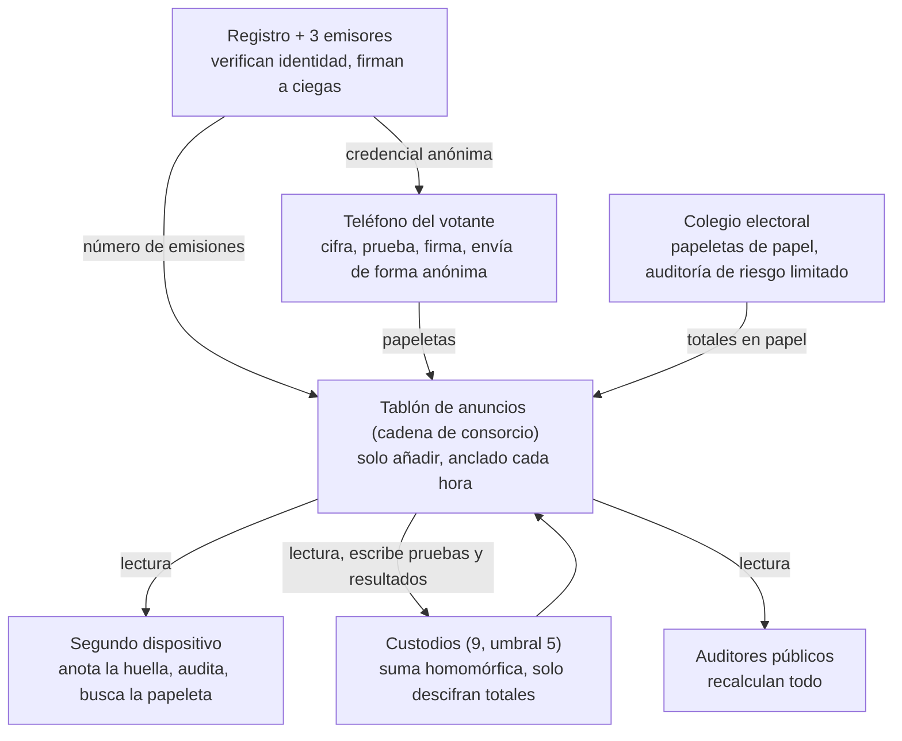

# Sistema de votación verificable de extremo a extremo: propuesta de diseño

[English](en.md) · [简体中文](zh-CN.md) · [Français](fr.md) · [Русский](ru.md) · **Español** · [العربية](ar.md) · [日本語](ja.md) · [한국어](ko.md)

Última actualización: 2026-11-08

## Resumen

Este diseño apunta al fraude a gran escala: papeletas fabricadas, papeletas borradas o alteradas, escrutinios manipulados, malware masivo en teléfonos y compra organizada de votos. El votante vincula su teléfono una sola vez, recibe antes de cada elección una credencial de elegibilidad válida solo para esa elección y vota desde el teléfono en pocos minutos. La cadena publica solo textos cifrados, cualquiera puede recalcular el resultado y cada votante puede confirmar que su papeleta no fue alterada ni borrada y que se contó. Los casos aislados, como un votante coaccionado en persona por un familiar, no tienen un diseño específico: quedan en manos de la ley vigente a cambio de un proceso más simple y rápido.

**Objetivos**

- **Verificable públicamente:** cualquiera puede recalcular el resultado de forma independiente con los datos de la cadena y herramientas de código abierto.
- **Verificable individualmente:** cada votante puede confirmar que su papeleta se registró tal como la emitió, sin alterar ni borrar, y que se incluyó en el escrutinio.
- **Voto secreto:** es matemáticamente imposible vincular papeletas con identidades, aunque el cifrado se rompa en el futuro.
- **Resistente al fraude masivo:** todo fraude a escala (fabricar, borrar, alterar o comprar votos) es imposible o se detecta con certeza.
- **Eficiente:** el teléfono se vincula una vez; la credencial de cada elección se obtiene automáticamente; votar lleva minutos; resultados verificables a las pocas horas del cierre.

**Principios**

- **Separación de poderes:** cada operación sensible se reparte entre instituciones que se controlan mutuamente. El abuso exige colusión, y la colusión deja rastro.
- **Pruebas, no confianza:** cada paso lleva una prueba matemática que cualquiera puede comprobar.
- **Detección estadística del fraude masivo:** no hace falta que todos verifiquen; las comprobaciones aleatorias de una pequeña fracción de votantes impiden ocultar un fraude masivo.
- **La cadena de bloques es solo un tablón de anuncios:** garantiza que los datos publicados no cambien; no responde de la seguridad previa a la publicación.
- **El papel como respaldo:** los colegios electorales conservan la papeleta de papel y la auditoría humana.

## Métodos de fraude habituales y respuesta del diseño

La tabla sigue las categorías habituales de los casos de fraude electoral en Estados Unidos. El canal en línea elimina el voto doble, el relleno de urnas, la manipulación del escrutinio y el descarte de papeletas; la suplantación y la compra de votos se reducen mucho; la calidad del censo y la coacción en persona siguen requiriendo medidas tradicionales.

| Método | Práctica típica | Respuesta del diseño | Efecto |
| --- | --- | --- | --- |
| Voto doble | Inscribirse en varios estados o condados y votar en cada uno; votar en línea y luego en el colegio | Una credencial por persona y elección, con los estados compartiendo hashes de identidad de quienes ya la recibieron para detectar duplicados; la cadena acepta una papeleta por credencial; quien tiene credencial solo puede votar provisionalmente en el colegio | Eliminado |
| Suplantación | Usar la identidad de inscritos que no votan o de fallecidos | Verificación de identidad al vincular el teléfono; prueba facial de vida en cada emisión; cada votante puede comprobar si consta como receptor | Muy reducida; la víctima puede detectarla |
| Inscripciones falsas, votantes fantasma | Inscribir nombres, direcciones falsas o fallecidos y votar por ellos | Censo vinculado a registros de defunción, traslado y nacionalidad; emisión con documento y prueba de vida; credenciales emitidas por distrito publicadas en tiempo real y comparadas con población y participación previa | Anomalías detectables; la calidad del censo sigue requiriendo gestión |
| Voto de no elegibles | Votan no ciudadanos, no residentes o personas inhabilitadas por ley estatal | Elegibilidad revisada contra el censo más reciente en cada emisión | Tan buena como el censo |
| Fraude en voto por correo, recolección ilegal | Pedir papeletas ajenas, falsificar firmas, recoger papeletas y alterarlas o desecharlas | Sin intermediarios en línea: la credencial está bloqueada en el teléfono del votante, exige prueba de vida y no hay papeleta de papel que interceptar | Eliminado en línea |
| Compra de votos | Pagar por el voto y exigir prueba | Sin recibos; la credencial no puede exportarse del teléfono; solo se acepta la app oficial | Difícil de escalar |
| "Ayuda" ilegal, coacción en persona | Rellenar papeletas de mayores, personas con discapacidad o que no dominan el idioma con la excusa de ayudar | El voto exige la prueba de vida del propio votante; la vigilancia en persona no se previene específicamente | Mitigada en parte |
| Relleno de urnas por el personal | Añadir papeletas o votar por ausentes | El personal no tiene credenciales y no puede crear papeletas válidas; las papeletas en línea válidas no pueden superar las credenciales emitidas, comparación pública | Eliminado en línea |
| Descartar o destruir papeletas | Tirar u ocultar papeletas antes del escrutinio | Datos de la cadena imborrables y anclados externamente; el votante encuentra su papeleta por su huella; un acuse firmado prueba la recepción | Se detecta con certeza |
| Alterar el escrutinio o la agregación | Cambiar cifras de una mesa o al agregar | El escrutinio es una suma homomórfica pública de todos los cifrados que cualquiera puede recalcular; el descifrado lleva prueba de corrección | Eliminado |
| Hackear dispositivos o sistemas de escrutinio | Manipular el software para cambiar papeletas o resultados | En el teléfono, lo detectan las auditorías aleatorias; en el servidor, todo resultado se recalcula con datos públicos sin confiar en ningún servidor | La manipulación masiva se detecta con certeza |
| Impedir votar a electores legítimos | Dar de baja sin motivo o negar la credencial | El votante puede consultar su inscripción y su emisión; toda negativa es motivada y recurrible; las bajas por distrito se publican | Detectable |

Fuera del alcance: firmas falsas en peticiones de candidatura, infracciones de financiación de campañas, desinformación y otros asuntos ajenos a votar y contar. Categorías basadas en la [base de datos de la Heritage Foundation](https://electionfraud.heritage.org/categories) y la [investigación de News21](https://www.pewtrusts.org/en/research-and-analysis/articles/2012/08/30/election-fraud).

### Los cinco principios de fondo

1. **Credencial anónima (firma ciega): impide votar dos veces sin revelar tu voto.** Imagina una tarjeta numerada dentro de un sobre con papel carbón que el emisor sella: el sello queda impreso en la tarjeta, pero él nunca ve el número. Al emitir, el registro sabe que «Ana ya recibió la suya», así que no obtendrá otra; al votar solo se muestran la tarjeta y el sello, y nadie sabe de quién es.
2. **Una credencial, una papeleta, como regla de la cadena: los votos repetidos se rechazan.** Cada papeleta se publica con la clave pública de la credencial. Si la misma clave vuelve a aparecer, todos los nodos la rechazan con la misma regla pública; ningún nodo puede hacer excepciones.
3. **Escrutinio homomórfico: el total sin abrir ninguna papeleta.** Cada papeleta es como una caja cerrada con una propiedad especial: al «apilar» todas las cajas se obtiene una nueva caja que contiene exactamente el total. Cualquiera puede apilarlas, así que el escrutinio es recalculable públicamente; hacen falta al menos 5 custodios juntos para abrir esa única caja de totales, con una prueba matemática de que la apertura fue honesta.
4. **Auditorías aleatorias: un teléfono tramposo no tiene dónde esconderse.** El teléfono entrega primero la caja cerrada; tú anotas su huella en un segundo dispositivo y solo entonces decides depositarla o abrirla ahí mismo. El teléfono no conoce tu elección de antemano, así que hacer trampa es una apuesta; cuantas más papeletas altere, más se acerca a 100 % la probabilidad de que lo descubran.
5. **Datos públicos, anclaje externo y cuadre de cifras: las papeletas borradas o sobrantes dejan rastro.** Cualquiera puede descargar los datos; cada hora su huella se publica en cadenas públicas externas y en la prensa, así que reescribir la historia no cuadrará; controles públicos como «papeletas en línea ≤ credenciales emitidas» no dejan sitio a papeletas fabricadas.

## Modelo de amenazas y supuestos de confianza

Cada fraude capaz de operar a escala tiene respuesta: la corrección del resultado no depende de la honestidad de nadie y el anonimato lo garantizan las matemáticas, no la contención de las instituciones.

| Fraude a gran escala | Quién podría intentarlo | Respuesta |
| --- | --- | --- |
| Fabricar papeletas, emitir credenciales a personas inexistentes | Personal interno | Firma ciega conjunta de 3 emisores; emisiones publicadas y comparadas con las credenciales usadas en la cadena; el votante puede comprobar si consta como receptor |
| Borrar o alterar papeletas o escrutinios | Personal interno, hackers | Datos públicos con anclaje externo; escrutinio homomórfico recalculable por todos; verificación por huella |
| Malware masivo que altera votos | Hackers, actores extranjeros | Auditorías aleatorias al votar; huella anotada primero en un segundo dispositivo |
| Compra organizada de votos | Grupos políticos, grupos de interés | Sin recibos; credencial bloqueada en el chip seguro; solo app oficial |
| Tumbar el sistema | Hackers | Nodos de múltiples partes, 14 días de votación, colegios como respaldo |
| Espiar o filtrar resultados antes de tiempo | Custodios en colusión | Umbral 5 de 9; solo se descifran los totales, tras el cierre |
| Sin tratamiento específico: votantes coaccionados en persona | — | Ley vigente; si se necesita, añadir la sección «Módulo opcional: resistencia a la coacción» |

**Supuestos de confianza**

- **Anonimato:** lo garantiza la firma ciega; las credenciales no pueden vincularse con identidades, sea cual sea la honestidad de las instituciones, y los ordenadores cuánticos no lo cambian. Supone que los relés anónimos no guardan registros.
- **Integridad:** no depende de nadie. Aunque todas las instituciones se confabulen, la manipulación queda al descubierto con la verificación pública.
- **Emisión:** los 3 emisores y el registro no se confabularán todos; si lo hicieran, las credenciales sobrantes quedan al descubierto al cuadrar cifras.
- **Disponibilidad de la cadena:** al menos dos tercios de los nodos son honestos. Más de un tercio malicioso solo puede denegar el servicio, no falsificar papeletas ni reescribir la historia.
- **Teléfonos:** no se garantiza que cada teléfono esté limpio, pero la manipulación masiva será detectada por las auditorías.

## Roles y separación de poderes

El daño que cada rol puede causar por sí solo está acotado; la última columna es la prueba del diseño.

| Rol | Quién | Funciones | Lo peor que puede hacer solo |
| --- | --- | --- | --- |
| Votante | Ciudadano elegible | Registrarse, votar, auditar, verificar | Afectar solo a su propio voto |
| Registro | Oficinas electorales actuales | Verificar identidad y elegibilidad; anotar quién recibió la credencial de la elección | Negar la emisión (consultable, recurrible) |
| Emisores de credenciales (3) | Oficina electoral y uno designado por cada gran partido | Firmar a ciegas las credenciales anónimas | No puede emitir solo una credencial válida; no ve su contenido |
| Custodios (9, umbral 5) | Grandes partidos, órganos electorales independientes, tribunales, universidades | Guardar partes de la clave; descifrar juntos los totales tras el cierre | Nada |
| Nodos del consorcio (21+) | Órganos electorales estatales, partidos, universidades, medios, observadores | Verificar y almacenar papeletas; firmar acuses conjuntamente | Denegar servicio; no puede falsificar ni reescribir |
| Relés anónimos (varios) | Operadores independientes distintos de los anteriores | Reenviar papeletas, ocultar la IP | Ninguno ve el recorrido completo |
| Colegios electorales | Colegios actuales | Voto en papel, asistencia | Afectar al servicio local; el papel es auditable |
| Auditores públicos | Cualquiera | Descargar datos, recalcular | Sin permiso de escritura |
| Desarrolladores | Comunidad de código abierto y organismos de certificación | Desarrollar, auditar, compilación reproducible | El código malicioso lo detectan las auditorías y la revisión pública |

## Componentes criptográficos

Todos los componentes son maduros, están bien estudiados y tienen implementaciones públicas; no se inventa criptografía nueva. Frente a un diseño resistente a la coacción, se eliminan las partes más pesadas (redes de mezcla y filtrado de credenciales falsas).

| Componente | Uso | Función |
| --- | --- | --- |
| ElGamal exponencial (homomórfico) | Papeletas | Los cifrados se suman directamente; solo se descifran totales, nunca una papeleta |
| Generación distribuida de claves + descifrado con umbral (5/9) | Clave electoral | Nadie tiene la clave privada completa |
| Firma ciega (3 emisores) | Credencial anónima de la elección | Los emisores firman sin ver la credencial; sin vínculo matemático con la identidad |
| Chip seguro + atestación de la app | Clave privada de la credencial | No exportable; solo la app oficial puede usarla |
| Firma de Schnorr | Cada papeleta | Solo el titular puede votar; una vez por credencial |
| Pruebas de conocimiento cero | Validez de la papeleta, corrección del descifrado | Probar «exactamente el número permitido de opciones por contienda» y «descifrado honesto» sin revelar el contenido |
| Desafío de Benaloh | Al votar | El teléfono no sabe si la papeleta se depositará o auditará; hacer trampa arriesga ser descubierto |
| Hashes y árboles de Merkle | Huellas de papeleta, anclaje externo | Huellas de datos: un byte cambiado rompe la coincidencia |

## Proceso completo

Una elección tiene siete pasos: preparación, vinculación del teléfono (una vez), credencial de la elección, voto y auditoría, verificación, escrutinio, auditoría pública. El resultado de cada paso se publica en la cadena para que cualquiera lo compruebe.

El registro, los teléfonos y los colegios escriben en la cadena; los segundos dispositivos y el público solo leen; los custodios leen y después escriben las pruebas de descifrado y los resultados.

### 1. Preparación (unos 60 días antes de votar)

1. **Ceremonia de claves:** 9 custodios ejecutan la generación distribuida de claves en una retransmisión pública. Se publica la clave pública; cada uno guarda una parte de la privada en un módulo de seguridad hardware.
2. **Parámetros en la cadena:** contiendas y candidatos, periodo de votación, reglas de validación, hashes de cada versión del software.
3. **Publicación del software:** app de voto, herramientas de verificación y verificador del escrutinio en código abierto con compilación reproducible, auditados por varios organismos independientes con informes públicos.
4. **Pruebas públicas:** simulacros completos y programa de recompensas por fallos.

### 2. Vinculación del teléfono (una vez, hasta 4 años)

1. **Verificación de identidad:** el votante presenta su documento en cualquier oficina electoral, oficina de tráfico o de correos, y el personal lo coteja con la inscripción. O en línea con un código de activación enviado por correo a la dirección inscrita más el número de documento.
2. **Vinculación:** la app crea una clave de identidad de largo plazo en el chip seguro; la clave privada no puede exportarse. El registro emite un certificado de identidad de largo plazo, que solo prueba que «este teléfono es de esta persona» y no otorga derecho a votar.
3. **Vigencia:** hasta 4 años o hasta que caduque el documento; después, nueva verificación.
4. **Revocación automática:** si el votante sale del censo (fallecimiento, traslado fuera del estado, pérdida de la nacionalidad, sentencia, etc.), el certificado se revoca. El censo está vinculado a registros de defunción, traslado y nacionalidad.
5. **Teléfono nuevo:** migrar en cualquier oficina o autorizar desde el teléfono antiguo; el certificado anterior se revoca.

Quien no quiera usar el teléfono no necesita registrarse y vota en papel en el colegio como siempre.

### 3. Credencial de la elección (en cada elección, válida solo para ella)

1. **Clave nueva:** antes de abrir la votación, la app genera en el chip un nuevo par de claves para esta elección.
2. **Prueba de vida:** la app usa la cámara frontal y compara el rostro con la foto del documento, para confirmar que opera el propio votante e impedir que otro use el teléfono de alguien fallecido o no elegible.
3. **Nueva revisión de elegibilidad:** la app demuestra la identidad al registro con el certificado; el registro revisa la elegibilidad con el censo más reciente y anota «credencial emitida». Una por persona y elección; los estados comparten hashes de identidad de quienes la recibieron, así que alguien inscrito en varios estados solo obtiene una.
4. **Firma ciega:** los 3 emisores firman a ciegas la nueva clave pública sin verla, de modo que nadie puede vincular credencial e identidad.
5. **Credencial obtenida:** la clave pública y las 3 firmas forman la credencial anónima, válida solo para esta elección; caduca al terminar. Todo el proceso dura un minuto aproximadamente.
6. **Recuentos públicos:** las emisiones por distrito se publican en tiempo real. Cada votante puede consultar en cualquier momento si consta como receptor; si consta sin haberla pedido, alguien lo suplantó.

### 4. Voto y auditoría (14 días)

1. **Elegir:** el votante elige candidatos para cada contienda.
2. **Anotar la huella:** la app cifra la elección y muestra un código QR con la huella de la papeleta. El votante lo escanea con un segundo dispositivo o anota sus primeros 8 caracteres. Debe hacerse antes del paso siguiente.
3. **Depositar o auditar:**
    - **Auditar:** la app revela la aleatoriedad del cifrado; el segundo dispositivo abre el cifrado y comprueba que el contenido coincide con la elección y la huella con la anotada. La papeleta auditada se anula y se vuelve al paso 1.
    - **Depositar:** la app adjunta una prueba de conocimiento cero, firma con la credencial, envía por relés anónimos y destruye la aleatoriedad.
4. **En la cadena:** los nodos comprueban firmas, prueba, periodo de votación y que la credencial no haya votado. Solo entonces se escribe la papeleta en un bloque y se devuelve un acuse firmado conjuntamente por los nodos.
5. **Una credencial, una papeleta:** una papeleta depositada no puede cambiarse, así que el malware no puede volver a votar a escondidas.

### 5. Verificación del votante

| Cuándo | Qué se confirma | Cómo |
| --- | --- | --- |
| Al votar | El teléfono no alteró la papeleta | Auditar al menos una vez antes de depositar; el teléfono no sabe de antemano si lo harás |
| En cualquier momento después | La papeleta está en la cadena, sin borrar ni sustituir | Buscar la huella anotada en un segundo dispositivo o cualquier web pública de consulta |
| Tras el escrutinio | La papeleta se contó | Tu huella está en el conjunto de entrada y todas las pruebas de escrutinio y descifrado son válidas |
| En caso de disputa | Pruebas | Reclamar ante la comisión de disputas electorales con el acuse y los datos de la cadena |

### 6. Escrutinio (a las pocas horas del cierre)

1. **Congelación:** se publica la altura de bloque del cierre; no se aceptan más papeletas en línea.
2. **Control de reglas:** se comprueba públicamente que cada credencial tiene exactamente una papeleta y 3 firmas válidas.
3. **Suma homomórfica:** se multiplican todas las papeletas válidas por contienda para obtener los totales cifrados. Cualquiera puede calcularlo.
4. **Descifrar totales:** al menos 5 custodios descifran juntos el total de cada contienda, con pruebas de corrección. Nunca se descifra una papeleta individual.
5. **Cuadre de cifras:** las papeletas en línea válidas no pueden superar las credenciales emitidas; las emisiones por distrito se comparan con inscripciones y participación previa, y las anomalías se investigan.
6. **Publicación:** totales por contienda y todas las pruebas, junto con los resultados en papel de los colegios.

### 7. Auditoría pública

- **Recálculo independiente:** cualquiera puede descargar los datos con el verificador abierto y repetir los controles de credenciales, la suma y la verificación del descifrado.
- **Informes de múltiples partes:** partidos, medios, universidades y otros organismos independientes publican su propio informe en las 24 horas siguientes a los resultados.
- **Auditoría en papel:** auditorías de riesgo limitado en el canal de los colegios, cotejando una muestra de papeletas con el recuento electrónico.
- **Vigilancia de anomalías:** auditorías fallidas notificadas y emisiones por distrito se publican por región; las concentraciones de anomalías abren una investigación.
- **La potencia estadística de las auditorías:** no hace falta que todos auditen. Si se audita al azar el 1 % de las papeletas, la probabilidad de alterar 1.000 sin que nadie lo note es de alrededor del 0,004 %. Se supone que el teléfono no puede prever quién auditará, por eso la app ni registra ni informa si un votante auditó.

## Cuestiones clave y soluciones

El fraude masivo tiene cinco vías principales; a continuación, por qué cada una fracasa aquí. Los últimos puntos son cuestiones operativas.

### Fabricar papeletas

- La credencial necesita la firma de los 3 emisores; ninguno puede crearla solo.
- Aunque los 3 emisores y el registro se confabulen para emitir credenciales de más, solo caben dos resultados: las credenciales usadas superan las emisiones registradas, o a votantes reales se les dice «ya emitida». Ambos quedan al descubierto.
- Las emisiones por distrito son públicas en tiempo real y se comparan con inscripciones y participación previa; los distritos anómalos se investigan.
- **Los votantes fantasma del censo** (fallecidos o trasladados que siguen inscritos) afectan también al voto por correo actual, y una cadena de bloques no puede resolverlo. Este diseño vincula el censo a registros de defunción, traslado y nacionalidad, revisa el censo más reciente y hace la prueba de vida en cada emisión, y prioriza la inspección de distritos con tasas de emisión anómalamente altas.

### Borrar o alterar papeletas o resultados

- Los datos son públicos y se anclan externamente cada hora; cualquier cambio deja de cuadrar con los anclajes.
- El votante encuentra su papeleta por la huella anotada; si falta, el acuse prueba que el sistema la recibió.
- El escrutinio es una suma homomórfica pública que cualquiera puede recalcular; los custodios solo descifran totales, con pruebas.

### Malware masivo en teléfonos

- **Auditorías:** al cifrar, el teléfono no sabe si la papeleta se depositará o auditará; hacer trampa arriesga ser descubierto, y cuanto más trampa, más segura la detección.
- **Primero la huella:** la huella debe anotarse en un segundo dispositivo antes de elegir entre depositar y auditar; si no, el teléfono podría depositar una papeleta a escondidas y enseñarte otra para auditar.
- **Una credencial, una papeleta:** no se puede cambiar tras depositar, así que no hay segundo voto oculto.
- **Respuesta:** en cuanto se confirma una auditoría fallida, se hace pública, se congela la versión afectada de la app y los votantes afectados votan en el colegio.

### Compra organizada de votos

La compra organizada de votos es fraude a escala y no puede ignorarse junto con la coacción individual. Sin mecanismos pesados puede hacerse difícil de escalar:

- **Sin recibos:** el votante no obtiene nada que pruebe su voto. La auditoría solo muestra papeletas anuladas; la aleatoriedad de la papeleta depositada se destruye al instante.
- **Credencial no exportable:** la clave está bloqueada en el chip seguro; vender el voto exige entregar el propio teléfono. Manejar miles de teléfonos de forma centralizada es difícil de ocultar.
- **Solo la app oficial:** la credencial solo funciona en la app oficial atestada; los compradores no pueden crear una app modificada que genere recibos.
- **Riesgo residual:** un comprador que vigile al vendedor en persona paga caro y escala mal; queda en manos de la ley.

### Denegación de servicio

- Con 14 días de votación, un día caído no decide nada.
- Solo se procesan papeletas con credencial válida; la basura se descarta en la entrada y verificar es barato.
- Los nodos están repartidos entre varios proveedores de nube y centros de datos propios; los datos de lectura se sirven desde varios espejos.
- Si el canal en línea no está disponible, los colegios son el respaldo; un ataque masivo antes del cierre activa una prórroga legal.

### Colusión de custodios

- Descifrar cualquier cosa requiere 5 de los 9 custodios.
- Aunque descifren una papeleta, solo sabrán cómo votó una credencial anónima, no quién.
- El riesgo principal es espiar resultados parciales. El descifrado solo ocurre tras el cierre; las partes de la clave están en módulos hardware y cada uso queda registrado en la cadena.

### Privacidad a largo plazo

- La imposibilidad de vincular una firma ciega es matemáticamente absoluta. Aunque un ordenador cuántico rompa algún día el cifrado, solo revelará los votos de credenciales anónimas, no a sus autores.
- Supuesto clave: los relés anónimos no guardan registros; los gestionan varios operadores independientes, ninguno de los cuales ve el recorrido completo.

### Pérdida del teléfono y voto doble

- Perdido antes de recibir la credencial de la elección: registrarse de nuevo y obtenerla con normalidad.
- Perdido después: la credencial exige el código o la biometría del teléfono, así que quien lo encuentre no puede usarla. El votante puede emitir un voto provisional en el colegio; estos votos provisionales se publican por distrito y las concentraciones se investigan.
- El censo indica si cada persona recibió la credencial de la elección. Quien la recibió solo vota provisionalmente en el colegio; quien no, vota en papel con normalidad.

### Disputas

- **Papeleta desaparecida:** el acuse está firmado conjuntamente por los nodos; el sistema no puede negarlo.
- **La auditoría muestra un contenido incorrecto:** el registro de auditoría del segundo dispositivo prueba públicamente qué cifraba realmente esa papeleta, pero no qué eligió el votante; por eso las investigaciones dependen del número y la distribución de los avisos.
- **Valor jurídico:** el valor probatorio de los datos de la cadena y los acuses debe fijarse por ley.

### Usabilidad

- El teléfono se vincula una vez; la credencial de cada elección tarda alrededor de un minuto; votar con una auditoría lleva pocos minutos.
- Lectores de pantalla, varios idiomas y letra grande; sin segundo dispositivo se puede pedir el de un familiar o usar los terminales públicos de los colegios.
- Quien no pueda o no quiera usar el teléfono siempre puede votar en papel.

## Cadena de consorcio e infraestructura

Se usa una cadena de consorcio de varias partes, no una cadena pública. Aquí es solo un tablón de anuncios de solo añadir; un registro de solo añadir replicado de forma independiente por varias partes daría casi la misma seguridad.

- **Consenso:** tolerante a fallos bizantinos (p. ej. HotStuff), admite menos de un tercio de nodos maliciosos, bloques de unos 2 segundos.
- **Nodos:** 21 o más, de órganos electorales estatales, grandes partidos, universidades, medios y observadores, sin que ninguna categoría supere un tercio.
- **Reglas de escritura:** solo se aceptan papeletas con credencial válida, firma y prueba válidas, dentro del periodo y de una credencial que aún no haya votado; lo demás se rechaza. Los nodos no pueden decidir por su cuenta si aceptan una papeleta válida.
- **Lectura pública:** cualquiera puede descargar todos los datos; hay varios espejos.
- **Anclaje externo:** cada hora, la raíz de Merkle del estado de la cadena se escribe en varias cadenas públicas y se publica en anuncios de prensa. Aunque todos los nodos se confabulen para reescribir la historia, no cuadrará con los anclajes.
- **Estimación de capacidad (aproximada):** unos 150 millones de papeletas de unos 5 KB (con pruebas) suman unos 750 GB, almacenables en un servidor corriente. En 14 días, unas 124 papeletas por segundo de media; diseñando para picos de 10× son unas 1.200 por segundo, y la verificación es paralelizable.
- **Velocidad del escrutinio:** la suma homomórfica es una multiplicación por lotes sencilla y solo se descifran totales, así que los resultados están listos a las pocas horas del cierre.

**Por qué no una cadena pública:**

- **Privacidad:** las transacciones públicas requieren comisiones y cuentas, que pueden exponer la identidad del votante.
- **Coste y congestión:** comisiones y tiempos de confirmación impredecibles en los picos electorales.
- **Gobernanza:** mineros o validadores anónimos no deben decidir si los datos electorales entran en la cadena.

## Hoja de ruta

Empezar por elecciones pequeñas y de bajo riesgo y pasar a la etapa siguiente solo tras superar su umbral. El canal en línea siempre complementa a los colegios y nunca los sustituye.

1. **Prototipo y revisión pública (aprox. año 1)**
    - Implementación abierta, artículo de diseño, recompensas por fallos.
    - Umbral: auditoría criptográfica independiente superada, sin vulnerabilidades graves sin corregir.
2. **Simulacros (aprox. años 1–2)**
    - Elecciones internas de asociaciones estudiantiles, organizaciones comunitarias, sindicatos, etc.
    - Umbral: tasa de auditoría, tasa de avisos de anomalías y pruebas de usabilidad dentro de los objetivos.
3. **Pilotos oficiales pequeños (aprox. años 2–3)**
    - Votantes en el extranjero, militares y votantes con discapacidad, como complemento del voto por correo actual.
    - Umbral: ninguna discrepancia de cifras sin explicar.
4. **Canal complementario en elecciones locales (aprox. años 3–5)**
    - Elecciones de condado y municipales, junto al canal en papel.
5. **Decisión de ampliar**
    - Según los datos de los pilotos y la legislación. Requiere ley estatal y certificación según las normas federales de sistemas de votación.

## Módulo opcional: resistencia a la coacción

Desactivado por defecto. Si más adelante se considera necesario prevenir la coacción individual, pueden añadirse los módulos siguientes, a costa de un proceso notablemente más lento y complejo.

| Módulo | Qué resuelve | Coste |
| --- | --- | --- |
| Emisión de la credencial en cabina privada | El coaccionador no puede vigilar la emisión | Desplazarse en persona en cada elección |
| Credenciales falsas | Bajo presión, entregar una credencial falsa idéntica en apariencia; sus papeletas se eliminan discretamente en el escrutinio | El escrutinio pasa a mezcla y filtrado, mucho más lento; el diseño se complica mucho |
| Revoto, solo cuenta el último | Tras un voto coaccionado, el votante puede cambiarlo | El malware también puede revotar a escondidas; hacen falta tablas en papel de códigos de retorno y vigilancia continua desde un segundo dispositivo |
| Anular el voto en línea en el colegio | El día de la elección, anular la credencial en línea en el colegio y votar en papel | Las anulaciones deben ocultarse; si no, el coaccionador las ve |

Estos módulos solo funcionan juntos; añadir uno solo tiene un efecto limitado.

## Riesgos residuales y sistemas de referencia

Este diseño garantiza que se detecten la fabricación, el borrado y la alteración masivos y hace difícil escalar la compra organizada de votos, pero algunos riesgos no pueden eliminarse del todo.

**Riesgos residuales**

- **Depende de que algunos votantes auditen de verdad:** con muy pocas auditorías, una manipulación pequeña podría pasar; la masiva es casi imposible de ocultar.
- **Calidad del censo:** la cadena de bloques no resuelve los votantes fantasma; depende del mantenimiento del censo y de la vigilancia de anomalías.
- **Dependencia de plataformas:** chips seguros y atestación de apps dependen de plataformas como Apple y Google, lo que exige alternativas y regulación.
- **La complejidad desplaza la confianza:** la gente no puede leer estas pruebas y acaba confiando en los expertos que las revisaron, así que los auditores independientes deben ser diversos y de varios partidos.
- **Sin rastro en papel en línea:** no hay recuento manual tradicional; se depende de las pruebas criptográficas.
- **Opinión experta:** la comunidad de seguridad informática es en general cautelosa con el voto por internet, pues considera difícil garantizar la seguridad de los dispositivos con la tecnología actual; muchos expertos siguen prefiriendo la papeleta de papel marcada a mano.

**Sistemas de referencia**

- **Helios, Belenios:** sistemas académicos de voto por internet verificables de extremo a extremo; el escrutinio homomórfico y la auditoría son los mismos aquí.
- **ElectionGuard:** kit de herramientas abierto de Microsoft para la verificabilidad de extremo a extremo, usado en el escrutinio cifrado en colegios.
- **JCJ / Civitas:** la investigación original sobre resistencia a la coacción con credenciales falsas; corresponde a la sección «Módulo opcional: resistencia a la coacción».
- **Voto por internet en Estonia:** revoto, la papeleta en papel del día de la elección prevalece sobre el voto en línea, verificación con un segundo dispositivo.
- **Voto electrónico en Suiza:** tablas en papel de códigos de retorno contra la manipulación en el dispositivo.
