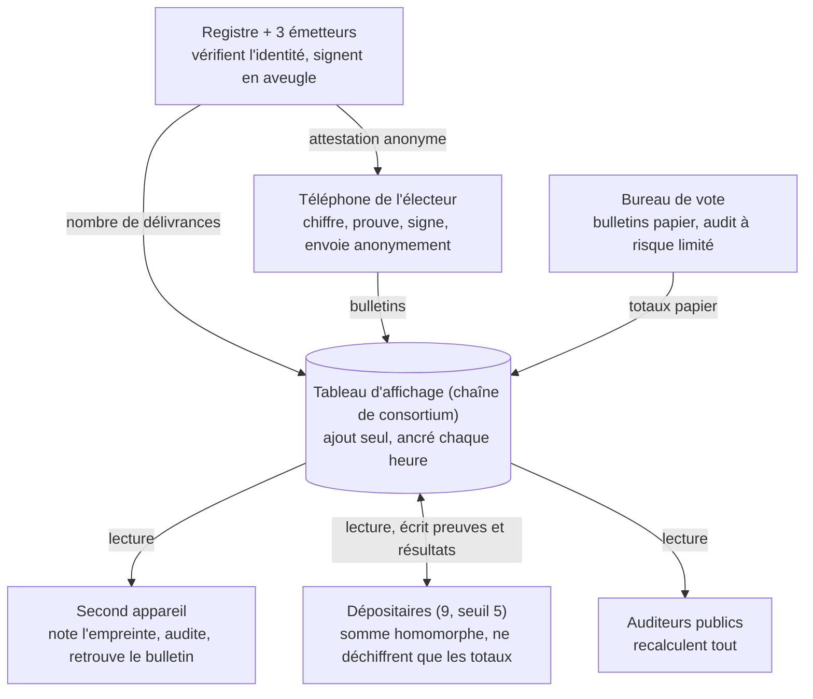

# Système de vote vérifiable de bout en bout : proposition de conception

[English](en.md) · [简体中文](zh-CN.md) · **Français** · [Русский](ru.md) · [Español](es.md) · [العربية](ar.md) · [日本語](ja.md) · [한국어](ko.md)

Dernière mise à jour : 2026-11-08

## Vue d'ensemble

Cette conception vise la fraude à grande échelle : bulletins fabriqués, bulletins supprimés ou modifiés, dépouillement falsifié, logiciels malveillants sur des téléphones en masse et achat de votes organisé. L'électeur associe une fois son téléphone, reçoit avant chaque scrutin une attestation d'éligibilité valable pour ce seul scrutin, et vote sur son téléphone en quelques minutes. La chaîne ne publie que des chiffrés, chacun peut recalculer le résultat, et chaque électeur peut vérifier que son bulletin n'a été ni modifié ni supprimé et qu'il a été compté. Les cas isolés, comme un électeur contraint en personne par un proche, ne font pas l'objet d'une conception spécifique : ils relèvent du droit existant, en échange d'un processus plus simple et plus rapide.

**Objectifs**

- **Vérifiable publiquement :** chacun peut recalculer le résultat de façon indépendante à partir des données de la chaîne et d'outils libres.
- **Vérifiable individuellement :** chaque électeur peut confirmer que son bulletin a été enregistré tel quel, ni modifié ni supprimé, et inclus dans le décompte.
- **Secret du vote :** les bulletins ne peuvent pas être reliés aux identités, mathématiquement, même si le chiffrement est cassé à l'avenir.
- **Résistance à la fraude massive :** toute fraude à grande échelle (fabriquer, supprimer, modifier ou acheter des votes) est soit impossible, soit forcément détectée.
- **Efficacité :** téléphone associé une fois ; attestation de chaque scrutin obtenue automatiquement ; vote en quelques minutes ; résultats vérifiables quelques heures après la clôture.

**Principes**

- **Séparation des pouvoirs :** chaque opération sensible est répartie entre des institutions qui se contrôlent mutuellement. Abuser exige une collusion, et la collusion laisse des traces.
- **Des preuves, pas de la confiance :** chaque étape est accompagnée d'une preuve mathématique vérifiable par tous.
- **Détecter la fraude massive par la statistique :** inutile que tout le monde vérifie ; des contrôles aléatoires par une petite fraction des électeurs empêchent de cacher une fraude massive.
- **La blockchain n'est qu'un tableau d'affichage :** elle garantit que les données publiées ne changent plus ; elle n'assure pas la sécurité avant publication.
- **Le papier en dernier recours :** les bureaux de vote conservent le bulletin papier et l'audit humain.

## Méthodes de fraude courantes et réponses

Le tableau suit les catégories habituelles des affaires de fraude électorale aux États-Unis. Le canal en ligne élimine le double vote, le bourrage d'urnes, la falsification du décompte et les bulletins jetés ; l'usurpation d'identité et l'achat de votes sont fortement réduits ; la qualité des listes électorales et la contrainte en personne exigent encore des mesures traditionnelles.

| Méthode | Pratique typique | Réponse de cette conception | Effet |
| --- | --- | --- | --- |
| Double vote | S'inscrire dans plusieurs États ou comtés et voter dans chacun ; voter en ligne puis au bureau de vote | Une attestation par personne et par scrutin, les États partageant les empreintes d'identité des électeurs servis pour détecter les doublons ; la chaîne n'accepte qu'un bulletin par attestation ; les détenteurs d'une attestation ne peuvent voter qu'à titre provisoire au bureau | Éliminé |
| Usurpation d'identité | Utiliser l'identité d'inscrits qui ne votent pas ou de personnes décédées | Vérification d'identité à l'association du téléphone ; contrôle facial de vivacité à chaque délivrance ; chacun peut vérifier s'il est noté comme servi | Fortement réduite ; la victime peut la découvrir |
| Fausses inscriptions, électeurs fantômes | Inscrire de faux noms, de fausses adresses ou des décédés, puis voter à leur place | Listes reliées aux registres de décès, de départ et de nationalité ; délivrance avec pièce d'identité et contrôle de vivacité ; nombre d'attestations par circonscription publié en temps réel et comparé à la population et à la participation passée | Anomalies détectables ; la qualité des listes reste à gérer |
| Vote d'inéligibles | Non-citoyens, non-résidents ou personnes privées du droit de vote | Éligibilité revérifiée sur la liste la plus récente à chaque délivrance | Aussi bonne que les listes |
| Fraude au vote par correspondance, collecte illégale | Demander les bulletins d'autrui, falsifier des signatures, collecter des bulletins puis les modifier ou les jeter | Aucun intermédiaire en ligne : l'attestation est verrouillée dans le téléphone de l'électeur, exige un contrôle de vivacité, et il n'y a pas de bulletin papier à intercepter | Éliminée en ligne |
| Achat de votes | Payer des électeurs et exiger une preuve | Pas de reçu ; attestation non exportable du téléphone ; seule l'application officielle est acceptée | Difficile à industrialiser |
| « Aide » illégale, contrainte en personne | Remplir le bulletin de personnes âgées, handicapées ou ne maîtrisant pas la langue sous prétexte d'aider | Vote soumis au contrôle de vivacité de l'électeur ; la surveillance en personne n'est pas spécifiquement empêchée | Atténuée en partie |
| Bourrage par le personnel | Ajouter des bulletins ou voter pour des absents | Le personnel n'a pas d'attestation et ne peut créer de bulletin valide ; les bulletins en ligne valides ne peuvent dépasser les attestations délivrées, comparaison publique | Éliminé en ligne |
| Bulletins jetés ou détruits | Jeter ou cacher des bulletins avant le dépouillement | Données de la chaîne non effaçables et ancrées à l'extérieur ; l'électeur retrouve son bulletin par son empreinte ; un accusé signé prouve la réception | Forcément détecté |
| Falsification du décompte | Modifier les chiffres d'un bureau ou de l'agrégation | Le décompte est une somme homomorphe publique de tous les chiffrés, recalculable par tous ; le déchiffrement est accompagné d'une preuve | Éliminée |
| Piratage des appareils ou du système de décompte | Modifier le logiciel pour changer bulletins ou résultats | Côté téléphone : détecté par audits aléatoires ; côté serveur : tout résultat se recalcule à partir des données publiques, sans faire confiance à aucun serveur | Falsification massive forcément détectée |
| Empêcher des électeurs légitimes de voter | Radier sans motif ou refuser l'attestation | L'électeur peut vérifier son inscription et sa délivrance ; tout refus est motivé et contestable ; les radiations par circonscription sont publiées | Détectable |

Hors champ : fausses signatures sur des pétitions de candidature, infractions au financement des campagnes, désinformation, etc., sans lien avec le vote et le dépouillement. Catégories inspirées de la [base de données de la Heritage Foundation](https://electionfraud.heritage.org/categories) et de l'[enquête News21](https://www.pewtrusts.org/en/research-and-analysis/articles/2012/08/30/election-fraud).

### Les cinq principes sous-jacents

1. **Attestations anonymes (signatures aveugles) : empêcher le double vote sans révéler le choix.** Imaginez une carte numérotée glissée dans une enveloppe carbone que l'émetteur tamponne : le tampon s'imprime sur la carte, mais l'émetteur ne voit jamais le numéro. À la délivrance, le registre sait qu'« Alice a reçu la sienne », elle ne peut donc pas en obtenir une seconde ; au vote, seuls la carte et le tampon sont montrés, et personne ne sait à qui appartient la carte.
2. **Une attestation, un bulletin, imposé sur la chaîne : les votes répétés sont rejetés.** Chaque bulletin est publié avec la clé publique de l'attestation. Si la même clé réapparaît, tous les nœuds la rejettent selon la même règle publique ; aucun nœud ne peut faire d'exception.
3. **Décompte homomorphe : le total sans ouvrir aucun bulletin.** Chaque bulletin est comme une boîte verrouillée dotée d'une propriété spéciale : empiler toutes les boîtes donne une nouvelle boîte contenant exactement le total. Tout le monde peut faire l'empilement, le décompte est donc recalculable publiquement ; il faut au moins 5 dépositaires ensemble pour ouvrir cette seule boîte des totaux, avec une preuve mathématique que l'ouverture est honnête.
4. **Audits aléatoires : un téléphone qui triche n'a nulle part où se cacher.** Le téléphone remet d'abord la boîte verrouillée ; vous notez son empreinte sur un second appareil, puis décidez de la déposer ou de l'ouvrir sur place. Le téléphone ignore votre choix à l'avance : tricher est un pari, et plus il triche, plus la probabilité d'être pris approche 100 %.
5. **Données publiques, ancrage externe et rapprochement des comptes : suppressions et bulletins en trop laissent des traces.** Tout le monde peut télécharger les données ; chaque heure, leur empreinte est publiée sur des blockchains publiques externes et dans la presse, toute réécriture ultérieure ne correspond plus ; des contrôles publics comme « bulletins en ligne ≤ attestations délivrées » ne laissent aucune place aux bulletins fabriqués.

## Modèle de menace et hypothèses de confiance

Chaque fraude capable d'opérer à grande échelle est traitée : l'exactitude du résultat ne dépend de l'honnêteté de personne, et l'anonymat repose sur les mathématiques, pas sur la retenue des institutions.

| Fraude à grande échelle | Auteurs possibles | Réponse |
| --- | --- | --- |
| Fabriquer des bulletins, délivrer des attestations à des personnes inexistantes | Initiés | Signatures aveugles conjointes de 3 émetteurs ; nombre de délivrances publié et comparé aux attestations utilisées ; l'électeur peut vérifier s'il est noté comme servi |
| Supprimer ou modifier bulletins ou décomptes | Initiés, pirates | Données publiques ancrées à l'extérieur ; décompte homomorphe recalculable par tous ; vérification par empreinte |
| Logiciels malveillants modifiant les votes en masse | Pirates, acteurs étrangers | Audits aléatoires au moment du vote ; empreinte notée d'abord sur un second appareil |
| Achat de votes organisé | Groupes politiques, groupes d'intérêts | Pas de reçu ; attestation verrouillée dans la puce sécurisée ; application officielle uniquement |
| Mise hors service | Pirates | Nœuds multipartites, 14 jours de vote, bureaux de vote en secours |
| Consulter ou divulguer les résultats avant l'heure | Dépositaires en collusion | Seuil 5 sur 9 ; seuls les totaux sont déchiffrés, après la clôture |
| Non traité spécifiquement : électeurs contraints en personne | — | Droit existant ; ajouter si besoin la section « Module optionnel : résistance à la coercition » |

**Hypothèses de confiance**

- **Anonymat :** garanti par les signatures aveugles ; les attestations ne peuvent être reliées aux identités, quelle que soit l'honnêteté des institutions, et les ordinateurs quantiques n'y changent rien. Suppose que les relais anonymes ne conservent pas de journaux.
- **Intégrité :** ne dépend de personne. Même si toutes les institutions sont complices, la falsification est révélée par la vérification publique.
- **Délivrance :** les 3 émetteurs et le registre ne seront pas tous complices ; s'ils le sont, les attestations en trop sont révélées par le rapprochement des comptes.
- **Disponibilité de la chaîne :** au moins deux tiers des nœuds sont honnêtes. Au-delà d'un tiers de nœuds malveillants, ils ne peuvent que bloquer le service, pas forger de bulletins ni réécrire l'historique.
- **Téléphones :** chaque téléphone n'est pas garanti sain, mais une falsification massive sera détectée par les audits.

## Rôles et séparation des pouvoirs

Le tort qu'un rôle peut causer seul est borné ; la dernière colonne sert de test à la séparation des pouvoirs.

| Rôle | Qui | Missions | Le pire qu'il puisse faire seul |
| --- | --- | --- | --- |
| Électeur | Citoyen éligible | S'inscrire, voter, auditer, vérifier | N'affecter que son propre vote |
| Registre | Bureaux électoraux existants | Vérifier identité et éligibilité ; noter qui a reçu l'attestation du scrutin | Refuser une délivrance (vérifiable, contestable) |
| Émetteurs d'attestations (3) | Bureau électoral et un émetteur désigné par chaque grand parti | Signer en aveugle les attestations anonymes | Ne peut produire seul une attestation valide ; ne voit pas son contenu |
| Dépositaires (9, seuil 5) | Grands partis, organes électoraux indépendants, tribunaux, universités | Détenir des parts de la clé ; déchiffrer ensemble les totaux après la clôture | Rien |
| Nœuds du consortium (21+) | Organes électoraux des États, partis, universités, médias, observateurs | Vérifier et stocker les bulletins ; signer conjointement les accusés | Bloquer le service ; ne peut forger ni réécrire |
| Relais anonymes (plusieurs) | Opérateurs indépendants distincts des précédents | Transmettre les bulletins, masquer l'adresse IP | Aucun relais ne voit le chemin complet |
| Bureaux de vote | Bureaux existants | Vote papier, assistance | Affecter le service local ; le papier est auditable |
| Auditeurs publics | Tout le monde | Télécharger les données, recalculer | Aucun droit d'écriture |
| Développeurs | Communauté libre et organismes de certification | Développer, auditer, compilation reproductible | Un code malveillant est repéré par les audits et la revue publique |

## Composants cryptographiques

Tous les composants sont éprouvés, bien étudiés et disposent d'implémentations publiques ; aucune cryptographie nouvelle n'est inventée. Par rapport à une conception résistante à la coercition, les parties les plus lourdes (réseaux de mélange et filtrage des fausses attestations) sont supprimées.

| Composant | Usage | Rôle |
| --- | --- | --- |
| ElGamal exponentiel (homomorphe) | Bulletins | Les chiffrés s'additionnent directement ; seuls les totaux sont déchiffrés, jamais un bulletin |
| Génération distribuée de clé + déchiffrement à seuil (5/9) | Clé du scrutin | Personne ne détient la clé privée complète |
| Signatures aveugles (3 émetteurs) | Attestation anonyme du scrutin | Les émetteurs signent sans voir l'attestation ; aucun lien mathématique avec l'identité |
| Puce sécurisée + attestation d'application | Clé privée de l'attestation | Clé non exportable ; seule l'application officielle peut l'utiliser |
| Signatures de Schnorr | Chaque bulletin | Seul le détenteur peut voter ; une seule fois par attestation |
| Preuves à divulgation nulle | Validité du bulletin, exactitude du déchiffrement | Prouver « exactement le nombre de choix permis par élection » et « déchiffrement honnête » sans révéler le contenu |
| Défi de Benaloh | Au moment du vote | Le téléphone ignore si le bulletin sera déposé ou audité, tricher fait courir le risque d'être pris |
| Hachages et arbres de Merkle | Empreintes de bulletin, ancrage externe | Empreintes : un octet modifié et rien ne correspond |

## Déroulement complet

Un scrutin compte sept étapes : préparation, association du téléphone (une fois), attestation du scrutin, vote et audit, vérification, dépouillement, audit public. Le résultat de chaque étape est publié sur la chaîne pour que chacun puisse le vérifier.

Le registre, les téléphones et les bureaux de vote écrivent sur la chaîne ; les seconds appareils et le public lisent seulement ; les dépositaires lisent puis réécrivent les preuves de déchiffrement et les résultats.

### 1. Préparation (environ 60 jours avant le vote)

1. **Cérémonie des clés :** 9 dépositaires réalisent la génération distribuée de clé en direct public. La clé publique est publiée ; chacun garde une part de la clé privée dans un module matériel de sécurité.
2. **Paramètres sur la chaîne :** élections et candidats, période de vote, règles de validation, empreintes de chaque version logicielle.
3. **Publication des logiciels :** application de vote, outils de vérification et vérificateur de décompte en code libre avec compilation reproductible, audités par plusieurs organismes indépendants avec rapports publics.
4. **Tests publics :** scrutins fictifs complets et programme de prime aux bogues.

### 2. Association du téléphone (une fois, 4 ans maximum)

1. **Contrôle d'identité :** l'électeur présente une pièce d'identité dans un bureau électoral, un service des permis ou un bureau de poste ; le personnel la rapproche de l'inscription. Ou en ligne avec un code d'activation envoyé par courrier à l'adresse d'inscription et un numéro de pièce.
2. **Association :** l'application crée une clé d'identité de long terme dans la puce sécurisée ; la clé privée n'est pas exportable. Le registre délivre un certificat d'identité de long terme, qui prouve seulement que « ce téléphone appartient à cette personne » et ne confère pas le droit de vote.
3. **Validité :** 4 ans au plus ou jusqu'à expiration de la pièce d'identité, puis nouveau contrôle.
4. **Révocation automatique :** quand un électeur est retiré des listes (décès, départ de l'État, perte de nationalité, décision de justice, etc.), le certificat est révoqué. Les listes sont reliées aux registres de décès, de départ et de nationalité.
5. **Nouveau téléphone :** migration dans n'importe quel bureau ou autorisation depuis l'ancien téléphone ; l'ancien certificat est révoqué.

Les électeurs qui ne veulent pas utiliser de téléphone n'ont pas à s'inscrire et votent sur papier comme d'habitude.

### 3. Attestation du scrutin (à chaque scrutin, valable pour lui seul)

1. **Nouvelle clé :** avant l'ouverture, l'application génère dans la puce une nouvelle paire de clés propre à ce scrutin.
2. **Contrôle de vivacité :** l'application utilise la caméra frontale et compare le visage à la photo de la pièce, pour s'assurer que l'électeur lui-même opère et empêcher qu'autrui utilise le téléphone d'une personne décédée ou inéligible.
3. **Nouvelle vérification d'éligibilité :** l'application prouve l'identité au registre avec le certificat ; le registre revérifie l'éligibilité sur la liste la plus récente et note « attestation délivrée ». Une par personne et par scrutin ; les États partagent les empreintes d'identité des électeurs servis, de sorte qu'une personne inscrite dans plusieurs États n'en obtient qu'une.
4. **Signatures aveugles :** les 3 émetteurs signent en aveugle la nouvelle clé publique sans la voir ; personne ne peut relier attestation et identité.
5. **Attestation obtenue :** la clé publique et les 3 signatures forment l'attestation anonyme, valable pour ce seul scrutin ; elle expire à la fin du scrutin. Le tout prend environ une minute.
6. **Comptes publics :** le nombre de délivrances par circonscription est publié en temps réel. Chaque électeur peut vérifier s'il est noté comme servi ; si c'est le cas sans demande de sa part, quelqu'un a usurpé son identité.

### 4. Vote et audit (14 jours)

1. **Choisir :** l'électeur choisit ses candidats pour chaque élection.
2. **Noter l'empreinte :** l'application chiffre les choix et affiche un QR code d'empreinte. L'électeur le scanne avec un second appareil ou note ses 8 premiers caractères. Cette étape doit précéder la suivante.
3. **Déposer ou auditer :**
    - **Auditer :** l'application révèle l'aléa de chiffrement ; le second appareil ouvre le chiffré et vérifie que le contenu correspond au choix et que l'empreinte correspond à celle notée. Le bulletin audité est annulé et l'électeur revient à l'étape 1.
    - **Déposer :** l'application joint une preuve à divulgation nulle, signe avec l'attestation, envoie via les relais anonymes, puis détruit l'aléa.
4. **Sur la chaîne :** les nœuds vérifient les signatures, la preuve, la période de vote et que l'attestation n'a pas encore voté. Le bulletin n'est inscrit qu'à ces conditions, et un accusé signé conjointement par les nœuds est renvoyé.
5. **Une attestation, un bulletin :** un bulletin déposé ne peut être modifié ; un logiciel malveillant ne peut donc pas revoter discrètement ensuite.

### 5. Vérification par l'électeur

| Quand | Ce qui est confirmé | Comment |
| --- | --- | --- |
| Pendant le vote | Le téléphone n'a pas modifié le bulletin | Auditer au moins une fois avant de déposer ; le téléphone ne peut prévoir si vous le ferez |
| À tout moment après | Bulletin sur la chaîne, ni supprimé ni remplacé | Rechercher l'empreinte notée sur un second appareil ou un site public de consultation |
| Après le dépouillement | Bulletin compté | Votre empreinte figure dans l'ensemble d'entrée, et toutes les preuves de décompte et de déchiffrement sont valides |
| En cas de litige | Preuves | Saisir la commission des litiges électoraux avec l'accusé et les données de la chaîne |

### 6. Dépouillement (quelques heures après la clôture)

1. **Gel :** la hauteur de bloc à l'heure limite est publiée ; plus aucun bulletin en ligne n'est accepté.
2. **Contrôle des règles :** vérification publique que chaque attestation a exactement un bulletin et 3 signatures valides.
3. **Somme homomorphe :** multiplier tous les bulletins valides par élection pour obtenir les totaux chiffrés. Chacun peut le calculer.
4. **Déchiffrer les totaux :** au moins 5 dépositaires déchiffrent ensemble le total de chaque élection, avec preuves d'exactitude. Aucun bulletin n'est jamais déchiffré individuellement.
5. **Rapprochement :** les bulletins en ligne valides ne peuvent dépasser les attestations délivrées ; les délivrances par circonscription sont comparées aux inscriptions et à la participation passée, toute anomalie donne lieu à enquête.
6. **Publication :** totaux par élection et toutes les preuves, combinés aux résultats papier des bureaux de vote.

### 7. Audit public

- **Recalcul indépendant :** chacun peut télécharger les données avec le vérificateur libre et refaire les contrôles d'attestation, la somme et la vérification du déchiffrement.
- **Rapports multipartites :** partis, médias, universités et autres organismes indépendants publient leur propre rapport dans les 24 heures.
- **Audit papier :** audits à risque limité sur le canal des bureaux de vote, en comparant un échantillon de bulletins papier aux comptages électroniques.
- **Surveillance des anomalies :** audits échoués signalés et délivrances par circonscription publiés par région ; une concentration d'anomalies déclenche une enquête.
- **La puissance statistique des audits :** si 1 % des bulletins, tirés au hasard, sont audités, la probabilité de modifier 1 000 bulletins sans que personne ne s'en aperçoive est d'environ 0,004 %. Cela suppose que le téléphone ne puisse prévoir qui auditera ; l'application n'enregistre ni ne signale donc si un électeur a audité.

## Questions clés et solutions

La fraude massive suit cinq voies principales ; voici pourquoi chacune échoue ici. Les derniers points concernent l'exploitation.

### Fabriquer des bulletins

- Une attestation exige la signature des 3 émetteurs ; aucun ne peut en créer seul.
- Même si les 3 émetteurs et le registre s'entendent pour créer des attestations en trop, il n'y a que deux issues : les attestations utilisées dépassent les délivrances enregistrées, ou de vrais électeurs s'entendent dire « déjà délivrée ». Les deux sont révélées.
- Les délivrances par circonscription sont publiques en temps réel et comparées aux inscriptions et à la participation passée ; les circonscriptions anormales font l'objet d'enquêtes.
- **Les électeurs fantômes** (décédés ou partis mais toujours inscrits) touchent aussi le vote par correspondance actuel, et une blockchain ne peut rien y faire. Cette conception relie les listes aux registres de décès, de départ et de nationalité, revérifie la liste et fait un contrôle de vivacité à chaque délivrance, et cible les circonscriptions au taux de délivrance anormalement élevé.

### Supprimer ou modifier bulletins ou résultats

- Les données sont publiques et ancrées à l'extérieur chaque heure ; toute modification ne correspond plus aux ancrages.
- L'électeur retrouve son bulletin par l'empreinte notée ; s'il manque, l'accusé prouve la réception.
- Le décompte est une somme homomorphe publique recalculable par tous ; les dépositaires ne déchiffrent que les totaux, avec preuves.

### Logiciels malveillants en masse

- **Audits :** en chiffrant, le téléphone ignore si le bulletin sera déposé ou audité ; tricher fait courir le risque d'être détecté, et plus il triche, plus la détection est sûre.
- **Empreinte d'abord :** l'empreinte doit être notée sur un second appareil avant le choix entre dépôt et audit ; sinon le téléphone pourrait déposer discrètement un bulletin et vous en montrer un autre pour l'audit.
- **Une attestation, un bulletin :** impossible de modifier après dépôt, donc pas de second vote discret.
- **Réaction :** dès qu'un audit échoué est confirmé, il est rendu public, la version de l'application concernée est gelée et les électeurs touchés votent au bureau.

### Achat de votes organisé

L'achat de votes organisé est une fraude à grande échelle qu'on ne peut ignorer comme la coercition individuelle. Sans mécanisme lourd, on peut tout de même le rendre difficile à industrialiser :

- **Pas de reçu :** l'électeur n'obtient rien qui prouve son vote. L'audit ne montre que des bulletins annulés ; l'aléa du bulletin déposé est détruit immédiatement.
- **Attestation non exportable :** la clé est verrouillée dans la puce sécurisée ; vendre son vote revient à remettre le téléphone lui-même. Manipuler des milliers de téléphones de façon centralisée est difficile à cacher.
- **Application officielle uniquement :** l'attestation ne fonctionne que dans l'application officielle attestée ; les acheteurs ne peuvent pas créer une version modifiée produisant des reçus.
- **Risque résiduel :** un acheteur qui surveille le vendeur en personne paie cher et ne peut guère industrialiser ; cela relève du droit existant.

### Déni de service

- Avec 14 jours de vote, une journée de panne ne décide de rien.
- Seuls les bulletins avec une attestation valide sont traités ; le reste est rejeté à l'entrée, la vérification coûte peu.
- Les nœuds sont répartis entre plusieurs fournisseurs cloud et centres de données propres ; les données en lecture sont servies par des miroirs.
- Si le canal en ligne est indisponible, les bureaux de vote prennent le relais ; une attaque massive avant la clôture entraîne une prolongation légale.

### Collusion des dépositaires

- Déchiffrer quoi que ce soit exige 5 des 9 dépositaires.
- Même en déchiffrant un bulletin, ils n'apprennent que le vote d'une attestation anonyme, pas son auteur.
- Le principal risque est de consulter des résultats intermédiaires. Le déchiffrement n'a lieu qu'après la clôture ; les parts de clé sont dans des modules matériels de sécurité et chaque usage est consigné sur la chaîne.

### Confidentialité à long terme

- L'impossibilité de relier une signature aveugle est mathématiquement absolue. Même si un ordinateur quantique casse un jour le chiffrement, il ne révélera que les votes d'attestations anonymes, pas leurs auteurs.
- Hypothèse clé : les relais anonymes ne conservent pas de journaux ; ils sont gérés par plusieurs opérateurs indépendants dont aucun ne voit le chemin complet.

### Téléphone perdu et double vote

- Perdu avant d'avoir reçu l'attestation du scrutin : se réinscrire et l'obtenir normalement.
- Perdu après : l'attestation exige le code ou la biométrie du téléphone, inutilisable par qui le trouve. L'électeur peut voter à titre provisoire au bureau ; ces votes provisoires sont publiés par circonscription et toute concentration fait l'objet d'une enquête.
- La liste indique si chacun a reçu l'attestation du scrutin. Ceux qui l'ont reçue ne peuvent voter qu'à titre provisoire au bureau ; les autres votent normalement sur papier.

### Litiges

- **Bulletin manquant :** l'accusé est signé conjointement par les nœuds ; le système ne peut le nier.
- **Audit au contenu incorrect :** l'enregistrement d'audit sur le second appareil prouve publiquement ce que ce bulletin chiffrait réellement, mais pas ce que l'électeur avait choisi ; les enquêtes dépendent donc du nombre et de la répartition des signalements.
- **Valeur juridique :** la force probante des données de la chaîne et des accusés doit être fixée par la loi.

### Facilité d'utilisation

- Téléphone associé une fois ; l'attestation de chaque scrutin prend environ une minute ; voter et auditer une fois prend quelques minutes.
- Lecteurs d'écran, plusieurs langues et grands caractères ; sans second appareil, on peut emprunter celui d'un proche ou utiliser les bornes publiques des bureaux de vote.
- Quiconque ne peut ou ne veut pas utiliser de téléphone peut toujours voter sur papier.

## Chaîne de consortium et infrastructure

On utilise une chaîne de consortium multipartite, pas une chaîne publique. Elle n'est ici qu'un tableau d'affichage en ajout seul ; un journal en ajout seul répliqué indépendamment par plusieurs parties offrirait presque la même sécurité.

- **Consensus :** tolérant aux fautes byzantines (par ex. HotStuff), supportant moins d'un tiers de nœuds malveillants, blocs d'environ 2 secondes.
- **Nœuds :** 21 ou plus, tenus par des organes électoraux des États, grands partis, universités, médias et observateurs, aucune catégorie au-delà d'un tiers.
- **Règles d'écriture :** seuls sont acceptés les bulletins avec attestation valide, signature et preuve valides, dans la période de vote, venant d'une attestation qui n'a pas encore voté ; tout le reste est rejeté. Les nœuds ne peuvent décider seuls d'accepter ou non un bulletin valide.
- **Lecture publique :** chacun peut télécharger toutes les données ; plusieurs sites miroirs existent.
- **Ancrage externe :** chaque heure, la racine de Merkle de l'état de la chaîne est inscrite sur plusieurs blockchains publiques et publiée dans des annonces de presse. Même si tous les nœuds s'entendent pour réécrire l'historique, cela ne correspondra plus aux ancrages.
- **Estimation de capacité (approximative) :** environ 150 millions de bulletins d'environ 5 Ko (preuves comprises), soit environ 750 Go, stockables sur un serveur ordinaire. Sur 14 jours, environ 124 bulletins par seconde en moyenne ; dimensionner pour des pics de 10× donne environ 1 200 par seconde, la vérification se parallélise.
- **Vitesse du décompte :** la somme homomorphe est une simple multiplication en lot et seuls les totaux sont déchiffrés ; les résultats sont disponibles quelques heures après la clôture.

**Pourquoi pas une chaîne publique :**

- **Confidentialité :** les transactions publiques exigent frais et comptes, qui peuvent exposer l'identité des électeurs.
- **Coût et congestion :** frais et délais de confirmation imprévisibles lors des pics électoraux.
- **Gouvernance :** des mineurs ou validateurs anonymes ne doivent pas décider si des données électorales sont publiées.

## Feuille de route

Commencer par de petits scrutins à faible risque et ne passer à l'étape suivante qu'après en avoir franchi le seuil. Le canal en ligne complète toujours les bureaux de vote, il ne les remplace jamais.

1. **Prototype et revue publique (environ année 1)**
    - Implémentation libre, article de conception, prime aux bogues.
    - Seuil : audit cryptographique indépendant réussi, aucune vulnérabilité grave non corrigée.
2. **Scrutins fictifs (environ années 1–2)**
    - Élections internes d'associations étudiantes, d'organisations locales, de syndicats, etc.
    - Seuil : taux d'audit, taux de signalements d'anomalies et tests d'utilisabilité conformes aux objectifs.
3. **Petits pilotes officiels (environ années 2–3)**
    - Électeurs à l'étranger, militaires et électeurs handicapés, en complément du vote par correspondance existant.
    - Seuil : aucun écart de comptage inexpliqué.
4. **Canal complémentaire pour les élections locales (environ années 3–5)**
    - Élections de comté et municipales, en parallèle du canal papier.
5. **Extension éventuelle**
    - Décidée selon les données des pilotes et la loi. Nécessite une loi de l'État et une certification selon les normes fédérales des systèmes de vote.

## Module optionnel : résistance à la coercition

Désactivé par défaut. Si l'on juge plus tard utile de prévenir la coercition individuelle, on peut ajouter les modules ci-dessous, au prix d'un processus nettement plus lent et plus complexe.

| Module | Ce qu'il résout | Coût |
| --- | --- | --- |
| Délivrance en isoloir | Un contraignant ne peut surveiller la délivrance | Un déplacement à chaque scrutin |
| Fausses attestations | Sous pression, remettre une fausse attestation identique d'apparence ; ses bulletins sont retirés discrètement au dépouillement | Dépouillement par mélange et filtrage, beaucoup plus lent ; conception bien plus complexe |
| Revote, seul le dernier compte | Après un vote sous contrainte, l'électeur peut le changer | Un logiciel malveillant peut aussi revoter discrètement, d'où des grilles papier de codes de retour et une surveillance continue sur un second appareil |
| Annulation du vote en ligne au bureau | Le jour du scrutin, annuler l'attestation en ligne au bureau et voter sur papier | Les annulations doivent rester cachées, sinon le contraignant les voit |

Ces modules ne fonctionnent qu'ensemble ; en ajouter un seul a un effet limité.

## Risques résiduels et systèmes de référence

Cette conception garantit que fabrication, suppression et modification massives seront détectées et rend l'achat de votes organisé difficile à industrialiser, mais certains risques ne peuvent être totalement éliminés.

**Risques résiduels**

- **Dépend d'électeurs qui auditent vraiment :** avec trop peu d'audits, une falsification à petite échelle peut passer ; une falsification massive est presque impossible à cacher.
- **Qualité des listes :** une blockchain ne résout pas les électeurs fantômes ; cela repose sur la tenue des listes et la surveillance des anomalies.
- **Dépendance aux plateformes :** puces sécurisées et attestation d'application dépendent de plateformes comme Apple et Google, ce qui exige des solutions de repli et un encadrement réglementaire.
- **La complexité déplace la confiance :** le public ne peut lire ces preuves et finit par faire confiance aux experts qui les ont vérifiées ; les auditeurs indépendants doivent donc être divers et transpartisans.
- **Pas de trace papier en ligne :** pas de recomptage manuel traditionnel ; on s'appuie sur les preuves cryptographiques.
- **Avis des experts :** la communauté de la sécurité informatique est largement prudente vis-à-vis du vote par internet, jugeant la sécurité des terminaux difficile à garantir avec les technologies actuelles ; beaucoup d'experts privilégient encore le bulletin papier rempli à la main.

**Systèmes de référence**

- **Helios, Belenios :** systèmes universitaires de vote par internet vérifiables de bout en bout ; le décompte homomorphe et l'audit sont les mêmes ici.
- **ElectionGuard :** boîte à outils libre de Microsoft pour la vérifiabilité de bout en bout, utilisée pour le décompte chiffré en bureau de vote.
- **JCJ / Civitas :** recherche fondatrice sur la résistance à la coercition par fausses attestations, correspondant à la section « Module optionnel : résistance à la coercition ».
- **Vote par internet en Estonie :** revote, bulletin papier le jour du scrutin prévalant sur le vote en ligne, vérification sur un second appareil.
- **Vote électronique en Suisse :** grilles papier de codes de retour contre la falsification par l'appareil.
