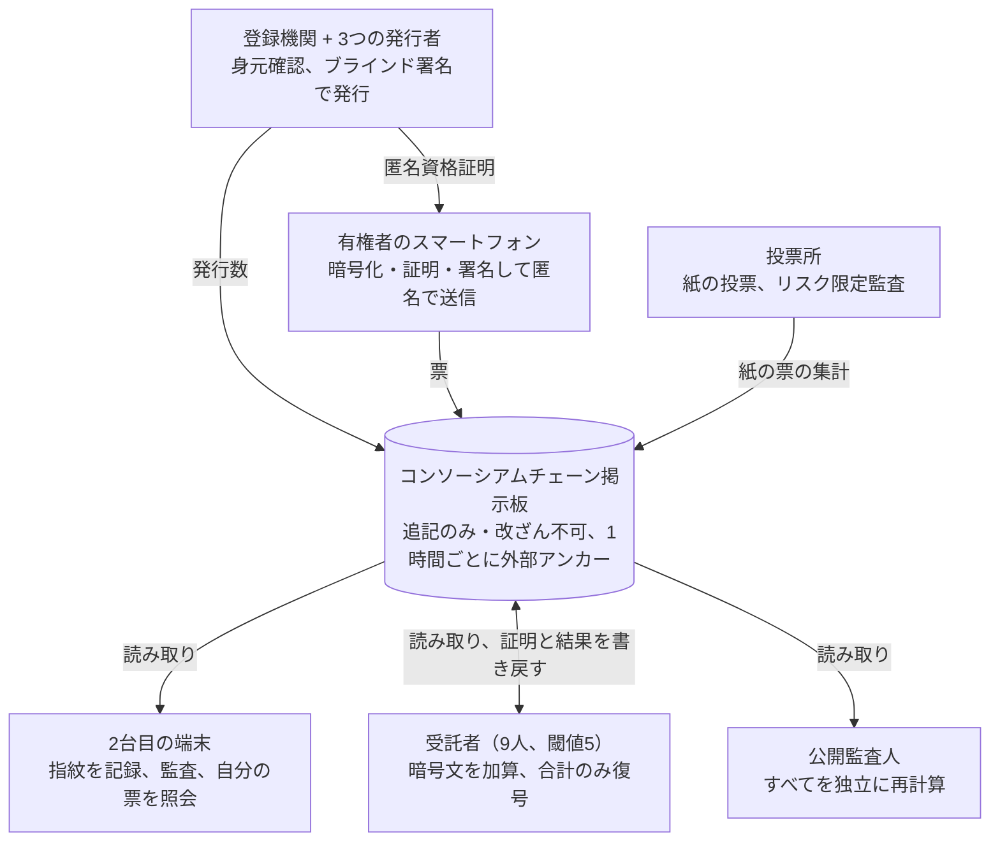

# エンドツーエンド検証可能な投票システム 設計案

[English](en.md) · [简体中文](zh-CN.md) · [Français](fr.md) · [Русский](ru.md) · [Español](es.md) · [العربية](ar.md) · **日本語** · [한국어](ko.md)

最終更新：2026-11-08

## 概要

本設計は大規模な不正の防止を目的とする。対象は、架空の票の作成、票の削除や改ざん、集計結果の改ざん、スマートフォンへの大規模なマルウェア感染、組織的な買票である。有権者はスマートフォンを一度だけ登録し、選挙ごとにその選挙限りで有効な資格証明を受け取り、スマートフォンで数分のうちに投票する。チェーン上に公開されるのは暗号文だけで、誰でも結果を再計算できる。有権者は自分の票が改ざんも削除もされず、集計に含まれたことを確認できる。家族などによる対面での強要のような個別の偶発的ケースには専用の仕組みを設けず、現行法に委ねることで、より簡単で速い手続きを実現する。

**設計目標**

- **公開検証可能性：** 誰でもチェーン上のデータとオープンソースのツールで、結果を独立に再計算できる。
- **個人検証可能性：** 有権者は自分の票が投じた通りに記録され、改ざんも削除もされず、集計に含まれたことを確認できる。
- **秘密投票：** 票と身元は数学的に結びつけられない。将来暗号が破られても同じである。
- **大規模不正への耐性：** 規模を伴う不正（票の作成・削除・改ざん・買収）は、不可能であるか、必ず発見される。
- **効率性：** スマートフォンの登録は一度だけ。各選挙の資格証明は自動で受け取れ、投票は数分、締め切り後数時間で検証可能な結果が出る。

**基本原則**

- **権力分立：** 敏感な操作はすべて、互いに牽制する複数の機関に分割する。悪用には共謀が必要で、共謀すれば痕跡が残る。
- **信頼ではなく証明：** すべての手順に、誰でも検証できる数学的証明を付ける。
- **統計で大規模不正を捕らえる：** 全員が確認する必要はない。一部の有権者が無作為に確認するだけで、大規模不正は隠せなくなる。
- **ブロックチェーンは掲示板にすぎない：** 掲載後のデータが変更されないことを保証するだけで、掲載前の安全は担わない。
- **紙による保険：** 投票所では紙の投票を続け、人手による監査能力を残す。

## よくある不正手口と本設計の対応

下表は米国の選挙不正事件の一般的な分類に沿っている。オンライン経路では二重投票、票の水増し、集計改ざん、票の廃棄をなくせる。なりすましと買票は大幅に抑えられる。名簿の品質と対面での強要には、引き続き従来の手段が必要である。

| 不正手口 | 典型的なやり方 | 本設計の対応 | 効果 |
| --- | --- | --- | --- |
| 二重投票 | 複数の州や郡で登録してそれぞれ投票する。オンラインで投票した後に投票所でも投票する | 1人1選挙につき資格証明は1つ。各州が受領者の身元ハッシュを共有して州をまたぐ重複を検出する。チェーンは1つの資格証明につき1票のみ受理する。資格証明を受け取った人は投票所では暫定投票しかできない | 根絶 |
| なりすまし投票 | 投票しない登録者や死亡者の身元を使う | スマートフォン登録時に身分証を確認。資格証明の発行ごとに顔の生体確認。本人は自分が受領済みとされていないか照会できる | 大幅に抑制、被害者が発見できる |
| 虚偽登録・幽霊有権者 | 偽名、偽住所、死亡者を登録し、代わりに投票する | 名簿を死亡・転出・国籍の記録と連携。発行には身分証と生体確認が必要。選挙区ごとの発行数をリアルタイムで公開し、人口や過去の投票率と比較 | 異常は発見可能、名簿自体の管理は引き続き必要 |
| 資格のない者の投票 | 非市民、非居住者、州法上投票権のない者の投票 | 発行のたびに最新の名簿で資格を再確認 | 名簿データの品質に依存 |
| 郵便投票の不正・違法な回収 | 他人の郵便投票用紙を請求、署名を偽造、回収した票を改ざんまたは廃棄 | オンラインの票は仲介者を経由しない。資格証明は本人のスマートフォン内に固定され、生体確認がないと使えず、横取りできる紙の票もない | オンライン経路で根絶 |
| 買票 | お金を払って特定の候補者に投票させ、証拠を求める | 受領証を出さない。資格証明はスマートフォンから取り出せない。公式アプリのみ受け付ける | 大規模化が困難 |
| 違法な「介助」・対面での強要 | 手伝いを口実に高齢者、障害者、言葉に不慣れな人の票を代わりに記入する | 投票には本人の生体確認が必要。対面での監視には専用の対策はない | 一部緩和 |
| 職員による票の水増し | 投票箱に余分な票を入れる、来なかった有権者の代わりに投票する | 職員は資格証明を持たず有効な票を作れない。オンラインの有効票数は発行数を超えてはならず、公開で比較 | オンライン経路で根絶 |
| 票の廃棄・破棄 | 集計前に一部の票を捨てる、隠す | チェーン上のデータは削除できず外部にアンカーされる。有権者はフィンガープリントで自分の票を確認できる。署名付きの受理証明が受領を証明 | 必ず発見される |
| 集計・集約の改ざん | 選挙区の数字や集約段階の数字を書き換える | 集計はチェーン上の全暗号文の公開された準同型加算で、誰でも再計算できる。復号には正当性の証明が付く | 根絶 |
| 投票機器・集計システムへの侵入 | ソフトウェアを改ざんして票や結果を書き換える | スマートフォン側は無作為な監査で発見。サーバー側はすべての結果を公開データから独立に再計算でき、どのサーバーも信頼する必要がない | 大規模な改ざんは必ず発見される |
| 正当な有権者の投票妨害 | 理由なく名簿から削除する、資格証明の発行を拒否する | 有権者は自分の登録と発行の状況を照会できる。拒否には理由が必要で異議申し立てができる。選挙区ごとの削除数を公開 | 発見可能 |

対象外：候補者擁立請願の署名偽造、選挙資金の違反、偽情報など、投票と集計に関わらないもの。分類は[ヘリテージ財団の選挙不正データベース](https://electionfraud.heritage.org/categories)と[News21 の調査](https://www.pewtrusts.org/en/research-and-analysis/articles/2012/08/30/election-fraud)を参考にした。

### 背後にある5つの原理

1. **匿名の資格証明（ブラインド署名）：二重投票を防ぎつつ、誰に投票したかは明かさない。** 番号を書いたカードをカーボン紙入りの封筒に入れ、発行者が封筒の上から判を押す場面を想像してほしい。判はカードに写るが、発行者には番号が見えない。発行時に登録機関は「花子さんは受け取り済み」と分かるので2枚目は出ない。投票時に示すのはカードと判だけで、誰のカードかは誰にも分からない。
2. **1資格証明1票のチェーン上のルール：重複投票はそのまま拒否される。** すべての票は資格証明の公開鍵と一緒に掲載される。同じ公開鍵が2回目に現れると、すべてのノードが同じ公開ルールで拒否し、例外を作れるノードはない。
3. **準同型暗号による集計：1票も開けずに合計が出る。** 各票は鍵のかかった箱のようなもので、特別な性質を持つ。すべての箱を「重ねる」と、中身がちょうど合計票数の新しい箱になる。重ねる作業は誰でもできるので、集計は公開で再計算できる。最後に合計の箱1つを開けるには5人以上の受託者がそろう必要があり、「開け方に細工がない」ことの数学的証明も付ける。
4. **無作為な監査：票を書き換えるスマートフォンは逃げ場がない。** スマートフォンはまず鍵のかかった箱を差し出し、あなたは2台目の端末でそのフィンガープリントを記録してから、投じるかその場で開けて確かめるかを決める。スマートフォンにはあなたの選択が事前に分からないので、改ざんは賭けになる。改ざんする票が多いほど、発覚の確率は100%に近づく。
5. **公開データ・外部アンカー・数量照合：削除された票も余分な票も痕跡を残す。** チェーン上のデータは誰でもダウンロードできる。1時間ごとにデータのフィンガープリントを外部の公開ブロックチェーンと新聞に掲載するので、後から履歴を書き換えると一致しなくなる。「オンライン票数は発行数を超えない」といった数量関係を公開で照合するので、架空の票は隠れられない。

## 脅威モデルと信頼の前提

規模を伴いうる不正の手口ごとに対策を講じる。結果の正しさは誰の誠実さにも依存せず、票の匿名性は機関の自制ではなく数学で保証する。

| 大規模不正の手口 | 実行しうる者 | 本設計の対応 |
| --- | --- | --- |
| 架空の票の作成、存在しない人への資格証明発行 | 内部関係者 | 3者共同のブラインド署名。発行数をリアルタイムで公開し、チェーン上の使用数と照合。有権者は自分が受領済みとされていないか照会できる |
| 票の削除・改ざん、集計結果の改ざん | 内部関係者、ハッカー | チェーン上で公開し外部にアンカー。準同型集計は誰でも再計算可能。有権者は票のフィンガープリントで確認 |
| スマートフォンの大規模感染による票の改ざん | ハッカー、外国勢力 | 投票時の無作為な監査。2台目の端末でフィンガープリントを先に記録 |
| 組織的な買票 | 政治団体、利益団体 | 受領証を出さない。資格証明はセキュアチップ内に固定。公式アプリのみ |
| システムの停止 | ハッカー | 多者運営のノード、14日間の投票期間、投票所による補完 |
| 結果の盗み見・早期漏洩 | 一部の受託者の共謀 | 5/9 の閾値。投票終了後に合計のみ復号 |
| 専用の対策なし：個々の有権者への対面での強要 | — | 現行法で対処。必要なら「オプションモジュール：強要への耐性」の設計を追加 |

**信頼の前提**

- **匿名性：** ブラインド署名により保証される。資格証明と身元は数学的に結びつかず、どの機関の誠実さにも依存せず、将来の量子計算も影響しない。匿名リレーがログを残さないことが前提。
- **完全性：** 誰にも依存しない。すべての機関が共謀しても、改ざんは公開検証で露見する。
- **発行：** 3つの発行者と登録機関が全員で共謀することはない。仮に共謀しても、余分な資格証明は数量照合で露見する。
- **チェーンの可用性：** コンソーシアムチェーンのノードの3分の2以上が誠実。3分の1を超えるノードが悪意を持っても、サービス拒否しかできず、票の偽造や履歴の書き換えはできない。
- **スマートフォン：** すべての端末がクリーンとは保証しないが、大規模な改ざんは監査で必ず発見される。

## 役割と権力分立

各役割が単独で悪事を働いたときの最大の被害は限定されている。最後の列が権力分立設計の検証基準である。

| 役割 | 担い手 | 職責 | 単独で最大限できること |
| --- | --- | --- | --- |
| 有権者 | 資格を持つ市民 | 登録、投票、監査、確認 | 自分の1票にしか影響しない |
| 登録機関 | 既存の選挙事務所 | 身元と資格の確認、今回の資格証明を受け取ったかの記録 | 発行の拒否（照会・異議申し立てが可能） |
| 資格証明の発行者（3者） | 選挙事務所と主要政党がそれぞれ1者を指名 | 有権者の匿名資格証明にブラインド署名 | 単独では有効な資格証明を作れず、中身も見えない |
| 受託者（9人、閾値5） | 主要政党、独立選挙機関、裁判所、大学 | 選挙鍵の分割片を保持し、投票終了後に共同で合計を復号 | 何もできない |
| コンソーシアムノード（21以上） | 各州の選挙機関、政党、大学、報道機関、監視団体 | 票の検証と保存、受理証明の共同署名 | サービス拒否のみ。票の偽造や書き換えはできない |
| 匿名リレー（複数） | 上記と異なる独立運営者 | 票を中継し、有権者のIPを隠す | 単独では経路全体が見えない |
| 投票所 | 既存の投票所 | 紙の投票、介助 | その投票所のサービスに影響。紙の部分は監査可能 |
| 公開監査人 | 誰でも | チェーン上のデータをダウンロードし独立に再計算 | 書き込み権限なし |
| ソフトウェア開発者 | オープンソースコミュニティと認証機関 | 開発、監査、再現可能なビルド | 悪意あるコードは監査と公開レビューで発見される |

## 暗号コンポーネント一覧

すべて学術的に成熟し、公開実装があるコンポーネントを使い、新しい暗号は発明しない。強要耐性のある設計と比べ、ミックスネットや偽の資格証明のフィルタリングなど最も重い部分を省いている。

| コンポーネント | 用途 | 役割 |
| --- | --- | --- |
| 指数 ElGamal 暗号（準同型） | 票 | 暗号文のまま足し合わせられ、集計では合計だけを復号し、個々の票は決して復号しない |
| 分散鍵生成 + 閾値復号（5/9） | 選挙鍵 | 完全な秘密鍵を持つ者はいない |
| ブラインド署名（3者共同） | 選挙ごとの匿名資格証明 | 発行者は中身を見ずに署名し、資格証明と身元は数学的に結びつかない |
| スマートフォンのセキュアチップ + アプリ認証 | 資格証明の秘密鍵 | 秘密鍵は取り出せず、公式アプリだけが使える |
| Schnorr 署名 | 各票 | 資格証明の保有者だけが投票でき、1つの資格証明で1回だけ |
| ゼロ知識証明 | 票の正当性、復号の正当性 | 「各選挙で規定数だけ選んでいる」「復号に細工がない」ことを、中身を明かさずに証明 |
| Benaloh チャレンジ | 投票時 | スマートフォンは暗号化の時点で、その票が投じられるか監査されるかを知らないので、改ざんは発覚の危険を伴う |
| ハッシュと Merkle 木 | 票のフィンガープリント、外部アンカー | データの指紋。1バイト変えても一致しなくなる |

## 全体の流れ

1回の選挙は7つの段階からなる。準備、スマートフォン登録（一度だけ）、今回の資格証明の受け取り（選挙ごと）、投票と監査、確認、集計、公開監査。各段階の出力はチェーン上に書き込まれ、誰でも確認できる。

登録機関、有権者のスマートフォン、投票所はチェーンに書き込み、2台目の端末と一般の人は読むだけである。受託者は読み取った後、復号の証明と最終結果をチェーンに書き戻す。

### 1. 選挙準備（投票開始の約60日前）

1. **鍵の儀式：** 9人の受託者が公開の生中継のもとで分散鍵生成を行う。公開鍵はチェーンに掲載され、各人は秘密鍵の分割片を1つだけ持ち、ハードウェアセキュリティモジュールに保管する。
2. **パラメータの掲載：** 各選挙と候補者の一覧、投票期間、検証ルール、各ソフトウェアのバージョンのハッシュ。
3. **ソフトウェアの公開：** 投票アプリ、確認ツール、集計検証ツールはすべてオープンソースで再現可能なビルドとする。複数の独立機関が監査し、報告を公開する。
4. **公開テスト：** 全工程の模擬選挙を行い、バグ報奨金制度も設ける。

### 2. スマートフォン登録（一度だけ、最長4年）

1. **身元確認：** 有権者は任意の選挙事務所、運転免許窓口、郵便局で身分証を提示し、職員が有権者登録と照合する。登録住所に郵送された有効化コードと身分証番号を使ってオンラインで済ませることもできる。
2. **スマートフォンの登録：** アプリがスマートフォンのセキュアチップ内に長期の身元鍵を生成する。秘密鍵は取り出せない。登録機関がそれに長期の身元証明書を発行する。この証明書は「このスマートフォンはこの人のもの」であることを示すだけで、投票資格を意味しない。
3. **有効期間：** 最長4年、または身分証の有効期限まで。期限後は身元を再確認する。
4. **自動失効：** 有権者が名簿から外れたとき（死亡、州外への転出、国籍喪失、裁判所の判決など）、証明書も同時に失効する。名簿は死亡登録、転出、国籍変更の記録と連携する。
5. **機種変更：** 任意の窓口で、または旧端末からの承認で移行し、旧証明書は失効する。

スマートフォンを使いたくない有権者は登録の必要がなく、従来通り投票所で紙で投票する。

### 3. 今回の資格証明の受け取り（選挙ごと、その選挙限り有効）

1. **新しい鍵の生成：** 投票開始前に、アプリがセキュアチップ内でこの選挙専用の鍵ペアを新たに生成する。
2. **生体確認：** アプリが前面カメラで生体検知を行い、身分証の写真と照合して本人が操作していることを確かめ、死亡者や資格を失った人のスマートフォンが他人に使われるのを防ぐ。
3. **資格の再確認：** アプリは長期の身元証明書で登録機関に身元を証明し、登録機関は最新の名簿で今回の選挙の資格を再確認して「今回の資格証明を受領済み」と記録する。1人1選挙につき1回だけ受け取れる。各州は受領者の身元ハッシュを共有するので、複数の州に登録している人も1つしか受け取れない。
4. **ブラインド署名：** 3つの発行者がそれぞれ新しい公開鍵にブラインド署名する。署名時に公開鍵は見えないので、誰も資格証明と身元を結びつけられない。
5. **資格証明の取得：** 新しい公開鍵と3つの署名が今回の選挙の匿名資格証明となり、この選挙でのみ有効で、選挙終了とともに失効する。全体で約1分かかる。
6. **公開カウント：** 選挙区ごとの発行数をリアルタイムでチェーンに掲載する。有権者はいつでも自分が受領済みとされていないか照会できる。受け取っていないのに受領済みとなっていれば、誰かが不正に受け取ったことになる。

### 4. 投票と監査（投票期間14日）

1. **選択：** 有権者は各選挙の候補者を選ぶ。
2. **フィンガープリントの記録：** アプリが選択を暗号化し、票のフィンガープリントの QR コードを表示する。有権者は2台目の端末で読み取るか、先頭8文字を書き留める。この手順は次の手順より前に済ませる必要がある。
3. **投じるか監査するか、どちらか一方：**
    - **監査：** アプリがこの票の暗号化に使った乱数を公開し、2台目の端末がそれで暗号文を開き、中身が選択と一致すること、フィンガープリントが先ほど記録したものと一致することを確かめる。監査した票は無効となり、手順1に戻って暗号化し直す。
    - **投じる：** アプリがゼロ知識証明を付け、今回の資格証明で署名し、匿名リレー経由で送信した後、暗号化の乱数を破棄する。
4. **チェーンへの記録：** ノードは資格証明の署名、ゼロ知識証明、投票時刻、この資格証明が未投票であることを検証する。すべて通過して初めてブロックに書き込み、ノードが共同署名した受理証明を返す。
5. **1資格証明1票：** 投じた票は変更できない。これでマルウェアが有権者の投票後にこっそり投票し直すことはできない。

### 5. 有権者による確認

| いつ | 何を確かめるか | どうやって |
| --- | --- | --- |
| 投票時 | スマートフォンが票を改ざんしていない | 少なくとも1回監査してから投じる。スマートフォンには監査するかどうかが事前に分からない |
| 投票後いつでも | 票がチェーン上にあり、削除も差し替えもされていない | 2台目の端末または任意の公開照会サイトで、記録したフィンガープリントから自分の票を探す |
| 集計後 | 集計に含まれた | 自分のフィンガープリントが集計の入力集合にあり、集計と復号の証明がすべて通っている |
| 争いがあるとき | 証拠を残す | 受理証明とチェーン上の記録を使って選挙争訟委員会に申し立てる |

### 6. 集計（投票終了後数時間以内）

1. **凍結：** 締め切り時点のブロック高をチェーンに掲載し、以後オンラインの票は受け付けない。
2. **ルールの再確認：** 各資格証明に票が1つだけであること、各資格証明に3者の有効な署名があることを公開で確認する。
3. **準同型加算：** すべての有効票を選挙ごとに掛け合わせ、各選挙の暗号化された合計を得る。この手順は誰でも自分で計算できる。
4. **合計の復号：** 5人以上の受託者が各選挙の合計を共同で復号し、復号の正当性の証明を付ける。個々の票は決して復号しない。
5. **数量照合：** オンラインの有効票数は発行数を超えてはならない。選挙区ごとの発行数を登録者数や過去の投票率と比較し、異常があれば調査する。
6. **公表：** 各選挙の得票数とすべての証明。投票所の紙の票の結果と合わせて公表する。

### 7. 公開監査

- **独立した再計算：** 誰でもオープンソースの検証ツールでチェーン上のデータをダウンロードし、資格証明の確認、加算、復号の検証をやり直せる。
- **多者による報告：** 各政党、報道機関、大学などの独立機関が、結果公表から24時間以内にそれぞれの検証報告を出す。
- **紙の監査：** 投票所経路ではリスク限定監査を行い、紙の票と電子集計を抜き取りで比較する。
- **異常の監視：** 監査で不一致となった報告の件数、選挙区ごとの発行数を地域別に公開し、異常が集中すれば調査を始める。
- **監査の統計的な威力：** 全員が監査する必要はない。無作為に1%の票が監査されれば、1000票を改ざんして誰にも気づかれない確率は約0.004%になる。ただしスマートフォンが誰が監査するかを予測できないことが前提で、そのためアプリは有権者が監査したかどうかを記録も報告もしない。

## 主な課題と解決策

大規模不正には主に5つの経路がある。以下ではそれぞれが本設計では通用しない理由を説明する。最後のいくつかは運用面の課題である。

### 架空の票の作成

- 資格証明には3つの発行者の署名がそろう必要があり、どれか1者では有効な資格証明を作れない。
- 3つの発行者と登録機関が全員で共謀して余分な資格証明を作っても、結果は2通りしかない。チェーン上で使われた資格証明の数が登録機関の記録した発行数を超えるか、本物の有権者が受け取ろうとして「受領済み」と言われるかである。どちらも露見する。
- 選挙区ごとの発行数をリアルタイムで公開し、登録者数や過去の投票率と比較して、異常な選挙区を重点的に調べる。
- **名簿上の幽霊有権者**（死亡や転居後も名簿に残っている人）は、現在の郵便投票にも共通する問題で、ブロックチェーンでは解決できない。本設計は名簿を死亡登録、転出、国籍変更の記録と連携させ、発行のたびに最新の名簿で確認して生体確認を行い、発行率が異常に高い選挙区を重点的に調べる。

### 票の削除・改ざん、結果の改ざん

- チェーン上のデータは公開され、1時間ごとに外部にアンカーされる。削除や改ざんはアンカー記録と一致しなくなる。
- 有権者は記録したフィンガープリントで自分の票を見つけられる。票が消えていれば、受理証明がシステムが確かに受け取ったことを証明する。
- 集計は公開の準同型加算で、誰でも再計算できる。受託者は合計だけを復号し、復号の正当性の証明を付ける。

### スマートフォンの大規模感染

- **監査：** スマートフォンは暗号化の時点で、その票が投じられるか監査されるかを知らない。改ざんしようとすれば発覚の危険を負い、改ざんが多いほど発覚は確実になる。
- **指紋を先に記録：** フィンガープリントは、投じるか監査するかを選ぶ前に2台目の端末で記録しなければならない。そうしないと、スマートフォンがこっそり1票を投じ、別の票を監査用に見せることができてしまう。
- **1資格証明1票：** 投じた後は変更できないので、マルウェアが後からこっそり投票し直すことはできない。
- **発見後の対応：** 監査の不一致報告が確認されれば直ちに公表し、該当するアプリのバージョンを凍結し、影響を受けた有権者は投票所で投票する。

### 組織的な買票

組織的な買票は規模を伴う不正であり、個別の強要と一緒に無視することはできない。重い仕組みを加えなくても、大規模化を難しくできる：

- **受領証を出さない：** 有権者は誰に投票したかを証明できるものを何も受け取らない。監査で見えるのは無効にした票の中身だけで、投じた票の暗号化の乱数は直ちに破棄される。
- **資格証明を取り出せない：** 資格証明の秘密鍵はセキュアチップ内に固定されており、票を売るにはスマートフォンそのものを渡すしかない。何千台ものスマートフォンを集中的に操作すれば、まず見つかる。
- **公式アプリのみ：** 資格証明はシステムの認証を受けた公式アプリでしか使えず、買票グループは受領証を出せる改造アプリを作れない。
- **残るリスク：** 買い手が売り手の投票を目の前で見張る方法は、費用がかかり大規模化しにくい。現行法で取り締まる。

### サービス拒否

- 投票期間は14日間で、1日止まっても大勢に影響しない。
- 有効な資格証明付きの票だけを処理し、ゴミデータは入口で捨てられる。検証のコストは低い。
- ノードは複数のクラウド事業者と自前のデータセンターに分散し、読み取り用データは複数のミラーで提供する。
- オンライン経路が使えないときは投票所が補う。締め切り前に大規模な攻撃を受けた場合は、法定の手続きで投票期間を延長する。

### 受託者の共謀

- 何かを復号するには、9人のうち5人の共謀が必要である。
- 共謀して個々の票を復号しても、ある匿名資格証明が何に投票したかが分かるだけで、人とは結びつかない。
- 主なリスクは途中結果の盗み見である。復号は投票終了後にのみ行い、秘密鍵の分割片はハードウェアセキュリティモジュールに保管し、使用のたびにチェーン上に記録を残す。

### 長期的なプライバシー

- ブラインド署名の非連結性は数学的に絶対である。将来量子計算で暗号が破られても、匿名資格証明が何に投票したかが分かるだけで、人とは結びつかない。
- 匿名リレーがログを残さないことが重要な前提である。複数の独立機関が運営し、単独では経路全体が見えない。

### スマートフォンの紛失と二重投票

- 今回の資格証明を受け取る前に紛失した場合：再登録して通常通り受け取る。
- 受け取った後に紛失した場合：資格証明の使用にはスマートフォンのパスコードか生体認証が必要で、拾った人には使えない。有権者は投票所で暫定投票ができる。この種の暫定票の数は選挙区ごとに公開し、異常に集中すれば調査する。
- 名簿には各人が今回の資格証明を受け取ったかが記録される。受け取った人は投票所では暫定投票しかできず、受け取っていない人は通常通り紙で投票する。

### 争いの処理

- **票が消えた：** 受理証明はノードの共同署名なので、システム側は否認できない。
- **監査で中身が違った：** 2台目の端末の監査記録は、その票が実際に何を暗号化していたかを公開で証明できるが、有権者がそのとき何を選んだかは証明できない。そのため、報告の件数と分布に基づいて調査するかどうかを決める。
- **法的地位：** チェーン上のデータと受理証明の証拠としての効力は、立法で明確にする必要がある。

### 使いやすさ

- スマートフォンの登録は一度だけで、各選挙の資格証明の受け取りは約1分、投票と1回の監査も数分で済む。
- アプリは画面読み上げ、多言語、大きな文字に対応する。2台目の端末がない人は家族のスマートフォンや投票所の公開照会端末を使える。
- スマートフォンを使えない人、使いたくない人は、いつでも紙で投票できる。

## コンソーシアムチェーンと基盤

公開チェーンではなく、多者が運営するコンソーシアムチェーンを使う。ここでは追記のみで改ざんできない掲示板にすぎず、複数の当事者がそれぞれミラーする追記専用ログに置き換えても、安全性はほぼ同じである。

- **合意形成：** ビザンチン障害耐性のある合意（HotStuff など）。悪意あるノードが3分の1未満なら耐えられ、ブロック生成は約2秒。
- **ノード：** 21以上。各州の選挙機関、主要政党、大学、報道機関、選挙監視団体に分散し、どの種類も3分の1を超えない。
- **書き込みルール：** 資格証明が有効で、署名とゼロ知識証明が通り、投票期間内で、その資格証明が未投票の票だけを受け付け、それ以外はすべて拒否する。ノードが有効な票を受け付けるかどうかを独自に決めることはできない。
- **公開での読み取り：** 誰でもチェーン上の全データをダウンロードでき、複数のミラーサイトもある。
- **外部アンカー：** 1時間ごとにチェーンの状態の Merkle ルートを複数の公開ブロックチェーンに書き込み、新聞の公告にも掲載する。全ノードが共謀して履歴を書き換えても、アンカー記録と一致しなくなる。
- **容量の見積もり（概算）：** 約1.5億票、1票あたり約5KB（証明を含む）として、総データ量は約750GB で、一般的なサーバーに保存できる。14日間の平均は毎秒約124票で、10倍のピークを想定すると毎秒約1,200票。検証は並列化できる。
- **集計速度：** 準同型加算は単純な一括の掛け算で、復号は各選挙の合計だけなので、投票終了後数時間以内に結果が出る。

**公開チェーンを使わない理由：**

- **プライバシー：** 公開チェーンの取引には手数料とアカウントが必要で、有権者の身元が露見しやすい。
- **コストと混雑：** 選挙のピーク時に手数料と確認時間を制御できない。
- **ガバナンス：** 匿名のマイナーやバリデーターに、選挙データをチェーンに載せるかどうかを決めさせるべきではない。

## 導入ロードマップ

小規模で低リスクの選挙から始め、各段階の基準を満たしてから次へ進む。オンライン経路は常に投票所を補うもので、置き換えるものではない。

1. **プロトタイプと公開レビュー（1年目ごろ）**
    - オープンソースで実装し、設計論文を発表し、バグ報奨金制度を設ける。
    - 基準：独立した暗号監査に合格し、未修正の重大な脆弱性がない。
2. **模擬選挙（1〜2年目ごろ）**
    - 大学の学生会、地域団体、労働組合などの内部選挙。
    - 基準：監査率、異常報告率、使いやすさのテスト結果が目標を満たす。
3. **小規模な正式試行（2〜3年目ごろ）**
    - 在外有権者、軍人、障害のある有権者向けに、既存の郵便投票の補完として行う。
    - 基準：試行で説明のつかない数量の不一致がない。
4. **地方選挙での補完経路（3〜5年目ごろ）**
    - 郡や市の選挙で、投票所の紙の経路と並行して使う。
5. **拡大するかどうか**
    - 試行のデータと立法に基づいて決める。州法での承認と、連邦の投票システム認証基準への適合が前提となる。

## オプションモジュール：強要への耐性

既定では有効にしない。将来、個別の強要も防ぐべきだと判断した場合は、以下のモジュールを追加できるが、手続きは明らかに遅く複雑になる。

| モジュール | 解決すること | 代償 |
| --- | --- | --- |
| 個室での資格証明の受け取り | 強要者が受け取りの場面を見張れない | 選挙のたびに出向く必要がある |
| 偽の資格証明 | 強要されたら見た目が全く同じ偽の資格証明を渡す。それで投じた票は集計時にひそかに除外される | 集計をミックスネットとフィルタリングに変える必要があり大幅に遅くなる。設計全体もはるかに複雑になる |
| 再投票を認め、最後の1票だけを数える | 強要されて投票した後、自分で投票し直せる | マルウェアも後からこっそり投票し直せるので、紙の確認コード表と2台目の端末による継続的な監視が別途必要になる |
| 投票所でのオンライン票の無効化 | 選挙当日に投票所でオンラインの資格証明を無効にし、紙で投票し直す | 無効化の記録を隠す必要がある。そうしないと強要者に分かってしまう |

これらのモジュールは組み合わせて初めて効果があり、1つだけ加えても効果は限られる。

## 残るリスクと参考システム

本設計は、大規模な票の作成、削除、改ざんを必ず発見できるようにし、組織的な買票の大規模化を難しくするが、完全には取り除けないリスクがいくつか残る。

**残るリスク**

- **一部の人が実際に監査することが前提：** 監査する人が少なすぎると、小規模な改ざんは見逃されうる。大規模な改ざんを隠し通すことはほぼ不可能である。
- **名簿の品質：** 幽霊有権者の問題はブロックチェーンでは解決できず、名簿の整理と数量の異常監視に頼るしかない。
- **プラットフォーム依存：** スマートフォンのセキュアチップとアプリ認証は Apple や Google などのプラットフォームに依存するので、代替手段と規制による歯止めが必要である。
- **複雑さによる信頼の移転：** 一般の人はこれらの証明を読めず、最終的には検証した専門家を信頼することになる。だからこそ独立監査人は十分に多様で、党派を超えていなければならない。
- **オンライン経路には紙の記録がない：** 従来の手作業による再集計はできず、暗号学的な証明に頼るしかない。
- **専門家の見方：** コンピュータセキュリティの専門家の多くはインターネット投票に慎重で、現在の技術では端末の安全を保証するのは難しいと考えている。手書きの紙の投票を基本とすべきだとする専門家も多い。

**参考になる既存の仕組み**

- **Helios、Belenios：** 学術界のエンドツーエンド検証可能なインターネット投票システム。本設計の準同型集計と監査の仕組みはこれらと同じである。
- **ElectionGuard：** Microsoft のオープンソースのエンドツーエンド検証ツールキットで、投票所での暗号化集計に使われる。
- **JCJ / Civitas：** 偽の資格証明による強要耐性の原典となる研究で、「オプションモジュール：強要への耐性」の節に対応する。
- **エストニアのインターネット投票：** 再投票を認め、投票日の紙の票がオンライン票に優先し、2台目の端末で確認する。
- **スイスの電子投票：** 紙の確認コード表で端末による改ざんを防ぐ。
