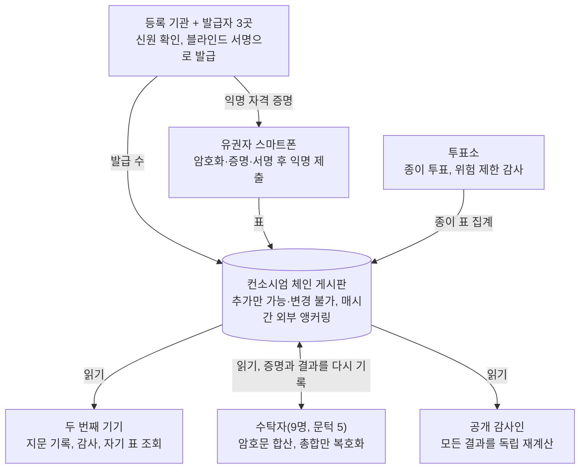

# 종단 간 검증 가능한 투표 시스템 설계안

[English](en.md) · [简体中文](zh-CN.md) · [Français](fr.md) · [Русский](ru.md) · [Español](es.md) · [العربية](ar.md) · [日本語](ja.md) · **한국어**

최종 업데이트: 2026-11-08

## 개요

이 설계는 대규모 부정을 막는 것을 목표로 한다. 대상은 가짜 표 생성, 표 삭제·변조, 개표 결과 조작, 스마트폰 대량 악성코드 감염, 조직적 매표다. 유권자는 스마트폰을 한 번만 등록하고, 선거마다 그 선거에만 유효한 자격 증명을 받아 스마트폰으로 몇 분 만에 투표한다. 체인에는 암호문만 공개되고 누구나 결과를 다시 계산할 수 있으며, 유권자는 자기 표가 변조되거나 삭제되지 않고 개표에 포함되었음을 확인할 수 있다. 가족 등이 대면으로 강요하는 것 같은 개별적·우발적 사례는 별도로 설계하지 않고 현행법에 맡겨, 더 단순하고 빠른 절차를 얻는다.

**설계 목표**

- **공개 검증 가능성:** 누구나 체인 데이터와 오픈소스 도구로 선거 결과를 독립적으로 다시 계산할 수 있다.
- **개인 검증 가능성:** 유권자는 자기 표가 던진 그대로 기록되고, 변조·삭제되지 않았으며, 개표에 포함되었음을 확인할 수 있다.
- **비밀투표:** 표와 신원은 수학적으로 연결할 수 없으며, 나중에 암호가 깨져도 마찬가지다.
- **대규모 부정 방지:** 규모를 갖춘 부정(표 생성·삭제·변조·매수)은 불가능하거나 반드시 발각된다.
- **효율성:** 스마트폰은 한 번만 등록하고, 선거마다 자격 증명은 자동으로 받으며, 투표는 몇 분, 마감 후 몇 시간 안에 검증 가능한 결과가 나온다.

**핵심 원칙**

- **권력 분립:** 민감한 작업은 모두 서로 견제하는 여러 기관에 나눈다. 악용하려면 공모가 필요하고, 공모하면 흔적이 남는다.
- **신뢰가 아닌 증명:** 모든 단계에 누구나 검증할 수 있는 수학적 증명을 붙인다.
- **통계로 대규모 부정을 잡는다:** 모두가 확인할 필요는 없다. 일부 유권자가 무작위로 확인하기만 해도 대규모 부정은 숨길 수 없다.
- **블록체인은 게시판일 뿐:** 게시된 데이터가 바뀌지 않음을 보장할 뿐, 게시 이전의 보안은 책임지지 않는다.
- **종이로 뒷받침:** 투표소에서는 종이 투표를 유지하여 사람에 의한 감사 능력을 남긴다.

## 흔한 부정 수법과 이 설계의 대응

아래 표는 미국 선거 부정 사건의 일반적인 분류를 따른다. 온라인 경로는 이중 투표, 표 채워 넣기, 개표 조작, 표 폐기를 원천 차단하고, 신분 도용과 매표는 크게 줄인다. 명부 품질과 대면 강요에는 여전히 전통적 수단이 필요하다.

| 부정 수법 | 전형적인 방식 | 이 설계의 대응 | 효과 |
| --- | --- | --- | --- |
| 이중 투표 | 여러 주나 카운티에 등록해 각각 투표, 온라인 투표 후 투표소에서 또 투표 | 1인 1선거당 자격 증명은 1개, 각 주가 수령자의 신원 해시를 공유해 주 간 중복을 검출, 체인은 자격 증명 1개당 1표만 수리, 자격 증명을 받은 사람은 투표소에서 임시 투표만 가능 | 원천 차단 |
| 신분 도용 투표 | 투표하지 않는 등록자나 사망자의 신원을 사용 | 스마트폰 등록 시 신분증 확인, 자격 증명 발급 때마다 얼굴 생체 확인, 본인이 수령 처리되었는지 조회 가능 | 크게 감소, 피해자가 발견 가능 |
| 허위 등록·유령 유권자 | 가명, 가짜 주소, 사망자를 등록한 뒤 대신 투표 | 명부를 사망·전출·국적 기록과 연동, 발급에 신분증과 생체 확인 필요, 선거구별 발급 수를 실시간 공개해 인구 및 과거 투표율과 비교 | 이상 징후 발견 가능, 명부 자체는 계속 관리 필요 |
| 자격 없는 사람의 투표 | 비시민권자, 비거주자, 주법상 투표권이 없는 사람의 투표 | 발급 때마다 최신 명부로 자격을 재확인 | 명부 데이터 품질 수준 |
| 우편 투표 부정·불법 수거 | 남의 우편 투표용지 신청, 서명 위조, 수거한 표를 변조하거나 폐기 | 온라인 표는 중개자를 거치지 않음: 자격 증명은 본인 스마트폰에 잠겨 있고 생체 확인 없이는 쓸 수 없으며, 가로챌 종이 표가 없음 | 온라인 경로에서 원천 차단 |
| 매표 | 돈을 주고 특정 후보에게 투표하게 하고 증거를 요구 | 영수증 없음, 자격 증명은 스마트폰에서 꺼낼 수 없음, 공식 앱만 인정 | 대규모화가 어려움 |
| 불법 "도움"·대면 강요 | 도와준다는 명목으로 노인, 장애인, 언어가 서툰 유권자의 표를 대신 기입 | 투표에는 본인 생체 확인이 필요, 대면 감시는 별도로 막지 않음 | 부분 완화 |
| 직원의 표 채워 넣기 | 투표함에 표를 더 넣거나 오지 않은 유권자 대신 투표 | 직원은 자격 증명이 없어 유효한 표를 만들 수 없음, 온라인 유효표 수는 발급 수를 넘을 수 없고 공개 비교 | 온라인 경로에서 원천 차단 |
| 표 폐기·파기 | 개표 전에 일부 표를 버리거나 숨김 | 체인 데이터는 삭제 불가하고 외부에 앵커링, 유권자가 지문으로 자기 표를 찾음, 서명된 수리 증명이 접수를 증명 | 반드시 발각 |
| 개표·집계 조작 | 선거구 숫자를 바꾸거나 집계 단계에서 숫자를 바꿈 | 개표는 체인상 모든 암호문의 공개 동형 합산으로 누구나 재계산 가능, 복호화에 정당성 증명 첨부 | 원천 차단 |
| 투표 기기·개표 시스템 해킹 | 소프트웨어를 조작해 표나 결과를 바꿈 | 스마트폰 쪽은 무작위 감사로 발견, 서버 쪽은 모든 결과를 공개 데이터로 독립 재계산할 수 있어 어떤 서버도 신뢰할 필요 없음 | 대규모 조작은 반드시 발각 |
| 정당한 유권자의 투표 방해 | 이유 없이 명부에서 삭제하거나 자격 증명 발급 거부 | 유권자가 자기 등록·발급 상태를 조회 가능, 거부에는 사유가 필요하고 이의 제기 가능, 선거구별 삭제 수 공개 | 발견 가능 |

범위 밖: 후보 등록 청원 서명 위조, 선거자금 위반, 허위 정보 등 투표·개표와 무관한 사안. 분류는 [헤리티지 재단 선거 부정 데이터베이스](https://electionfraud.heritage.org/categories)와 [News21 조사](https://www.pewtrusts.org/en/research-and-analysis/articles/2012/08/30/election-fraud)를 참고했다.

### 뒤에 있는 다섯 가지 원리

1. **익명 자격 증명(블라인드 서명): 이중 투표를 막으면서 누구에게 투표했는지는 드러내지 않는다.** 번호를 적은 카드를 먹지가 든 봉투에 넣고 발급자가 봉투 위에 도장을 찍는다고 생각해 보자. 도장은 카드에 찍히지만 발급자는 번호를 볼 수 없다. 발급 때 등록 기관은 "영희는 이미 받았다"는 것을 알기 때문에 두 번째는 받을 수 없다. 투표할 때는 카드와 도장만 보여 주므로 누구의 카드인지 아무도 알 수 없다.
2. **자격 증명 1개당 1표인 체인 규칙: 중복 투표는 바로 거부된다.** 모든 표는 자격 증명의 공개키와 함께 게시된다. 같은 공개키가 두 번째로 나타나면 모든 노드가 같은 공개 규칙에 따라 거부하며, 어떤 노드도 예외를 둘 수 없다.
3. **동형 암호 개표: 표를 하나도 열지 않고 총합을 구한다.** 각 표는 자물쇠가 채워진 상자와 같은데, 특별한 성질이 있다. 모든 상자를 "포개면" 정확히 총 득표수가 든 새 상자가 된다. 포개는 일은 누구나 할 수 있으므로 개표는 공개적으로 재계산할 수 있다. 마지막에 총합이 든 상자 하나를 열려면 5명 이상의 수탁자가 함께 있어야 하고, "여는 과정에 조작이 없었다"는 수학적 증명도 붙여야 한다.
4. **무작위 감사: 표를 바꾸는 스마트폰은 숨을 곳이 없다.** 스마트폰은 먼저 잠긴 상자를 내놓고, 당신은 두 번째 기기로 그 지문을 기록한 뒤 제출할지, 그 자리에서 열어 확인할지를 정한다. 스마트폰은 당신의 선택을 미리 알 수 없으므로 조작은 도박이 된다. 바꾸는 표가 많을수록 들킬 확률은 100%에 가까워진다.
5. **공개 데이터, 외부 앵커링, 수량 대조: 삭제된 표도 늘어난 표도 흔적을 남긴다.** 체인 데이터는 누구나 내려받을 수 있다. 매시간 데이터 지문을 외부 공개 블록체인과 신문에 게재하므로 나중에 이력을 고치면 맞지 않는다. "온라인 표 수는 발급 수를 넘지 않는다" 같은 수량 관계를 공개적으로 대조하므로 가짜 표는 숨을 수 없다.

## 위협 모델과 신뢰 가정

규모를 가질 수 있는 부정 수법마다 대책을 둔다. 결과의 정확성은 누구의 정직성에도 의존하지 않고, 표의 익명성은 기관의 자제가 아니라 수학이 보장한다.

| 대규모 부정 수법 | 가능한 주체 | 이 설계의 대응 |
| --- | --- | --- |
| 가짜 표 생성, 존재하지 않는 사람에게 자격 증명 발급 | 내부자 | 3곳 공동 블라인드 서명, 발급 수 실시간 공개 및 체인상 사용 수와 대조, 유권자가 수령 처리 여부 조회 가능 |
| 표 삭제·변조, 개표 결과 조작 | 내부자, 해커 | 체인 공개 및 외부 앵커링, 누구나 재계산 가능한 동형 개표, 유권자가 표 지문으로 확인 |
| 스마트폰 대량 감염으로 표 변조 | 해커, 외국 세력 | 투표 시 무작위 감사, 두 번째 기기로 지문을 먼저 기록 |
| 조직적 매표 | 정치 단체, 이익 집단 | 영수증 없음, 자격 증명은 보안 칩에 잠김, 공식 앱만 인정 |
| 시스템 마비 | 해커 | 다자 운영 노드, 14일 투표 기간, 투표소가 보완 |
| 결과 엿보기·조기 유출 | 일부 수탁자의 공모 | 9명 중 5명 문턱, 투표 종료 후 총합만 복호화 |
| 별도로 다루지 않음: 개별 유권자에 대한 대면 강요 | — | 현행법으로 처리, 필요하면 "선택 모듈: 강요 저항" 절의 설계를 추가 |

**신뢰 가정**

- **익명성:** 블라인드 서명이 보장한다. 자격 증명과 신원은 수학적으로 연결되지 않으며, 어떤 기관의 정직성에도 의존하지 않고, 미래의 양자 컴퓨팅도 바꾸지 못한다. 익명 중계가 로그를 남기지 않는다는 것이 전제다.
- **무결성:** 누구에게도 의존하지 않는다. 모든 기관이 공모해도 조작은 공개 검증에서 드러난다.
- **발급:** 3곳의 발급자와 등록 기관이 모두 공모하지는 않는다. 설령 공모해도 더 만든 자격 증명은 수량 대조에서 드러난다.
- **체인 가용성:** 컨소시엄 체인 노드의 3분의 2 이상은 정직하다. 3분의 1을 넘는 노드가 악의적이어도 서비스 거부만 할 수 있을 뿐, 표를 위조하거나 이력을 고칠 수 없다.
- **스마트폰:** 모든 스마트폰이 깨끗하다고 보장하지는 않지만, 대규모 조작은 감사로 반드시 발견된다.

## 시스템 역할과 권력 분립

각 역할이 혼자 악용했을 때의 최대 피해는 제한되어 있다. 마지막 열이 권력 분립 설계의 검증 기준이다.

| 역할 | 담당 | 직무 | 혼자서 최대한 할 수 있는 일 |
| --- | --- | --- | --- |
| 유권자 | 자격 있는 시민 | 등록, 투표, 감사, 확인 | 자기 한 표에만 영향 |
| 등록 기관 | 기존 선거 사무소 | 신원·자격 확인, 이번 자격 증명 수령 여부 기록 | 발급 거부(조회·이의 제기 가능) |
| 자격 증명 발급자(3곳) | 선거 사무소와 양대 정당이 각각 1곳 지정 | 유권자의 익명 자격 증명에 블라인드 서명 | 혼자서는 유효한 자격 증명을 만들 수 없고 내용도 볼 수 없음 |
| 수탁자(9명, 문턱 5) | 주요 정당, 독립 선거 기관, 법원, 대학 | 선거 키 조각을 보유하고 투표 종료 후 공동으로 총합 복호화 | 아무것도 못 함 |
| 컨소시엄 노드(21개 이상) | 각 주 선거 기관, 정당, 대학, 언론, 감시 단체 | 표 검증·저장, 수리 증명 공동 서명 | 서비스 거부만 가능, 표 위조·변조 불가 |
| 익명 중계(여러 곳) | 위 기관과 다른 독립 운영자 | 표 중계, 유권자 IP 숨김 | 한 곳만으로는 전체 경로를 볼 수 없음 |
| 투표소 | 기존 투표소 | 종이 투표, 도움 | 해당 투표소 서비스에 영향, 종이 부분은 감사 가능 |
| 공개 감사인 | 누구나 | 체인 데이터를 내려받아 독립 재계산 | 쓰기 권한 없음 |
| 소프트웨어 개발자 | 오픈소스 커뮤니티 + 인증 기관 | 개발, 감사, 재현 가능한 빌드 | 악성 코드는 감사와 공개 검토로 발견됨 |

## 암호 구성 요소

모두 학계에서 충분히 연구되고 공개 구현이 있는 구성 요소를 쓰며, 새 암호를 발명하지 않는다. 강요 저항 설계와 비교하면 믹스넷, 가짜 자격 증명 필터링 같은 가장 무거운 부분을 뺐다.

| 구성 요소 | 용도 | 역할 |
| --- | --- | --- |
| 지수 ElGamal 암호(동형) | 표 | 암호문을 그대로 더할 수 있어 개표 때 총합만 복호화하고 개별 표는 절대 복호화하지 않음 |
| 분산 키 생성 + 문턱 복호화(5/9) | 선거 키 | 완전한 개인키를 가진 사람이 없음 |
| 블라인드 서명(3곳 공동) | 이번 선거의 익명 자격 증명 | 발급자는 내용을 보지 않고 서명하며, 자격 증명과 신원은 수학적으로 연결되지 않음 |
| 스마트폰 보안 칩 + 앱 인증 | 자격 증명 개인키 | 개인키를 꺼낼 수 없고 공식 앱만 사용 가능 |
| Schnorr 서명 | 각 표 | 자격 증명 보유자만 투표할 수 있고, 자격 증명 1개로 한 번만 투표 |
| 영지식 증명 | 표의 유효성, 복호화의 정당성 | "각 선거 항목에서 정확히 규정된 수만 선택했다", "복호화에 조작이 없다"를 내용 공개 없이 증명 |
| Benaloh 챌린지 | 투표 시 | 스마트폰은 암호화할 때 이 표가 제출될지 감사될지 모르므로, 조작하면 들킬 위험이 따름 |
| 해시와 Merkle 트리 | 표 지문, 외부 앵커링 | 데이터 지문, 1바이트만 바꿔도 맞지 않음 |

## 전체 흐름

선거 한 번은 일곱 단계로 이루어진다. 준비, 스마트폰 등록(한 번), 이번 자격 증명 수령(선거마다), 투표와 감사, 확인, 개표, 공개 감사. 각 단계의 출력은 체인에 기록되어 누구나 확인할 수 있다.

등록 기관, 유권자 스마트폰, 투표소는 체인에 쓰고, 두 번째 기기와 일반 대중은 읽기만 한다. 수탁자는 읽은 뒤 복호화 증명과 최종 결과를 체인에 다시 기록한다.

### 1. 선거 준비(투표 시작 약 60일 전)

1. **키 의식:** 9명의 수탁자가 공개 생중계 아래 분산 키 생성을 진행한다. 공개키는 체인에 올리고, 각자는 개인키 조각 하나만 하드웨어 보안 모듈에 보관한다.
2. **매개변수 게시:** 각 선거 항목과 후보 명단, 투표 기간, 검증 규칙, 각 소프트웨어 버전의 해시.
3. **소프트웨어 공개:** 투표 앱, 확인 도구, 개표 검증기는 모두 오픈소스이며 재현 가능한 빌드로 만든다. 여러 독립 기관이 감사하고 보고서를 공개한다.
4. **공개 테스트:** 전 과정을 모의 선거로 시험하고, 버그 바운티도 운영한다.

### 2. 스마트폰 등록(한 번, 최장 4년)

1. **신원 확인:** 유권자는 아무 선거 사무소, 차량관리국, 우체국에서 신분증을 제시하고, 직원이 유권자 등록 정보와 대조한다. 등록 주소로 우편 발송된 활성화 코드와 신분증 번호로 온라인에서 마칠 수도 있다.
2. **스마트폰 등록:** 앱이 스마트폰 보안 칩 안에 장기 신원 키를 생성하며, 개인키는 꺼낼 수 없다. 등록 기관이 이에 대한 장기 신원 인증서를 발급한다. 이 인증서는 "이 스마트폰은 이 사람의 것"임을 증명할 뿐, 투표 자격을 뜻하지 않는다.
3. **유효 기간:** 최장 4년 또는 신분증 만료일까지이며, 만료 후 신원을 다시 확인한다.
4. **자동 폐기:** 유권자가 명부에서 제외되면(사망, 주 밖으로 전출, 국적 상실, 법원 판결 등) 인증서도 함께 폐기된다. 명부는 사망 등록, 전출, 국적 변경 기록과 연동된다.
5. **기기 변경:** 아무 창구에서, 또는 기존 기기의 승인으로 이전하며, 기존 인증서는 폐기된다.

스마트폰을 쓰고 싶지 않은 유권자는 등록할 필요 없이 평소처럼 투표소에서 종이로 투표한다.

### 3. 이번 자격 증명 수령(선거마다, 해당 선거에만 유효)

1. **새 키 생성:** 투표 시작 전에 앱이 보안 칩 안에서 이번 선거 전용 키 쌍을 새로 만든다.
2. **생체 확인:** 앱이 전면 카메라로 생체 감지를 하고 신분증 사진과 대조해 본인이 조작하고 있음을 확인한다. 사망자나 자격을 잃은 사람의 스마트폰을 남이 쓰는 것을 막는다.
3. **자격 재확인:** 앱이 장기 신원 인증서로 등록 기관에 신원을 증명하면, 등록 기관은 최신 명부로 이번 선거 자격을 다시 확인하고 "이번 자격 증명 수령"으로 기록한다. 1인 1선거당 한 번만 받을 수 있다. 각 주가 수령자의 신원 해시를 공유하므로, 여러 주에 등록된 사람도 하나만 받을 수 있다.
4. **블라인드 서명:** 발급자 3곳이 각각 새 공개키에 블라인드 서명한다. 서명할 때 공개키를 볼 수 없으므로 누구도 자격 증명과 신원을 연결할 수 없다.
5. **자격 증명 획득:** 새 공개키와 서명 3개가 이번 선거의 익명 자격 증명이 되며, 이번 선거에만 유효하고 선거가 끝나면 무효가 된다. 전체 과정은 약 1분이다.
6. **공개 집계:** 선거구별 발급 수를 실시간으로 체인에 올린다. 유권자는 언제든 자신이 수령 처리되었는지 조회할 수 있다. 받지 않았는데 받은 것으로 나오면 누군가 도용한 것이다.

### 4. 투표와 감사(투표 기간 14일)

1. **선택:** 유권자가 각 선거 항목의 후보를 고른다.
2. **지문 기록:** 앱이 선택을 암호화하고 표 지문 QR 코드를 보여 준다. 유권자는 두 번째 기기로 스캔하거나 앞 8자리를 적어 둔다. 이 단계는 반드시 다음 단계보다 먼저 해야 한다.
3. **제출 또는 감사, 둘 중 하나:**
    - **감사:** 앱이 이 표를 암호화할 때 쓴 난수를 공개하고, 두 번째 기기가 이를 이용해 암호문을 열어 내용이 선택과 일치하는지, 지문이 방금 기록한 것과 일치하는지 확인한다. 감사한 표는 무효가 되고 1단계로 돌아가 다시 암호화한다.
    - **제출:** 앱이 영지식 증명을 붙이고 이번 자격 증명으로 서명해 익명 중계를 거쳐 제출한 뒤, 암호화 난수를 폐기한다.
4. **체인 기록:** 노드가 자격 증명 서명, 영지식 증명, 투표 시간, 이 자격 증명이 아직 투표하지 않았음을 검증한다. 모두 통과해야만 블록에 기록하고, 노드가 공동 서명한 수리 증명을 돌려준다.
5. **자격 증명 1개당 1표:** 제출한 표는 바꿀 수 없다. 따라서 악성코드가 유권자 투표 후에 몰래 다시 투표할 수 없다.

### 5. 유권자 확인

| 언제 | 무엇을 확인하나 | 어떻게 |
| --- | --- | --- |
| 투표할 때 | 스마트폰이 표를 몰래 바꾸지 않았다 | 최소 한 번 감사한 뒤 제출한다. 스마트폰은 감사 여부를 미리 알 수 없다 |
| 투표 후 언제든 | 표가 체인에 있고 삭제·교체되지 않았다 | 두 번째 기기나 아무 공개 조회 사이트에서 기록한 지문으로 자기 표를 찾는다 |
| 개표 후 | 개표에 포함되었다 | 자기 지문이 개표 입력 집합에 있고, 개표와 복호화 증명이 모두 통과한다 |
| 분쟁 시 | 증거 보존 | 수리 증명과 체인 기록으로 선거 분쟁 위원회에 이의를 제기한다 |

### 6. 개표(투표 종료 후 몇 시간 이내)

1. **동결:** 마감 시점의 블록 높이를 체인에 올리고, 이후 온라인 표는 받지 않는다.
2. **규칙 재확인:** 자격 증명마다 표가 하나뿐인지, 자격 증명마다 발급자 3곳의 유효한 서명이 있는지 공개적으로 확인한다.
3. **동형 합산:** 모든 유효표를 선거 항목별로 곱해 각 항목의 암호화된 총합을 얻는다. 이 단계는 누구나 직접 계산할 수 있다.
4. **총합 복호화:** 5명 이상의 수탁자가 각 선거 항목의 총합을 공동으로 복호화하고 정당성 증명을 붙인다. 개별 표는 절대 복호화하지 않는다.
5. **수량 대조:** 온라인 유효표 수는 발급 수를 넘을 수 없다. 선거구별 발급 수를 등록자 수, 과거 투표율과 비교해 이상하면 조사한다.
6. **공표:** 각 선거 항목의 득표수와 모든 증명을 투표소 종이 표 결과와 합쳐 공표한다.

### 7. 공개 감사

- **독립 재계산:** 누구나 오픈소스 검증기로 체인 데이터를 내려받아 자격 증명 확인, 합산, 복호화 검증을 다시 돌릴 수 있다.
- **다자 보고서:** 각 정당, 언론, 대학 등 독립 기관이 결과 발표 후 24시간 안에 각자의 검증 보고서를 낸다.
- **종이 감사:** 투표소 경로에서는 위험 제한 감사를 하여 종이 표와 전자 집계를 표본 비교한다.
- **이상 감시:** 감사 불일치 신고 건수와 선거구별 발급 수를 지역별로 공개하고, 이상이 몰리면 조사를 시작한다.
- **감사의 통계적 위력:** 모두가 감사할 필요는 없다. 무작위로 1%의 표만 감사되어도 1,000표를 몰래 바꾸고 아무에게도 들키지 않을 확률은 약 0.004%다. 단, 스마트폰이 누가 감사할지 예측할 수 없어야 하므로 앱은 유권자의 감사 여부를 기록하지도 보고하지도 않는다.

## 핵심 문제와 해결책

대규모 부정에는 다섯 가지 주요 경로가 있다. 아래에서 각각이 이 설계에서 왜 통하지 않는지 설명한다. 마지막 몇 항목은 운영상의 문제다.

### 가짜 표 생성

- 자격 증명은 발급자 3곳의 서명이 모두 필요하므로, 어느 한 곳도 혼자서는 유효한 자격 증명을 만들 수 없다.
- 발급자 3곳과 등록 기관이 모두 공모해 자격 증명을 더 만들어도 결과는 두 가지뿐이다. 체인에서 사용된 자격 증명 수가 등록 기관이 기록한 발급 수를 넘거나, 진짜 유권자가 받으러 갔을 때 "이미 받았다"는 말을 듣는다. 어느 쪽이든 드러난다.
- 선거구별 발급 수를 실시간 공개하고 등록자 수, 과거 투표율과 비교해 이상한 선거구를 집중 조사한다.
- **명부상의 유령 유권자**(사망이나 이사 후에도 명부에 남은 사람)는 현재 우편 투표에도 똑같이 있는 문제로, 블록체인이 해결할 수 없다. 이 설계는 명부를 사망 등록, 전출, 국적 변경 기록과 연동하고, 발급 때마다 최신 명부 확인과 생체 확인을 하며, 발급률이 비정상적으로 높은 선거구를 집중 점검한다.

### 표 삭제·변조, 결과 조작

- 체인 데이터는 공개되고 매시간 외부에 앵커링되므로, 삭제나 변조는 앵커 기록과 맞지 않는다.
- 유권자는 기록한 지문으로 자기 표를 찾을 수 있다. 표가 사라졌다면 수리 증명이 시스템이 분명히 받았음을 증명한다.
- 개표는 공개 동형 합산이라 누구나 재계산할 수 있고, 수탁자는 총합만 복호화하며 정당성 증명을 붙인다.

### 스마트폰 대량 감염

- **감사:** 스마트폰은 암호화할 때 이 표가 제출될지 감사될지 모른다. 조작하려면 들킬 위험을 감수해야 하고, 많이 바꿀수록 확실히 들킨다.
- **지문 먼저 기록:** 지문은 제출과 감사 중 하나를 고르기 전에 두 번째 기기로 기록해야 한다. 그렇지 않으면 스마트폰이 한 표를 몰래 제출하고 다른 표를 감사용으로 보여 줄 수 있다.
- **자격 증명 1개당 1표:** 제출 후에는 바꿀 수 없으므로 악성코드가 나중에 몰래 다시 투표할 수 없다.
- **발견 후 조치:** 감사 불일치 신고가 확인되면 즉시 공개하고 해당 앱 버전을 동결하며, 영향을 받은 유권자는 투표소에서 투표한다.

### 조직적 매표

조직적 매표는 규모를 갖춘 부정이므로 개별 강요와 함께 무시할 수 없다. 무거운 장치를 더하지 않고도 대규모화를 어렵게 만들 수 있다.

- **영수증 없음:** 유권자는 누구에게 투표했는지 증명할 수 있는 것을 아무것도 받지 않는다. 감사로는 무효 처리한 표의 내용만 볼 수 있고, 제출한 표의 암호화 난수는 즉시 폐기된다.
- **자격 증명을 꺼낼 수 없음:** 자격 증명 개인키는 스마트폰 보안 칩에 잠겨 있어, 표를 팔려면 스마트폰 자체를 넘겨야 한다. 수천 대의 스마트폰을 한꺼번에 다루면 들키기 쉽다.
- **공식 앱만 인정:** 자격 증명은 시스템 인증을 받은 공식 앱에서만 쓸 수 있어, 매표 조직은 영수증을 보여 주는 변조 앱을 만들 수 없다.
- **남은 위험:** 매수자가 판매자의 투표를 직접 지켜보는 방식은 비용이 크고 대규모화가 어렵다. 현행법으로 단속한다.

### 서비스 거부

- 투표 기간이 14일이라 하루 마비돼도 대세에 지장이 없다.
- 유효한 자격 증명이 있는 표만 처리하므로 쓰레기 데이터는 입구에서 버려지고 검증 비용도 낮다.
- 노드는 여러 클라우드 사업자와 자체 데이터센터에 분산하고, 읽기 전용 데이터는 여러 미러로 제공한다.
- 온라인 경로를 쓸 수 없으면 투표소가 보완한다. 마감 전에 대규모 공격을 받으면 법정 절차에 따라 투표 기간을 연장한다.

### 수탁자 공모

- 무엇이든 복호화하려면 9명 중 5명이 공모해야 한다.
- 공모해서 개별 표를 복호화해도 어떤 익명 자격 증명이 무엇에 투표했는지만 알 뿐 사람과는 연결되지 않는다.
- 주된 위험은 중간 결과를 미리 엿보는 것이다. 복호화는 투표 종료 후에만 하고, 개인키 조각은 하드웨어 보안 모듈에 보관하며, 사용할 때마다 체인에 기록을 남긴다.

### 장기 프라이버시

- 블라인드 서명의 비연결성은 수학적으로 절대적이다. 나중에 양자 컴퓨팅으로 암호가 깨져도 익명 자격 증명이 무엇에 투표했는지만 알 수 있을 뿐 사람과는 연결되지 않는다.
- 익명 중계가 로그를 남기지 않는 것이 핵심 전제다. 여러 독립 기관이 운영하며, 한 곳만으로는 전체 경로를 볼 수 없다.

### 스마트폰 분실과 이중 투표

- 이번 자격 증명을 받기 전에 잃어버린 경우: 다시 등록한 뒤 정상적으로 받는다.
- 받은 뒤에 잃어버린 경우: 자격 증명을 쓰려면 스마트폰 비밀번호나 생체 인증이 필요해 남이 주워도 쓸 수 없다. 유권자는 투표소에서 임시 투표를 할 수 있다. 이런 임시 표의 수는 선거구별로 공개하고, 비정상적으로 몰리면 조사한다.
- 명부에는 각자가 이번 자격 증명을 받았는지가 기록된다. 받은 사람은 투표소에서 임시 투표만 할 수 있고, 받지 않은 사람은 정상적으로 종이 투표를 한다.

### 분쟁 처리

- **표가 사라짐:** 수리 증명은 노드가 공동 서명하므로 시스템 측이 부인할 수 없다.
- **감사에서 내용이 다름:** 두 번째 기기의 감사 기록은 그 표가 실제로 무엇을 암호화했는지 공개적으로 증명할 수 있지만, 유권자가 그때 무엇을 골랐는지는 증명하지 못한다. 그래서 신고 건수와 분포를 보고 조사 여부를 정한다.
- **법적 지위:** 체인 데이터와 수리 증명의 증거 효력은 입법으로 명확히 해야 한다.

### 사용성

- 스마트폰은 한 번만 등록하고, 선거마다 자격 증명 수령은 약 1분, 투표와 한 번의 감사도 몇 분이면 된다.
- 앱은 화면 낭독, 다국어, 큰 글씨를 지원한다. 두 번째 기기가 없는 사람은 가족의 스마트폰이나 투표소의 공용 조회 단말기를 쓸 수 있다.
- 스마트폰을 쓸 줄 모르거나 쓰기 싫은 사람은 언제든 종이로 투표할 수 있다.

## 컨소시엄 체인과 기반 시설

공개 체인이 아니라 여러 주체가 운영하는 컨소시엄 체인을 쓴다. 여기서는 추가만 가능하고 바꿀 수 없는 게시판일 뿐이며, 여러 주체가 각자 미러링하는 추가 전용 로그로 바꿔도 보안 효과는 거의 같다.

- **합의:** 비잔틴 장애 허용 합의(HotStuff 등). 악의적인 노드가 3분의 1 미만이면 견디며, 블록 생성은 약 2초다.
- **노드:** 21개 이상. 각 주 선거 기관, 주요 정당, 대학, 언론, 선거 감시 단체에 나뉘며, 어떤 유형도 3분의 1을 넘지 않는다.
- **기록 규칙:** 자격 증명이 유효하고, 서명과 영지식 증명이 통과하며, 투표 기간 안이고, 그 자격 증명이 아직 투표하지 않은 표만 받고 나머지는 모두 거부한다. 노드는 유효한 표를 받을지 말지 스스로 정할 수 없다.
- **공개 읽기:** 누구나 체인 데이터 전체를 내려받을 수 있고, 미러 사이트도 여러 개 있다.
- **외부 앵커링:** 매시간 체인 상태의 Merkle 루트를 여러 공개 블록체인에 기록하고 신문 공고에도 싣는다. 모든 노드가 공모해 이력을 고쳐도 앵커 기록과 맞지 않는다.
- **용량 추정(대략):** 약 1억 5천만 표, 표당 약 5KB(증명 포함)로 보면 총 약 750GB로 일반 서버에 저장할 수 있다. 14일 평균 초당 약 124표이며, 10배 정점을 기준으로 설계하면 초당 약 1,200표다. 검증은 병렬화할 수 있다.
- **개표 속도:** 동형 합산은 단순한 일괄 곱셈이고 복호화는 각 선거 항목의 총합에만 하므로, 투표 종료 후 몇 시간 안에 결과가 나온다.

**공개 체인을 쓰지 않는 이유:**

- **프라이버시:** 공개 체인 거래에는 수수료와 계정이 필요해 유권자 신원이 드러나기 쉽다.
- **비용과 혼잡:** 선거 정점 때 수수료와 확인 시간을 통제할 수 없다.
- **거버넌스:** 익명의 채굴자나 검증자가 선거 데이터를 체인에 올릴지 말지를 정하게 해서는 안 된다.

## 도입 로드맵

작고 위험이 낮은 선거부터 시작하고, 각 단계의 기준을 충족해야 다음 단계로 넘어간다. 온라인 경로는 언제나 투표소를 보완할 뿐 대체하지 않는다.

1. **프로토타입과 공개 검토(약 1년 차)**
    - 오픈소스로 구현하고, 설계 논문을 발표하며, 버그 바운티를 운영한다.
    - 기준: 독립 암호 감사 통과, 수정되지 않은 고위험 취약점 없음.
2. **모의 선거(약 1~2년 차)**
    - 대학 학생회, 지역 단체, 노동조합 등의 내부 선거.
    - 기준: 감사율, 이상 신고율, 사용성 테스트 결과가 목표에 도달.
3. **소규모 정식 시범(약 2~3년 차)**
    - 재외 유권자, 군인, 장애 유권자를 대상으로 기존 우편 투표를 보완한다.
    - 기준: 시범에서 설명할 수 없는 수량 차이가 없음.
4. **지방 선거 보완 경로(약 3~5년 차)**
    - 카운티·시 선거에서 투표소 종이 경로와 함께 쓴다.
5. **확대 여부**
    - 시범 데이터와 입법에 따라 결정한다. 주법의 승인과 연방 투표 시스템 인증 기준 통과가 전제다.

## 선택 모듈: 강요 저항

기본적으로 쓰지 않는다. 나중에 개별 강요도 막아야 한다고 판단하면 아래 모듈을 추가할 수 있지만, 절차가 눈에 띄게 느려지고 복잡해진다.

| 모듈 | 해결하는 것 | 대가 |
| --- | --- | --- |
| 개인 부스에서 자격 증명 수령 | 강요자가 수령 장면을 지켜볼 수 없음 | 선거 때마다 직접 가야 함 |
| 가짜 자격 증명 | 강요당하면 겉모습이 똑같은 가짜 자격 증명을 넘기고, 그것으로 낸 표는 개표 때 조용히 제외됨 | 개표를 믹스넷과 필터링으로 바꿔야 해 훨씬 느려지고, 전체 설계가 훨씬 복잡해짐 |
| 재투표 허용, 마지막 한 표만 인정 | 강요로 투표한 뒤 스스로 다시 바꿀 수 있음 | 악성코드도 나중에 몰래 재투표할 수 있어, 종이 확인 코드표와 두 번째 기기의 지속 감시가 따로 필요 |
| 투표소에서 온라인 표 무효화 | 선거일에 투표소에서 온라인 자격 증명을 무효로 하고 종이로 다시 투표 | 무효화 기록을 숨겨야 하며, 그렇지 않으면 강요자가 알아챔 |

이 모듈들은 함께 써야 효과가 있으며, 하나만 더하면 효과가 제한적이다.

## 남은 위험과 참고 시스템

이 설계는 대규모 가짜 표 생성, 삭제, 변조를 반드시 발견하게 하고 조직적 매표의 대규모화를 어렵게 만들지만, 완전히 없앨 수 없는 위험이 몇 가지 남는다.

**남은 위험**

- **일부 사람이 실제로 감사하는 것에 의존:** 감사하는 사람이 너무 적으면 소규모 조작은 빠져나갈 수 있다. 대규모 조작은 숨기기가 거의 불가능하다.
- **명부 품질:** 유령 유권자 문제는 블록체인으로 해결할 수 없고, 명부 정리와 수량 이상 감시에 기댈 수밖에 없다.
- **플랫폼 의존:** 스마트폰 보안 칩과 앱 인증은 Apple, Google 같은 플랫폼에 의존하므로, 대체 수단과 규제상의 제약이 필요하다.
- **복잡성으로 인한 신뢰 이전:** 일반인은 이런 증명을 읽을 수 없어 결국 검증한 전문가를 믿게 된다. 그러므로 독립 감사인은 충분히 다양하고 초당적이어야 한다.
- **온라인 경로에는 종이 기록이 없음:** 전통적인 수작업 재검표를 할 수 없고, 암호학적 증명에 의존할 수밖에 없다.
- **전문가 견해:** 컴퓨터 보안 업계는 대체로 인터넷 투표에 신중하며, 현재 기술로는 단말기 보안을 보장하기 어렵다고 본다. 많은 전문가가 여전히 손으로 기표하는 종이 투표를 기본으로 해야 한다고 주장한다.

**참고할 만한 기존 방식**

- **Helios, Belenios:** 학계의 종단 간 검증 가능한 인터넷 투표 시스템으로, 이 설계의 동형 개표와 감사 방식이 이들과 같다.
- **ElectionGuard:** Microsoft의 오픈소스 종단 간 검증 도구로, 투표소 환경의 암호화 개표에 쓰인다.
- **JCJ / Civitas:** 가짜 자격 증명 방식 강요 저항의 원조 연구로, "선택 모듈: 강요 저항" 절에 대응한다.
- **에스토니아 인터넷 투표:** 재투표 허용, 투표일 종이 표가 온라인 표에 우선, 두 번째 기기로 확인.
- **스위스 전자 투표:** 종이 확인 코드표로 기기에 의한 조작을 막는다.
