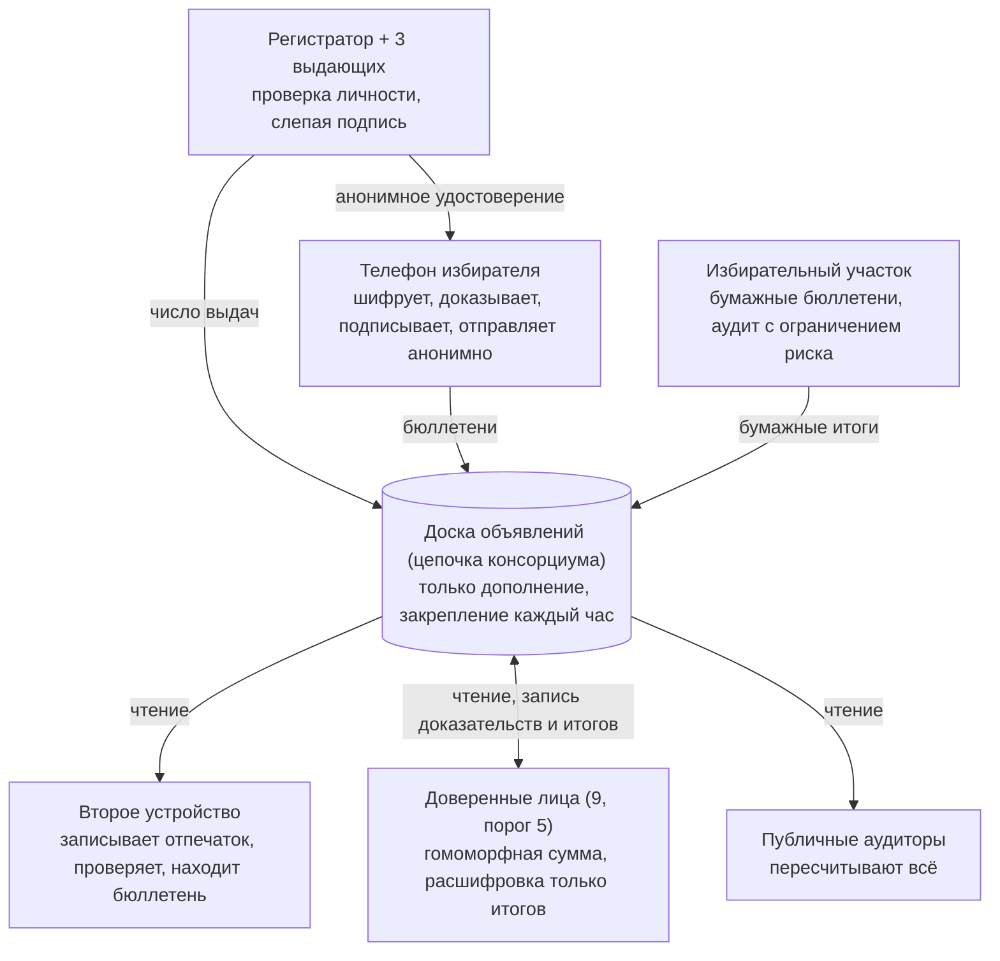

# Сквозная проверяемая система голосования: проект

[English](en.md) · [简体中文](zh-CN.md) · [Français](fr.md) · **Русский** · [Español](es.md) · [العربية](ar.md) · [日本語](ja.md) · [한국어](ko.md)

Последнее обновление: 2026-11-08

## Обзор

Проект направлен против массовых фальсификаций: вбросов, удаления и подмены бюллетеней, подделки подсчёта, массового заражения телефонов и организованного подкупа избирателей. Избиратель один раз привязывает телефон, перед каждыми выборами получает удостоверение права голоса, действующее только на эти выборы, и голосует с телефона за несколько минут. В цепочке публикуются только шифротексты, результат может пересчитать любой, а каждый избиратель может убедиться, что его бюллетень не изменён, не удалён и учтён. Единичные случаи, например давление на избирателя со стороны родственника, специально не рассматриваются: они остаются в ведении действующего законодательства ради более простого и быстрого процесса.

**Цели**

- **Публичная проверяемость:** любой может независимо пересчитать результат по данным цепочки с помощью открытых инструментов.
- **Индивидуальная проверяемость:** избиратель может убедиться, что его бюллетень записан как подан, не изменён, не удалён и учтён.
- **Тайна голосования:** бюллетени математически невозможно связать с личностью, даже если шифрование будет взломано в будущем.
- **Защита от массовых фальсификаций:** любая массовая фальсификация (вброс, удаление, подмена, подкуп) либо невозможна, либо гарантированно обнаруживается.
- **Эффективность:** телефон привязывается один раз; удостоверение на каждые выборы выдаётся автоматически; голосование занимает минуты; проверяемые итоги — через несколько часов после закрытия.

**Принципы**

- **Разделение полномочий:** каждая чувствительная операция распределена между взаимно контролирующими учреждениями. Злоупотребление требует сговора, а сговор оставляет следы.
- **Доказательства вместо доверия:** каждый шаг сопровождается математическим доказательством, которое может проверить любой.
- **Статистическое выявление массовых фальсификаций:** не нужно, чтобы проверяли все; выборочных проверок небольшой доли избирателей достаточно, чтобы массовую фальсификацию нельзя было скрыть.
- **Блокчейн — лишь доска объявлений:** он гарантирует неизменность опубликованных данных, но не отвечает за безопасность до публикации.
- **Бумага как страховка:** на избирательных участках сохраняются бумажные бюллетени и ручной аудит.

## Распространённые способы фальсификаций и ответ проекта

Таблица следует обычной классификации дел о фальсификациях на выборах в США. Онлайн-канал исключает повторное голосование, вбросы, подделку подсчёта и уничтожение бюллетеней; голосование под чужим именем и подкуп резко сокращаются; качество списков избирателей и давление лицом к лицу по-прежнему требуют традиционных мер.

| Способ | Типичная практика | Ответ проекта | Результат |
| --- | --- | --- | --- |
| Повторное голосование | Регистрация в нескольких штатах или округах и голосование в каждом; голосование онлайн, а затем на участке | Одно удостоверение на человека на выборы; штаты обмениваются хешами личности получивших его избирателей для выявления дублей; цепочка принимает один бюллетень на удостоверение; получившие удостоверение голосуют на участке только временным бюллетенем | Исключено |
| Голосование под чужим именем | Использование личности не голосующих избирателей или умерших | Проверка документов при привязке телефона; проверка «живости» лица при каждой выдаче; каждый может проверить, не значится ли он получившим удостоверение | Резко сокращено; жертва может обнаружить |
| Ложная регистрация, «мёртвые души» | Регистрация вымышленных имён, адресов или умерших и голосование за них | Списки связаны с реестрами смертей, выбытия и гражданства; выдача требует документа и проверки «живости»; число выданных удостоверений по участкам публикуется в реальном времени и сравнивается с населением и прошлой явкой | Аномалии выявляются; качество списков требует отдельной работы |
| Голосование лиц без права голоса | Голосование неграждан, нерезидентов или лишённых права по закону штата | Право голоса перепроверяется по актуальному списку при каждой выдаче | На уровне качества списков |
| Подлог почтовых бюллетеней, незаконный сбор | Запрос чужих почтовых бюллетеней, подделка подписей, сбор бюллетеней с последующей подменой или уничтожением | В онлайн-канале нет посредников: удостоверение заперто в телефоне избирателя, требует проверки «живости», бумажного бюллетеня для перехвата нет | Исключено онлайн |
| Подкуп избирателей | Оплата голоса с требованием доказательства | Никаких квитанций; удостоверение нельзя извлечь из телефона; принимается только официальное приложение | Трудно масштабировать |
| Незаконная «помощь», давление лицом к лицу | Заполнение бюллетеней за пожилых, инвалидов или плохо знающих язык под видом помощи | Голосование требует проверки «живости» самого избирателя; наблюдение лицом к лицу специально не предотвращается | Частично смягчено |
| Вбросы со стороны персонала | Вброс лишних бюллетеней или голосование за неявившихся | У персонала нет удостоверений, создать действительный бюллетень нельзя; действительных онлайн-бюллетеней не может быть больше выданных удостоверений, сравнение публично | Исключено онлайн |
| Уничтожение бюллетеней | Выбрасывание или сокрытие части бюллетеней до подсчёта | Данные цепочки нельзя удалить, они закреплены во внешних источниках; избиратель находит свой бюллетень по отпечатку; подписанная квитанция подтверждает приём | Гарантированно обнаруживается |
| Подделка подсчёта или сводки | Изменение цифр участка или на этапе сводки | Подсчёт — публичное гомоморфное суммирование всех шифротекстов, которое может повторить любой; расшифровка сопровождается доказательством | Исключено |
| Взлом устройств или системы подсчёта | Изменение ПО для подмены бюллетеней или итогов | На телефонах выявляется случайными проверками; на серверах любой результат пересчитывается по публичным данным без доверия к серверу | Массовая подделка гарантированно обнаруживается |
| Препятствование законным избирателям | Исключение из списков или отказ в удостоверении без причины | Избиратель может проверить статус регистрации и выдачи; отказ мотивируется и обжалуется; число исключений по участкам публикуется | Выявляется |

Вне рамок проекта: подделка подписей под выдвижением, нарушения финансирования кампаний, дезинформация и т. п., не связанные с голосованием и подсчётом. Классификация по [базе данных фонда Heritage](https://electionfraud.heritage.org/categories) и [расследованию News21](https://www.pewtrusts.org/en/research-and-analysis/articles/2012/08/30/election-fraud).

### Пять принципов, на которых всё держится

1. **Анонимное удостоверение (слепая подпись): нельзя проголосовать дважды, но и нельзя узнать, за кого вы голосовали.** Представьте карточку с номером в конверте с копировальной бумагой: выдающий ставит печать на конверт, оттиск попадает на карточку, но номера он не видит. При выдаче регистратор знает, что «Алиса уже получила», и второй ей не дадут; при голосовании предъявляются только карточка и печать, и никто не может сказать, чья это карточка.
2. **Одно удостоверение — один бюллетень, правило в цепочке: повторный голос отклоняется.** Каждый бюллетень публикуется с открытым ключом удостоверения. Если ключ встречается снова, все узлы отклоняют его по одному публичному правилу; исключений не может сделать ни один узел.
3. **Гомоморфный подсчёт: итог без вскрытия бюллетеней.** Каждый бюллетень — запертая коробка с особым свойством: если «сложить» все коробки, получится новая коробка, в которой ровно итоговое число голосов. Сложение может выполнить любой, поэтому подсчёт публично проверяем; открыть эту одну коробку с итогами могут только не менее 5 доверенных лиц вместе, приложив доказательство честной расшифровки.
4. **Случайные проверки: телефону-мошеннику негде спрятаться.** Телефон сначала отдаёт запертую коробку; вы записываете её отпечаток на втором устройстве и лишь затем решаете, подать её или вскрыть для проверки. Телефон не знает вашего выбора заранее, поэтому подмена — это лотерея; чем больше подмен, тем ближе вероятность разоблачения к 100%.
5. **Публичные данные, внешнее закрепление и сверка чисел: удалённые и лишние бюллетени оставляют следы.** Данные цепочки может скачать любой; каждый час их отпечаток публикуется во внешних публичных блокчейнах и газетах, так что переписать историю незаметно нельзя; публичные проверки вроде «онлайн-бюллетеней не больше выданных удостоверений» не оставляют места для вбросов.

## Модель угроз и допущения о доверии

Каждый способ фальсификации, способный действовать в масштабе, получает ответ: корректность результата не зависит от чьей-либо честности, а анонимность обеспечивается математикой, а не сдержанностью учреждений.

| Массовая фальсификация | Кто может | Ответ |
| --- | --- | --- |
| Вброс, выдача удостоверений несуществующим людям | Инсайдеры | Совместная слепая подпись 3 выдающих; число выдач публикуется и сверяется с использованными в цепочке; избиратель может проверить, не значится ли он получившим |
| Удаление или подмена бюллетеней и итогов | Инсайдеры, хакеры | Публичные данные с внешним закреплением; гомоморфный подсчёт, который может повторить любой; проверка по отпечатку |
| Массовое заражение телефонов | Хакеры, иностранные силы | Случайные проверки при голосовании; отпечаток сначала записывается на второе устройство |
| Организованный подкуп | Политические группы, группы интересов | Никаких квитанций; удостоверение заперто в защищённом чипе; только официальное приложение |
| Вывод системы из строя | Хакеры | Узлы разных сторон, 14 дней голосования, участки как резерв |
| Подглядывание или ранняя утечка итогов | Сговор доверенных лиц | Порог 5 из 9; расшифровываются только итоги и только после закрытия |
| Специально не рассматривается: давление на отдельных избирателей | — | Действующее законодательство; при необходимости добавить раздел «Дополнительный модуль: защита от принуждения» |

**Допущения о доверии**

- **Анонимность:** обеспечивается слепой подписью; удостоверение математически не связано с личностью, независимо от честности учреждений и от будущих квантовых компьютеров. Предполагается, что анонимные ретрансляторы не ведут журналов.
- **Целостность:** не зависит ни от кого. Даже при сговоре всех учреждений подделка вскрывается публичной проверкой.
- **Выдача:** 3 выдающих и регистратор не вступят в сговор все вместе; даже если вступят, лишние удостоверения выявит сверка чисел.
- **Доступность цепочки:** не менее двух третей узлов честны. При злонамеренности более трети узлов они могут лишь отказать в обслуживании, но не подделать бюллетени или переписать историю.
- **Телефоны:** чистота каждого телефона не гарантируется, но массовая подмена гарантированно выявляется проверками.

## Роли и разделение полномочий

Ущерб, который роль может причинить в одиночку, ограничен; последний столбец — проверка разделения полномочий.

| Роль | Кто | Обязанности | Худшее, что может сделать в одиночку |
| --- | --- | --- | --- |
| Избиратель | Гражданин с правом голоса | Регистрация, голосование, проверка | Повлиять только на свой голос |
| Регистратор | Существующие избирательные органы | Проверка личности и права голоса; учёт, кто получил удостоверение на эти выборы | Отказать в выдаче (проверяемо, обжалуемо) |
| Выдающие удостоверения (3) | Избирательный орган и по одному от каждой крупной партии | Слепая подпись анонимных удостоверений | В одиночку не может выдать действительное удостоверение; не видит его содержания |
| Доверенные лица (9, порог 5) | Крупные партии, независимые избирательные органы, суды, университеты | Хранят доли ключа выборов; совместно расшифровывают итоги после закрытия | Ничего |
| Узлы консорциума (21+) | Избирательные органы штатов, партии, университеты, СМИ, наблюдатели | Проверка и хранение бюллетеней; совместная подпись квитанций | Отказ в обслуживании; подделать или переписать нельзя |
| Анонимные ретрансляторы (несколько) | Независимые операторы, не совпадающие с перечисленными | Пересылка бюллетеней, сокрытие IP | Ни один не видит весь путь |
| Избирательные участки | Существующие участки | Бумажное голосование, помощь | Повлиять на работу участка; бумага проверяема |
| Публичные аудиторы | Кто угодно | Скачивание данных, независимый пересчёт | Нет прав записи |
| Разработчики ПО | Открытое сообщество и органы сертификации | Разработка, аудит, воспроизводимая сборка | Вредоносный код выявят проверки и публичный аудит |

## Криптографические компоненты

Все компоненты зрелые, хорошо изучены и имеют открытые реализации; новая криптография не изобретается. По сравнению с проектом, защищённым от принуждения, убраны самые тяжёлые части — сети перемешивания и фильтрация фиктивных удостоверений.

| Компонент | Где используется | Назначение |
| --- | --- | --- |
| Экспоненциальный ElGamal (гомоморфный) | Бюллетени | Шифротексты складываются напрямую; расшифровываются только итоги, а не отдельные бюллетени |
| Распределённая генерация ключа + пороговая расшифровка (5/9) | Ключ выборов | Ни у кого нет полного закрытого ключа |
| Слепая подпись (3 выдающих) | Анонимное удостоверение на выборы | Выдающие подписывают, не видя удостоверения; математически не связано с личностью |
| Защищённый чип телефона + аттестация приложения | Закрытый ключ удостоверения | Ключ нельзя извлечь; использовать его может только официальное приложение |
| Подпись Шнорра | Каждый бюллетень | Голосовать может только владелец удостоверения; один раз |
| Доказательства с нулевым разглашением | Корректность бюллетеня и расшифровки | Доказать «в каждом голосовании выбрано ровно разрешённое число» и «расшифровка честная», не раскрывая содержания |
| Проверка Бенало | При голосовании | Телефон не знает, будет бюллетень подан или проверен, поэтому подмена рискует быть пойманной |
| Хеши и деревья Меркла | Отпечатки бюллетеней, внешнее закрепление | Отпечатки данных: изменение одного байта нарушает совпадение |

## Полный процесс

Выборы проходят в семь шагов: подготовка, привязка телефона (один раз), получение удостоверения на выборы, голосование и проверка, сверка, подсчёт, публичный аудит. Результат каждого шага публикуется в цепочке и доступен для проверки любому.

Регистратор, телефоны избирателей и участки записывают данные в цепочку; вторые устройства и публика только читают; доверенные лица читают, а затем записывают обратно доказательства расшифровки и итоги.

### 1. Подготовка (примерно за 60 дней до голосования)

1. **Церемония ключей:** 9 доверенных лиц выполняют распределённую генерацию ключа в открытой трансляции. Открытый ключ публикуется; каждый хранит одну долю закрытого ключа в аппаратном модуле безопасности.
2. **Параметры в цепочке:** голосования и кандидаты, период голосования, правила проверки, хеши всех версий ПО.
3. **Выпуск ПО:** приложение для голосования, инструменты проверки и верификатор подсчёта — с открытым кодом и воспроизводимой сборкой, проверены несколькими независимыми организациями с публичными отчётами.
4. **Публичные испытания:** полные пробные выборы и программа вознаграждений за уязвимости.

### 2. Привязка телефона (один раз, до 4 лет)

1. **Проверка личности:** избиратель предъявляет документ в любом избирательном органе, отделении автоинспекции или почты, и сотрудник сверяет его с регистрацией. Либо онлайн по коду активации, присланному почтой на адрес регистрации, плюс номер документа.
2. **Привязка:** приложение создаёт долгосрочный ключ личности в защищённом чипе; закрытый ключ нельзя извлечь. Регистратор выдаёт долгосрочный сертификат личности, который лишь удостоверяет, что «этот телефон принадлежит этому человеку», и права голоса не даёт.
3. **Срок действия:** до 4 лет или до истечения срока документа, затем повторная проверка.
4. **Автоматический отзыв:** при исключении избирателя из списков (смерть, выезд из штата, утрата гражданства, решение суда и т. п.) сертификат отзывается. Списки связаны с реестрами смертей, выбытия и изменения гражданства.
5. **Новый телефон:** перенос в любом отделении или с разрешения старого телефона; старый сертификат отзывается.

Избиратели, не желающие пользоваться телефоном, не регистрируются и, как обычно, голосуют бумажным бюллетенем на участке.

### 3. Удостоверение на выборы (каждый раз, только на эти выборы)

1. **Новый ключ:** до открытия голосования приложение создаёт в чипе новую пару ключей для этих выборов.
2. **Проверка «живости»:** приложение через фронтальную камеру проверяет, что перед ним живой человек, и сверяет лицо с фото документа — чтобы телефоном умершего или лишённого права голоса не воспользовался другой.
3. **Повторная проверка права голоса:** приложение подтверждает личность сертификатом; регистратор перепроверяет право голоса по актуальному списку и отмечает «удостоверение выдано». Одно на человека на выборы; штаты обмениваются хешами личности получивших, поэтому зарегистрированный в нескольких штатах получит только одно.
4. **Слепая подпись:** 3 выдающих подписывают новый открытый ключ вслепую, не видя его, поэтому связать удостоверение с личностью не может никто.
5. **Удостоверение получено:** открытый ключ и 3 подписи — анонимное удостоверение права голоса только на эти выборы; по их окончании оно недействительно. Весь процесс занимает около минуты.
6. **Публичный счёт:** число выдач по участкам публикуется в реальном времени. Избиратель может в любой момент проверить, не значится ли он получившим; если значится, хотя он не запрашивал, — кто-то выдал себя за него.

### 4. Голосование и проверка (14 дней)

1. **Выбор:** избиратель выбирает кандидатов в каждом голосовании.
2. **Запись отпечатка:** приложение шифрует выбор и показывает QR-код отпечатка бюллетеня. Избиратель сканирует его вторым устройством или записывает первые 8 символов. Это нужно сделать до следующего шага.
3. **Подать или проверить:**
    - **Проверить:** приложение раскрывает случайное значение шифрования; второе устройство вскрывает шифротекст и сверяет содержимое с выбором, а отпечаток — с записанным. Проверенный бюллетень аннулируется, избиратель возвращается к шагу 1.
    - **Подать:** приложение прикладывает доказательство с нулевым разглашением, подписывает удостоверением, отправляет через анонимные ретрансляторы и уничтожает случайное значение.
4. **В цепочку:** узлы проверяют подписи, доказательство, период голосования и то, что удостоверение ещё не использовано. Только после этого бюллетень записывается в блок, и возвращается квитанция с совместной подписью узлов.
5. **Одно удостоверение — один бюллетень:** поданный бюллетень изменить нельзя, поэтому вредоносная программа не сможет тайно переголосовать.

### 5. Проверка избирателем

| Когда | Что подтверждается | Как |
| --- | --- | --- |
| При голосовании | Телефон не подменил бюллетень | Хотя бы раз проверить перед подачей; телефон не знает заранее, будете ли вы проверять |
| В любое время после | Бюллетень в цепочке, не удалён и не подменён | Найти по записанному отпечатку на втором устройстве или любом публичном сайте поиска |
| После подсчёта | Бюллетень учтён | Ваш отпечаток есть во входном наборе подсчёта, и все доказательства подсчёта и расшифровки проходят |
| При споре | Доказательства | Подать жалобу в комиссию по избирательным спорам с квитанцией и данными цепочки |

### 6. Подсчёт (в течение нескольких часов после закрытия)

1. **Заморозка:** высота блока на момент окончания публикуется; онлайн-бюллетени больше не принимаются.
2. **Проверка правил:** публично проверяется, что у каждого удостоверения ровно один бюллетень и 3 действительные подписи.
3. **Гомоморфная сумма:** все действительные бюллетени перемножаются по каждому голосованию, давая зашифрованные итоги. Это может вычислить любой.
4. **Расшифровка итогов:** не менее 5 доверенных лиц совместно расшифровывают итог каждого голосования с доказательствами корректности. Отдельные бюллетени никогда не расшифровываются.
5. **Сверка чисел:** действительных онлайн-бюллетеней не может быть больше выданных удостоверений; выдачи по участкам сравниваются с регистрацией и прошлой явкой, аномалии расследуются.
6. **Публикация:** итоги по каждому голосованию и все доказательства вместе с бумажными итогами участков.

### 7. Публичный аудит

- **Независимый пересчёт:** любой может скачать данные открытым верификатором и заново выполнить проверку удостоверений, суммирование и проверку расшифровки.
- **Отчёты разных сторон:** партии, СМИ, университеты и другие независимые организации публикуют свои отчёты в течение 24 часов после итогов.
- **Бумажный аудит:** на участках — аудит с ограничением риска, выборочная сверка бумажных бюллетеней с электронным подсчётом.
- **Мониторинг аномалий:** сообщения о неудачных проверках и число выдач по участкам публикуются по регионам; скопление аномалий запускает расследование.
- **Статистическая сила проверок:** проверять всем не нужно. Если случайно проверяется 1% бюллетеней, вероятность подменить 1000 бюллетеней незаметно — около 0,004%. Предполагается, что телефон не может предсказать, кто будет проверять, поэтому приложение не записывает и не сообщает, проверял ли избиратель.

## Ключевые вопросы и решения

У массовых фальсификаций пять основных путей; ниже — почему каждый из них здесь не работает. Последние пункты касаются эксплуатации.

### Вброс бюллетеней

- Удостоверению нужны подписи всех 3 выдающих; в одиночку никто не может его создать.
- Даже если все 3 выдающих и регистратор сговорятся выпустить лишние удостоверения, возможны лишь два исхода: использованных удостоверений больше, чем записанных регистратором выдач, либо настоящим избирателям говорят «уже выдано». Оба случая вскрываются.
- Число выдач по участкам публикуется в реальном времени и сравнивается с регистрацией и прошлой явкой; аномальные участки расследуются.
- **«Мёртвые души» в списках** (умершие или выбывшие, но не исключённые) затрагивают и нынешнее почтовое голосование, и блокчейн их не устранит. Проект связывает списки с реестрами смертей, выбытия и гражданства, при каждой выдаче проверяет актуальный список и «живость», а участки с аномально высокой долей выдач проверяются в первую очередь.

### Удаление или подмена бюллетеней и итогов

- Данные цепочки публичны и ежечасно закрепляются во внешних источниках; любое изменение не совпадёт с закреплениями.
- Избиратель находит свой бюллетень по записанному отпечатку; если его нет, квитанция доказывает приём.
- Подсчёт — публичное гомоморфное суммирование, которое может повторить любой; доверенные лица расшифровывают только итоги, с доказательствами.

### Массовое заражение телефонов

- **Проверки:** при шифровании телефон не знает, будет бюллетень подан или проверен; подмена рискует быть обнаруженной, и чем больше подмен, тем вернее обнаружение.
- **Сначала отпечаток:** отпечаток нужно записать на второе устройство до выбора между подачей и проверкой; иначе телефон мог бы тайно подать один бюллетень, а для проверки показать другой.
- **Одно удостоверение — один бюллетень:** поданный бюллетень нельзя изменить, тайное переголосование невозможно.
- **Реагирование:** после подтверждения неудачной проверки это публикуется, соответствующая версия приложения замораживается, а затронутые избиратели голосуют на участке.

### Организованный подкуп

Организованный подкуп — массовая фальсификация, и игнорировать его наравне с единичным давлением нельзя. Даже без тяжёлых механизмов его можно сделать трудномасштабируемым:

- **Никаких квитанций:** избиратель не получает ничего, что доказывало бы его выбор. Проверка показывает только аннулированные бюллетени; случайное значение поданного бюллетеня сразу уничтожается.
- **Удостоверение нельзя извлечь:** ключ заперт в защищённом чипе, продать голос — значит отдать сам телефон. Централизованно управлять тысячами телефонов незаметно трудно.
- **Только официальное приложение:** удостоверение работает лишь в аттестованном официальном приложении, поэтому покупатели не могут сделать модифицированное приложение, выдающее квитанции.
- **Остаточный риск:** покупатель, лично наблюдающий за голосованием продавца, платит дорого и плохо масштабируется; это остаётся в ведении закона.

### Отказ в обслуживании

- При 14 днях голосования однодневный сбой ничего не решает.
- Обрабатываются только бюллетени с действительным удостоверением; мусор отбрасывается на входе, проверка дешёвая.
- Узлы распределены между несколькими облачными провайдерами и собственными дата-центрами; данные для чтения раздаются с нескольких зеркал.
- При недоступности онлайн-канала резервом служат участки; массированная атака перед окончанием ведёт к законному продлению голосования.

### Сговор доверенных лиц

- Расшифровать что-либо можно только при участии 5 из 9.
- Даже расшифровав отдельный бюллетень, они узнают лишь голос анонимного удостоверения, а не того, кто голосовал.
- Главный риск — подглядывание за промежуточными итогами. Расшифровка выполняется только после закрытия; доли ключа хранятся в аппаратных модулях, каждое использование фиксируется в цепочке.

### Долгосрочная конфиденциальность

- Несвязываемость слепой подписи математически абсолютна. Даже если квантовый компьютер когда-нибудь взломает шифрование, он покажет лишь голоса анонимных удостоверений, но не их владельцев.
- Ключевое допущение — анонимные ретрансляторы не ведут журналов; ими управляют несколько независимых операторов, ни один из которых не видит весь путь.

### Потеря телефона и повторное голосование

- Потерян до получения удостоверения на выборы: перерегистрироваться и получить его как обычно.
- Потерян после: удостоверение требует пароля или биометрии телефона, нашедший не сможет им воспользоваться. Избиратель может проголосовать на участке временным бюллетенем; число таких бюллетеней публикуется по участкам, скопления расследуются.
- В списке отмечено, получил ли каждый удостоверение на эти выборы. Получившие голосуют на участке только временным бюллетенем; не получившие — обычным бумажным.

### Споры

- **Бюллетень пропал:** квитанция подписана узлами совместно, система не может это отрицать.
- **Проверка показала неверное содержимое:** запись проверки на втором устройстве публично доказывает, что на самом деле было зашифровано, но не то, что выбрал избиратель; поэтому расследование зависит от числа и распределения сообщений.
- **Правовой статус:** доказательную силу данных цепочки и квитанций нужно закрепить законом.

### Удобство

- Телефон привязывается один раз; получение удостоверения на выборы — около минуты; голосование с одной проверкой — несколько минут.
- Поддержка экранных дикторов, нескольких языков, крупного шрифта; без второго устройства можно взять телефон родственника или публичный терминал на участке.
- Кто не может или не хочет пользоваться телефоном, всегда может голосовать бумажным бюллетенем.

## Цепочка консорциума и инфраструктура

Используется цепочка консорциума нескольких сторон, а не публичный блокчейн. Здесь это лишь доска объявлений, допускающая только дополнение; журнал «только дополнение», независимо зеркалируемый несколькими сторонами, дал бы почти ту же безопасность.

- **Консенсус:** византийская отказоустойчивость (например, HotStuff), допускает менее трети злонамеренных узлов, блок примерно за 2 секунды.
- **Узлы:** 21 или больше, у избирательных органов штатов, крупных партий, университетов, СМИ и наблюдателей; ни одна категория не превышает трети.
- **Правила записи:** принимаются только бюллетени с действительным удостоверением, подписью и доказательством, в период голосования, от ещё не голосовавшего удостоверения; всё остальное отклоняется. Узлы не могут сами решать, принимать ли действительный бюллетень.
- **Публичное чтение:** любой может скачать все данные; есть несколько зеркал.
- **Внешнее закрепление:** каждый час корень Меркла состояния цепочки записывается в несколько публичных блокчейнов и публикуется в газетных объявлениях. Даже если все узлы сговорятся переписать историю, она не совпадёт с закреплениями.
- **Оценка объёма (грубая):** около 150 млн бюллетеней по ~5 КБ (с доказательствами) — около 750 ГБ, помещается на обычный сервер. За 14 дней в среднем около 124 бюллетеней в секунду; при расчёте на 10-кратные пики — около 1200 в секунду, проверка распараллеливается.
- **Скорость подсчёта:** гомоморфная сумма — простое пакетное умножение, расшифровываются только итоги, поэтому результаты готовы через несколько часов после закрытия.

**Почему не публичный блокчейн:**

- **Конфиденциальность:** транзакции в публичной сети требуют комиссий и счетов, что может раскрыть личность избирателя.
- **Стоимость и перегрузка:** комиссии и время подтверждения непредсказуемы в пиковые дни выборов.
- **Управление:** анонимные майнеры или валидаторы не должны решать, попадут ли данные выборов в цепочку.

## План внедрения

Начинать с небольших выборов с низким риском и переходить к следующему этапу только после прохождения его критерия. Онлайн-канал всегда дополняет участки и никогда их не заменяет.

1. **Прототип и публичная экспертиза (около 1-го года)**
    - Открытая реализация, статья с описанием проекта, программа вознаграждений за уязвимости.
    - Критерий: пройден независимый криптографический аудит, нет неисправленных серьёзных уязвимостей.
2. **Пробные выборы (около 1–2-го года)**
    - Внутренние выборы студенческих союзов, местных организаций, профсоюзов и т. п.
    - Критерий: доля проверок, доля сообщений об аномалиях и результаты тестов удобства соответствуют целям.
3. **Небольшие официальные пилоты (около 2–3-го года)**
    - Избиратели за рубежом, военнослужащие и избиратели с инвалидностью, как дополнение к действующему почтовому голосованию.
    - Критерий: в пилотах нет необъяснимых расхождений в числах.
4. **Дополнительный канал на местных выборах (около 3–5-го года)**
    - Выборы округов и городов параллельно с бумажным каналом участков.
5. **Решение о расширении**
    - Принимается по данным пилотов и законодательству. Требуются закон штата и сертификация по федеральным стандартам систем голосования.

## Дополнительный модуль: защита от принуждения

По умолчанию отключён. Если впоследствии сочтут нужным защищаться и от единичного принуждения, можно добавить модули ниже — ценой заметно более медленного и сложного процесса.

| Модуль | Что решает | Цена |
| --- | --- | --- |
| Получение удостоверения в закрытой кабине | Принуждающий не может наблюдать за выдачей | Личный визит на каждые выборы |
| Фиктивные удостоверения | Под давлением отдать внешне неотличимое фиктивное удостоверение; его бюллетени тихо отбрасываются при подсчёте | Подсчёт через перемешивание и фильтрацию, гораздо медленнее; проект намного сложнее |
| Переголосование, учитывается последний | После голосования под давлением можно изменить выбор | Вредоносное ПО тоже может тайно переголосовать — нужны бумажные таблицы кодов подтверждения и постоянный мониторинг со второго устройства |
| Аннулирование онлайн-голоса на участке | В день выборов аннулировать онлайн-удостоверение на участке и проголосовать на бумаге | Записи об аннулировании нужно скрывать, иначе принуждающий их увидит |

Эти модули работают только в связке; добавление одного даёт ограниченный эффект.

## Остаточные риски и эталонные системы

Проект гарантирует обнаружение массовых вбросов, удалений и подмен и делает организованный подкуп трудномасштабируемым, но некоторые риски устранить полностью нельзя.

**Остаточные риски**

- **Зависимость от того, что часть избирателей действительно проверяет:** при слишком малом числе проверок мелкая подмена может пройти; массовую скрыть почти невозможно.
- **Качество списков:** «мёртвые души» блокчейн не решает; это зависит от ведения списков и мониторинга аномалий.
- **Зависимость от платформ:** защищённые чипы и аттестация приложений зависят от платформ вроде Apple и Google, нужны запасные варианты и регулирование.
- **Сложность переносит доверие:** обычные люди не прочтут эти доказательства и в итоге доверяют проверившим их экспертам, поэтому независимые аудиторы должны быть разнообразными и межпартийными.
- **Нет бумажного следа в онлайн-канале:** традиционный ручной пересчёт невозможен, остаются криптографические доказательства.
- **Мнение экспертов:** сообщество компьютерной безопасности в целом осторожно относится к интернет-голосованию, считая безопасность конечных устройств трудно гарантируемой при нынешних технологиях; многие эксперты по-прежнему предпочитают бумажные бюллетени, заполняемые вручную.

**Эталонные системы**

- **Helios, Belenios:** академические системы сквозного проверяемого интернет-голосования; гомоморфный подсчёт и проверки здесь те же.
- **ElectionGuard:** открытый инструментарий Microsoft для сквозной проверяемости, используемый для зашифрованного подсчёта на участках.
- **JCJ / Civitas:** исходные исследования защиты от принуждения через фиктивные удостоверения; соответствуют разделу «Дополнительный модуль: защита от принуждения».
- **Интернет-голосование в Эстонии:** переголосование, бумажный бюллетень в день выборов имеет приоритет над онлайн-голосом, проверка со второго устройства.
- **Электронное голосование в Швейцарии:** бумажные таблицы кодов подтверждения против подмены на устройстве.
