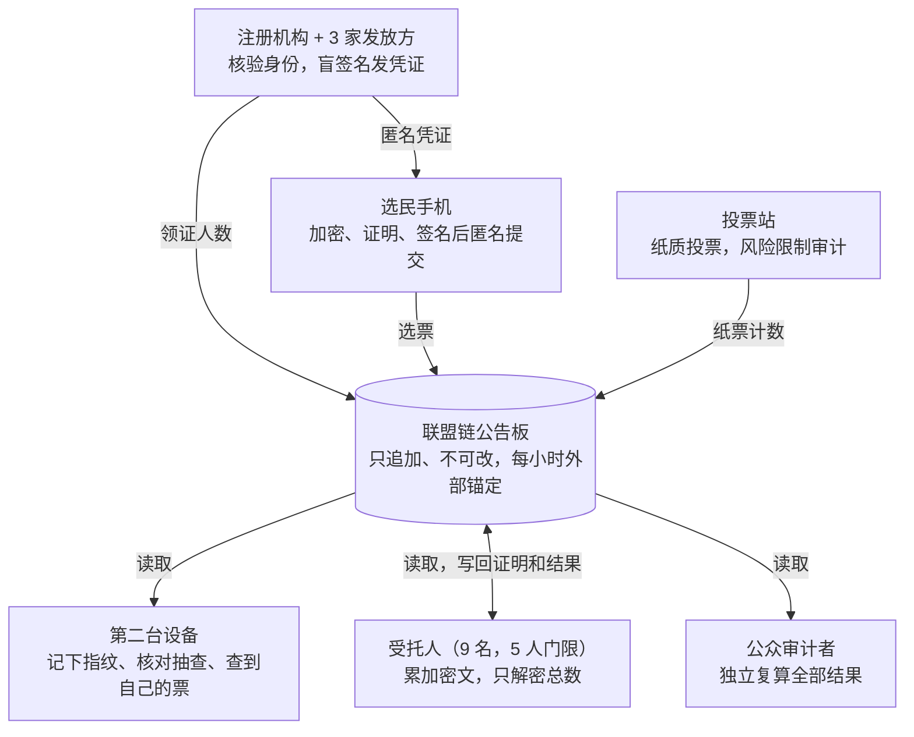

# 端到端可验证投票系统设计方案

[English](en.md) · **简体中文** · [Français](fr.md) · [Русский](ru.md) · [Español](es.md) · [العربية](ar.md) · [日本語](ja.md) · [한국어](ko.md)

最后更新：2026-11-08

## 概述

本方案以防范大规模作弊为目标：凭空造票、删票改票、篡改计票结果、批量感染手机、有组织买票。选民一次性绑定手机，每次选举前领取只限当次有效的资格凭证，用手机几分钟投完；链上只公开密文，任何人都能复算结果；选民能确认自己的票没被改、没被删，并进入了计票。个别选民被家人或他人当面胁迫这类偶发情况不做专门设计，按现有法律处理，以换取更简单、更快的流程。

**设计目标**

- **公开可验证：** 任何人用链上数据和开源工具都能独立复算选举结果。
- **个人可核验：** 选民能确认自己的票原样上链、没被改、没被删，并进入了计票。
- **无记名：** 选票和身份在数学上无法关联，将来加密算法被破解也一样。
- **防大规模作弊：** 任何规模化的造票、删票、改票、买票，要么做不到，要么一定会被发现。
- **高效：** 手机绑定一次，每次选举的资格凭证自动领取；投票几分钟；投票结束后几小时内出可验证的结果。

**核心原则**

- **分权：** 每个敏感操作都拆给多个互相制衡的机构，必须多方共谋才能作恶，而且共谋也会留下可查的痕迹。
- **证明而非信任：** 每一步操作都附带数学证明，公开可查。
- **靠统计抓大规模作弊：** 不要求人人核对，只要一小部分人随机核对，大规模作弊就藏不住。
- **区块链只做公告板：** 它保证数据上链后不被改，不负责上链之前的安全。
- **纸面兜底：** 投票站照常投纸票，保留人工审计能力。

## 常见作弊手段与本方案的应对

下表按美国选举舞弊案件的常见分类逐条对照：线上渠道能杜绝一人多票、塞票、改计票、丢票这几类，冒名和买票被大幅压缩，名册质量和当面胁迫仍需传统手段配合。

| 作弊手段 | 典型做法 | 本方案的应对 | 效果 |
| --- | --- | --- | --- |
| 一人多票 | 在多个州或县登记并分别投票；线上投完再去投票站投 | 每人每次选举只能领一张凭证，各州共享已领人员的身份哈希跨州查重；链上一张凭证只收一票；领过凭证的人在投票站只能投临时票 | 杜绝 |
| 冒名投票 | 冒用在册但不会去投票的人或死者的身份 | 绑定手机要核验证件；每次领凭证做活体人脸核验；本人可查询自己是否被记为已领 | 大幅压缩，被冒领者能发现 |
| 虚假登记、幽灵选民 | 用假名、假地址或已故者登记，再替他们投票 | 名册对接死亡、迁出、国籍记录；领凭证需证件加活体核验；各选区领证人数实时公开，与人口和历史投票率比对 | 异常可发现，名册本身仍需治理 |
| 无资格者投票 | 非公民、非本地居民、按州法无投票权者投票 | 每次领凭证都按最新名册重新核查资格 | 与名册数据质量相当 |
| 邮寄选票造假、非法代收 | 冒领他人邮寄选票、伪造签名、代收后篡改或丢弃 | 线上票不经过任何中间人：凭证锁在本人手机里，需活体核验才能用，没有纸质选票可截留 | 线上渠道杜绝 |
| 买票 | 付钱让选民投指定候选人，并要求出示证明 | 不给收据；凭证导不出手机；只认官方 App | 难以规模化 |
| 非法"协助"、当面胁迫 | 以帮忙为名替老人、残障者或语言不通的选民填票 | 投票需本人活体核验；当面盯着投票不专门防 | 部分缓解 |
| 工作人员塞票 | 往票箱塞额外选票，或替没来的选民投票 | 工作人员手里没有凭证，造不出有效选票；线上有效票数不得超过领证人数，公开比对 | 线上渠道杜绝 |
| 丢弃、销毁选票 | 计票前丢弃或藏匿部分选票 | 链上不可删改并外部锚定；选民凭指纹查到自己的票；受理回执证明系统收到过 | 一定会被发现 |
| 篡改计票或汇总 | 改选区计数，或在汇总环节改数字 | 计票是对链上全部密文的公开累加，任何人可复算；解密附正确性证明 | 杜绝 |
| 入侵投票设备或计票系统 | 篡改软件，偷改选票或结果 | 手机端靠随机抽查发现；服务端所有结果都能用公开数据独立复算，不必信任任何服务器 | 大规模篡改一定会被发现 |
| 阻止合法选民投票 | 无故把选民移出名册，或拒发凭证 | 选民可查询自己的登记和领证状态；拒发需说明理由并可申诉；各选区移出人数公开 | 可发现 |

不在本方案范围：候选人联名请愿签名造假、竞选资金违规、虚假信息等，它们与投票和计票环节无关。分类参考 [Heritage 基金会选举舞弊数据库](https://electionfraud.heritage.org/categories)和 [News21 调查](https://www.pewtrusts.org/en/research-and-analysis/articles/2012/08/30/election-fraud)。

### 背后的五个原理

1. **匿名资格凭证（盲签名）：既防一人多票，又不暴露你投了谁。** 好比把写着号码的卡片装进带复写纸的信封，发放方隔着信封盖章：章印到了卡片上，但他看不到号码。领证时注册机构知道"张三领过了"，所以张三领不到第二张；投票时出示的是卡片和印章，没人能对出这是谁的卡片。
2. **一凭证一票的链上规则：重复投票直接被拒。** 每张选票都带着凭证公钥上链。同一公钥第二次出现，所有节点按同一条公开规则拒收，任何节点都无权破例。
3. **同态加密计票：不拆开任何一张票就能算出总数。** 每张选票像一个上了锁的盒子，这种盒子有个特殊性质：把所有盒子"叠"在一起，得到的新盒子里装的正好是总票数。叠加任何人都能做，所以计票过程公开可复算；最后要 5 名以上受托人一起才能打开总数这一个盒子，还必须附上"打开过程没做手脚"的数学证明。
4. **随机抽查：偷改选票的手机无处藏身。** 手机先交出锁好的盒子，你用第二台设备记下它的指纹，再决定是投出还是当场拆开检查。手机事先不知道你会怎么选，偷改就是赌博；改的票越多，被抓的概率越接近 100%。
5. **公开数据、外部锚定和数量比对：删票和多出来的票都会留下痕迹。** 链上数据人人可下载；每小时把数据指纹登到外部公共区块链和报纸上，事后改历史会对不上；"线上票数不超过领证人数"等数量关系公开比对，凭空多出来的票藏不住。

## 威胁模型与信任假设

方案针对能成规模的作弊方式逐一设防：结果的正确性不依赖任何人诚实，选票的匿名性靠数学保证，不靠机构自律。

| 大规模作弊方式 | 谁可能干 | 本方案的应对 |
| --- | --- | --- |
| 凭空造票、给不存在的人发凭证 | 内部人员 | 3 家联合盲签名；领证人数实时公开并与链上用证数比对；选民可查自己是否被记为已领 |
| 删票、改票、改计票结果 | 内部人员、黑客 | 链上公开并外部锚定；同态计票任何人可复算；选民用选票指纹核对 |
| 批量感染手机偷改选票 | 黑客、外国势力 | 投票时随机抽查；第二台设备先记下选票指纹 |
| 有组织买票 | 政治团体、利益集团 | 不给收据；凭证锁在手机安全芯片里；只认官方 App |
| 瘫痪系统 | 黑客 | 多方节点、14 天投票期、投票站兜底 |
| 偷看或提前泄露结果 | 部分受托人共谋 | 5/9 门限；只在投票结束后解密总数 |
| 不专门处理：个别选民被当面胁迫 | — | 按现有法律处理；需要时加装"可选模块：抗胁迫"一节的设计 |

**信任假设**

- **匿名性：** 由盲签名保证，凭证与身份在数学上无法关联，不依赖任何机构诚实，也不怕将来的量子计算。前提是匿名中继不留日志。
- **完整性：** 不依赖任何人。即使全部机构共谋，篡改也会在公开验证中暴露。
- **发证：** 3 家发放方与注册机构不会全部共谋；即使全部共谋，多造的凭证也会在数量比对中暴露。
- **链的可用性：** 联盟链节点中至少三分之二诚实。超过三分之一作恶也只能拒绝服务，无法伪造选票或改写历史。
- **手机：** 不保证每一部手机都干净，但大规模篡改一定会被抽查发现。

## 系统角色与分权

每个角色单独作恶时能造成的最大破坏都被限制住，最后一列就是分权设计的检验标准。

| 角色 | 由谁担任 | 职责 | 单独作恶最多能做到 |
| --- | --- | --- | --- |
| 选民 | 有资格的公民 | 注册、投票、抽查、核对 | 只能影响自己的一票 |
| 注册机构 | 现有选举办公室 | 核验身份和资格，记录每人是否已领本次凭证 | 拒绝发证（选民可查询、可申诉） |
| 凭证发放方（3 家） | 选举办公室、两党各派一家 | 对选民的匿名凭证做盲签名 | 单独签不出有效凭证；签了也看不到凭证内容 |
| 受托人（9 名，5 人门限） | 各主要政党、独立选举机构、法院、高校 | 持有选举私钥分片，投票结束后联合解密总票数 | 什么都做不了 |
| 联盟链节点（21 个以上） | 各州选举机构、政党、高校、媒体、观察组织 | 验证、存储选票，联合签发受理回执 | 拒绝服务；无法伪造或改写选票 |
| 匿名中继（多家） | 与上述机构不同的独立运营方 | 转发选票，隐藏选民 IP | 单独一家看不到完整路径 |
| 投票站 | 现有投票站 | 纸质投票、协助 | 影响本站服务，纸质部分可审计 |
| 公众审计者 | 任何人 | 下载链上数据，独立复算 | 无写权限 |
| 软件开发方 | 开源社区 + 认证机构 | 开发、审计、可复现构建 | 恶意代码会被抽查和公开审计发现 |

## 密码学组件一览

全部使用学术界研究成熟、有公开实现的组件，不发明新密码学；相比带抗胁迫的设计，去掉了混洗、假凭证过滤等最重的部分。

| 组件 | 用在哪 | 作用 |
| --- | --- | --- |
| 指数 ElGamal 加密（同态） | 选票 | 密文可以直接相加，计票时只解密总数，单张选票从不解密 |
| 分布式密钥生成 + 门限解密（5/9） | 选举密钥 | 没有任何人拥有完整私钥 |
| 盲签名（3 家联合） | 本次选举的匿名凭证 | 发放方签了名却看不到凭证内容，凭证与身份在数学上无法关联 |
| 手机安全芯片 + 应用认证 | 凭证私钥 | 私钥无法导出，只有官方 App 能使用 |
| Schnorr 签名 | 每张选票 | 只有凭证持有者能投票，每个凭证只能投一次 |
| 零知识证明 | 选票合法性、解密正确性 | 证明"每个选举项恰好选了规定人数""解密没做手脚"，但不泄露内容 |
| Benaloh 抽查 | 投票时 | 手机加密时不知道这张票会被投出还是被抽查，偷改必然有被抓的风险 |
| 哈希与 Merkle 树 | 选票指纹、外部锚定 | 数据指纹，改一个字节就对不上 |

## 完整流程

一次选举分七步：准备、绑定手机（一次）、领本次资格凭证（每次选举）、投票与抽查、核对、计票、公开审计。每一步的输出都写在链上，任何人都能检查。

注册机构、选民手机和投票站往链上写；第二台设备和公众只读；受托人读取后，把解密证明和最终结果写回链上。

### 1. 选举准备（投票开始前约 60 天）

1. **密钥仪式：** 9 名受托人在公开直播下运行分布式密钥生成。公钥上链，每人只持有一个私钥分片，存放在硬件安全模块中。
2. **参数上链：** 各选举项和候选人名单、投票起止时间、验证规则、各软件版本的哈希。
3. **软件发布：** 投票 App、核对工具、计票验证器全部开源，可复现构建。多家独立机构审计并公开报告。
4. **公开测试：** 全流程模拟选举，同时开放漏洞赏金。

### 2. 绑定手机（一次，最长 4 年）

1. **核验身份：** 选民在任一选举办公室、车管所或邮局出示证件，工作人员核对选民登记信息。也可以用邮寄到登记地址的激活码，加证件号码在线完成。
2. **绑定手机：** App 在手机安全芯片里生成长期身份密钥，私钥无法导出。注册机构为它签发长期身份证书。这张证书只证明"这部手机属于这个人"，不代表投票资格。
3. **有效期：** 最长 4 年，或到身份证件到期为止，到期后重新核验身份。
4. **自动作废：** 选民从名册中移除时（死亡、迁出本州、丧失国籍、法院判决等），证书同步作废。名册对接死亡登记、迁出和国籍变更记录。
5. **换手机：** 到任一网点或用旧手机授权迁移，旧证书作废。

不想用手机的选民不必注册，照常去投票站投纸票。

### 3. 领取本次资格凭证（每次选举，只限当次有效）

1. **生成新密钥：** 投票开始前，App 在安全芯片里新生成一对本次选举专用的密钥。
2. **活体核验：** App 用前置摄像头做活体检测，与证件照比对，确认是本人在操作，防止去世或失去资格者的手机被他人使用。
3. **重新核查资格：** App 用长期身份证书向注册机构证明身份，注册机构按最新名册重新核查本次选举的资格，记录"已领取本次凭证"，每人每次选举只能领一次；各州之间共享已领人员的身份哈希，在多个州登记的人也只能领一张。
4. **盲签名：** 3 家发放方分别对新公钥做盲签名。签名时看不到公钥，所以谁也无法把凭证和身份对应起来。
5. **得到凭证：** 新公钥加 3 个签名就是本次选举的匿名资格凭证，只在本次选举有效，选举结束即失效。整个过程约一分钟。
6. **公开计数：** 每个选区的领证人数实时上链。选民随时可以查询自己是否被记为已领；没领却显示已领，就说明有人冒领。

### 4. 投票与抽查（投票期 14 天）

1. **选择：** 选民选择各选举项的候选人。
2. **记下指纹：** App 加密选择，显示选票指纹二维码。选民用第二台设备扫码记下，或手抄指纹前 8 位。这一步必须在下一步之前完成。
3. **投出或抽查，二选一：**
    - **抽查：** App 公开这张票的加密随机数，第二台设备据此打开密文，核对内容与所选一致，并核对指纹与刚才记下的一致。抽查过的票作废，回到第 1 步重新加密。
    - **投出：** App 附上零知识证明，用本次凭证签名，经匿名中继提交，然后销毁加密随机数。
4. **上链：** 节点验证凭证签名、零知识证明、投票时间，以及这个凭证没有投过票。全部通过才写入区块，并返回由节点联合签名的受理回执。
5. **一凭证一票：** 投出后不能更改。这样恶意软件无法在选民投完后偷偷重投。

### 5. 选民核对

| 什么时候 | 确认什么 | 怎么做 |
| --- | --- | --- |
| 投票时 | 手机没有偷改选票 | 至少抽查一次再投出；手机事先不知道你会不会抽查 |
| 投票后随时 | 票已上链、没被删、没被换 | 用第二台设备或任何一个公开查询网站，按记下的指纹查到自己的票 |
| 计票之后 | 已进入计票 | 自己的指纹在计票输入集合里，且计票和解密证明全部通过 |
| 有争议时 | 留存证据 | 用受理回执和链上记录向选举争议委员会投诉 |

### 6. 计票（投票结束后数小时内）

1. **冻结：** 截止时刻的区块高度上链，之后不再接受线上选票。
2. **复核规则：** 公开核查每个凭证只有一张票、每个凭证都有 3 家有效签名。
3. **同态累加：** 把所有有效选票按选举项相乘，得到各选举项的加密总数。这一步任何人都能自己算一遍。
4. **解密总数：** 至少 5 名受托人联合解密各选举项的总数，附解密正确性证明。单张选票从不解密。
5. **数量比对：** 线上有效票数不得超过领证人数；各选区领证人数与登记人数、历史投票率对比，异常即调查。
6. **公布：** 各选举项票数和全部证明；与投票站纸票结果合并公布。

### 7. 公开审计

- **独立复算：** 任何人用开源验证器下载链上数据，重跑凭证检查、累加和解密验证。
- **多方报告：** 各党、媒体、高校等独立机构在结果公布后 24 小时内发布各自的验证报告。
- **纸质审计：** 投票站渠道做风险限制审计，抽样比对纸质选票和电子计数。
- **异常监测：** 抽查不符的报告数量、各选区领证人数按地区公开，异常集中即启动调查。
- **抽查的统计威力：** 不需要人人抽查。只要随机 1% 的选票被抽查，偷改 1000 张票而不被任何人发现的概率约为 0.004%。前提是手机无法预知谁会抽查，所以 App 不记录、也不上报选民是否抽查过。

## 关键问题与解决方案

大规模作弊有五条主要路径，下面逐一说明为什么在本方案里走不通；最后几项是运行层面的问题。

### 凭空造票

- 凭证需要 3 家发放方同时签名，任何一家都造不出有效凭证。
- 即使 3 家发放方和注册机构全部共谋多造凭证，也只有两种结果：链上用掉的凭证数超过注册机构记录的领证人数，或者真选民去领时被告知"已领过"。两种情况都会暴露。
- 每个选区的领证人数实时公开，与登记人数、历史投票率对比，异常选区重点调查。
- **名册里的幽灵选民**（已去世、已搬走仍在册）是现有邮寄投票同样存在的问题，区块链管不了。本方案让名册对接死亡登记、迁出和国籍变更记录，每次领证时按最新名册核查并做活体核验，同时对领证率异常偏高的选区重点抽查。

### 删票、改票、改结果

- 链上数据公开，并每小时锚定到外部，删改会与锚定记录对不上。
- 选民用记下的指纹能查到自己的票；票不见了，受理回执证明系统确实收过。
- 计票是公开的同态累加，任何人都能复算；受托人只解密总数，并附解密正确性证明。

### 批量感染手机

- **抽查：** 手机加密时不知道这张票会被投出还是被抽查，想偷改就必须冒被抓的风险，改得越多越肯定被发现。
- **先记指纹：** 指纹必须在选择投出或抽查之前由第二台设备记下，否则手机可以先偷偷投一张，再拿另一张给你抽查。
- **一凭证一票：** 投出后不能改，恶意软件无法事后偷偷重投。
- **发现后的处置：** 一旦有抽查不符的报告被证实，立即公开、冻结相关 App 版本，受影响的选民改去投票站。

### 有组织买票

有组织买票是规模化作弊，不能和个别胁迫一起忽略。不加重型机制，也能让它很难规模化：

- **不给收据：** 选民拿不到任何能证明投给谁的东西。抽查只能看到作废票的内容，投出那张票的加密随机数立即销毁。
- **凭证导不出来：** 凭证私钥锁在手机安全芯片里，卖票只能交出手机本身。集中操作成千上万部手机，很难不被发现。
- **只认官方 App：** 凭证只能由通过系统认证的官方 App 使用，买票团伙做不出能出示收据的改版 App。
- **剩余风险：** 买家当面盯着卖家投票，成本高、难以规模化，按现有法律打击。

### 拒绝服务

- 投票期 14 天，单日瘫痪不影响大局。
- 只处理带有效凭证的选票，垃圾数据在入口就被丢弃，验证成本很低。
- 节点分布在多家云服务商和自建机房；只读数据通过多个镜像提供。
- 线上渠道不可用时投票站兜底；截止前遭大规模攻击，按法定程序延长投票期。

### 受托人共谋

- 需 9 人中 5 人共谋才能解密任何东西。
- 即使共谋解密了单张选票，也只知道某个匿名凭证投了什么，对应不到人。
- 主要风险是提前偷看中间结果。解密只在投票结束后进行，私钥分片存放在硬件安全模块中，每次使用都在链上留痕。

### 长期隐私

- 盲签名的不可关联性是数学上绝对的。将来量子计算即使破解加密，也只能看到匿名凭证投了什么，对应不到人。
- 匿名中继不留日志是关键前提，由多家独立机构运营，单独一家看不到完整路径。

### 丢手机和一人多投

- 没领本次凭证就丢了手机：重新注册后正常领取。
- 领了本次凭证后丢手机：凭证需要手机密码或生物识别才能用，别人拿到也用不了。选民可以到投票站投临时选票；这类临时票的数量按选区公开，异常集中就调查。
- 名册记录每人是否已领本次凭证。领过的人在投票站只能投临时选票，没领过的人正常投纸票。

### 争议处理

- **票不见了：** 受理回执由节点联合签名，系统方无法抵赖。
- **抽查发现内容不对：** 第二台设备上的抽查记录能公开证明那张票实际加密的是什么，但证明不了选民当时选的是什么，所以仍按报告的数量和分布决定是否调查。
- **法律地位：** 链上数据和回执作为法律证据的效力需要立法明确。

### 可用性

- 手机绑定一次，每次选举领资格凭证约一分钟，投票加一次抽查只需几分钟。
- App 支持读屏、多语言、大字体；没有第二台设备的人可以借用家人手机或用投票站的公共查询机。
- 不会或不愿用手机的人，始终可以投纸质选票。

## 联盟链与基础设施

采用多方运营的联盟链而非公链，它在这里只是一个只追加、不可改的公告板；换成多方各自镜像的只追加日志，安全效果几乎相同。

- **共识：** 拜占庭容错类共识（如 HotStuff），容忍不到三分之一的节点作恶，出块约 2 秒。
- **节点：** 21 个以上，分属各州选举机构、主要政党、高校、媒体、选举观察组织，任何一类不超过三分之一。
- **写入规则：** 只接受凭证有效、签名和零知识证明通过、在投票期内、且该凭证未投过票的选票，其余一律拒绝。节点无权自行决定收不收某张合法选票。
- **公开读取：** 任何人可全量下载链上数据，另有多个镜像站点。
- **外部锚定：** 每小时把链状态的 Merkle 根写入多条公共区块链，并刊登在报纸公告上。即使全体联盟节点共谋改写历史，也会与锚定记录对不上。
- **容量估算（粗略）：** 按约 1.5 亿张选票、每张约 5 KB（含证明）计，总数据约 750 GB，普通服务器即可存储。14 天平均每秒约 124 张，按 10 倍峰值设计约每秒 1,200 张，验证可并行。
- **计票速度：** 同态累加是简单的批量乘法，解密只针对各选举项的总数，投票结束后数小时内即可出结果。

**为什么不用公链：**

- **隐私：** 公链交易需要手续费和账户，容易暴露选民身份。
- **成本和拥堵：** 选举高峰时手续费和确认时间不可控。
- **治理：** 不能让匿名矿工或验证者决定选举数据能否上链。

## 部署路线

从小规模、低风险的选举开始，每一阶段达到门槛才进入下一阶段；线上渠道始终是投票站的补充，不取代投票站。

1. **原型与公开评审（约第 1 年）**
    - 开源实现，发表设计论文，开放漏洞赏金。
    - 门槛：独立密码学审计通过，无未修复的高危漏洞。
2. **模拟选举（约第 1–2 年）**
    - 大学学生会、社区组织、工会等内部选举。
    - 门槛：抽查率、异常报告率、可用性测试结果达标。
3. **小范围正式试点（约第 2–3 年）**
    - 海外选民、军人和残障选民，作为现有邮寄投票的补充。
    - 门槛：试点中没有无法解释的数量差异。
4. **地方选举补充渠道（约第 3–5 年）**
    - 县市级选举，与投票站纸质渠道并存。
5. **是否扩大**
    - 根据试点数据和立法决定。前提是州法律认可，并通过联邦投票系统认证标准。

## 可选模块：抗胁迫

默认不启用。如果将来认为个别胁迫也需要防，可以加装下面的模块，代价是流程明显变慢、变复杂。

| 模块 | 解决什么 | 代价 |
| --- | --- | --- |
| 私密隔间领凭证 | 胁迫者无法在领凭证时盯着 | 每次选举都要线下跑一趟 |
| 假凭证 | 被逼时交出外观完全相同的假凭证，它投的票在计票时被悄悄剔除 | 计票要改为混洗加过滤，慢得多；整套设计复杂很多 |
| 允许重投、只算最后一张 | 被逼投完后可以自己改回来 | 恶意软件也能事后偷偷重投，需要另加纸质确认码表和第二台设备持续监控 |
| 投票站作废线上票 | 选举日到投票站作废线上凭证、改投纸票 | 作废记录需要隐藏，否则胁迫者能看出来 |

这几个模块要配套使用才有效，单独加一个作用有限。

## 剩余风险与参考系统

这个方案能让大规模造票、删改和偷改一定被发现，让有组织买票很难规模化，但仍有几类风险无法彻底消除。

**剩余风险**

- **依赖一部分人真的去抽查：** 抽查的人太少，小规模篡改可能漏网；大规模篡改则几乎不可能藏住。
- **名册质量：** 幽灵选民问题区块链解决不了，只能靠名册清理和数量异常监测。
- **平台依赖：** 手机安全芯片和应用认证依赖苹果、谷歌等平台，需要备用方案和监管约束。
- **复杂度带来的信任转移：** 普通人看不懂这些证明，最终是相信检查过的专家，所以独立审计者必须足够多元、跨党派。
- **线上渠道没有纸质记录：** 无法做传统的人工重新点票，只能依赖密码学证明。
- **专家态度：** 计算机安全界普遍对网络投票持谨慎态度，认为当前技术下很难保证终端设备安全，很多专家仍主张以手写纸质选票为主。

**可参考的现有方案**

- **Helios、Belenios：** 学术界的端到端可验证网络投票系统，本方案的同态计票和抽查机制与之相同。
- **ElectionGuard：** 微软开源的端到端可验证工具包，用于投票站场景的加密计票。
- **JCJ / Civitas：** 假凭证抗胁迫方案的原始研究，对应"可选模块：抗胁迫"一节。
- **爱沙尼亚网络投票：** 允许重投、投票日纸票覆盖网上票、第二设备核验。
- **瑞士电子投票：** 使用纸质确认码表防止设备篡改。
